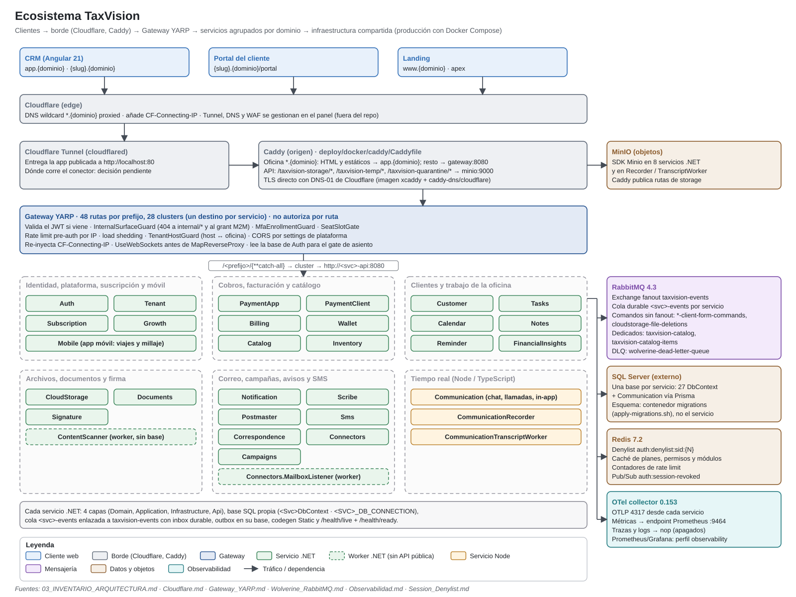

# Guía Maestra de Microservicios de TaxVision — Inicio

> Estándar de ingeniería para crear un microservicio que funcione dentro del ecosistema real de TaxVision. Pensado para devs junior, senior y agentes de IA.
> Construido el 2026-11-15 investigando el código real (solo lectura). Distingue en todo momento **Código verificado**, **Documentación histórica**, **Recomendación** y **Decisión pendiente**.

## Por dónde empezar

| Si eres… | Lee en este orden |
|---|---|
| Dev nuevo en TaxVision | [Guía maestra](GUIA_MAESTRA_CREACION_MICROSERVICIOS_TAXVISION.md) caps. 1–5 → [Inventario](03_INVENTARIO_ARQUITECTURA.md) → cap. 35 (procedimiento completo) → [Checklist maestro](Checklists/Nuevo_Microservicio.md) |
| Senior revisando un servicio | [Matriz dinámica](GUIA_MAESTRA_CREACION_MICROSERVICIOS_TAXVISION.md#5-matriz-dinámica-de-capacidades) → [Criterios de aceptación](GUIA_MAESTRA_CREACION_MICROSERVICIOS_TAXVISION.md#37-criterios-de-aceptación-para-producción) → [Checklist de producción](Checklists/Produccion.md) → [Decisiones pendientes](Referencias/Decisiones_Arquitectonicas.md) |
| Agente de IA | Esta página → la guía completa → el checklist del tema que toque → la investigación enlazada desde cada ítem |

## Las tres reglas que no se negocian

1. **Tests desde el primer día.** El proyecto `deploy/tests/TaxVision.<Svc>.Tests` se crea junto con el servicio. El CI no corre pruebas (decisión del dueño, 2026-11-13): el gate local es la única barrera. → [Checklist de testing](Checklists/Testing.md)
2. **Offboarding evaluado.** Si el servicio guarda datos, permisos, asignaciones o recursos de empleados, no está integrado hasta evaluar y probar su participación en el retiro de empleados. → [Checklist de offboarding](Checklists/Offboarding.md)
3. **Manda el código.** Si una guía antigua contradice el código, manda el código. → [Comparativa de guías](02_COMPARATIVA_GUIAS.md) y [Decisiones](Referencias/Decisiones_Arquitectonicas.md)

## Mapa de la carpeta

| Carpeta / archivo | Qué contiene |
|---|---|
| [GUIA_MAESTRA_CREACION_MICROSERVICIOS_TAXVISION.md](GUIA_MAESTRA_CREACION_MICROSERVICIOS_TAXVISION.md) | La guía completa: 38 capítulos y un anexo, con evidencia, ejemplos reales, errores históricos, pruebas y checklist por tema |
| [01_ESTADO_INVESTIGACION.md](01_ESTADO_INVESTIGACION.md) | Cómo se construyó y estado de cada etapa |
| [02_COMPARATIVA_GUIAS.md](02_COMPARATIVA_GUIAS.md) | Qué instrucciones de las guías antiguas siguen vigentes y cuáles no |
| [03_INVENTARIO_ARQUITECTURA.md](03_INVENTARIO_ARQUITECTURA.md) | Todos los servicios, stack con versiones y servicios de referencia |
| `Investigaciones/` | 32 investigaciones por tema, con evidencia `ruta:línea` |
| `Checklists/` | 11 checklists verificables, 348 ítems (condicionales marcados) |
| `Revisiones/` | Revisiones de servicios contra la guía ([Mobile](Revisiones/Revision_Mobile_2026-11-19.md), [4 proyectos](Revisiones/Revision_4_Proyectos_2026-11-20.md)) y el script [restore_generated.ps1](Revisiones/restore_generated.ps1) |
| `Diagramas/` | 23 diagramas SVG (abajo) |
| `Referencias/` | [Guardrails](Referencias/Guardrails.md) (los 36 originales), [Decisiones](Referencias/Decisiones_Arquitectonicas.md) (contradicciones resueltas y pendientes), [Fuentes](Referencias/Fuentes_Verificadas.md) |

## Checklists

[Nuevo microservicio](Checklists/Nuevo_Microservicio.md) · [Seguridad](Checklists/Seguridad.md) · [Proyecciones y reconciliation](Checklists/Proyecciones_Reconciliation.md) · [Offboarding](Checklists/Offboarding.md) · [Testing](Checklists/Testing.md) · [Módulos y planes](Checklists/Modulos_Planes.md) · [Notificaciones](Checklists/Notificaciones.md) · [Enlaces por oficina](Checklists/Tenant_Links.md) · [YARP y Cloudflare](Checklists/YARP_Cloudflare.md) · [Producción](Checklists/Produccion.md) · [Archivos y File Library](Checklists/Archivos_FileLibrary.md)

## Diagramas

| # | Diagrama | # | Diagrama |
|---|---|---|---|
| 01 | [Ecosistema](Diagramas/SVG-01_Ecosistema.svg) | 13 | [YARP y Cloudflare](Diagramas/SVG-13_YARP_Cloudflare.svg) |
| 02 | [Clean Architecture](Diagramas/SVG-02_Clean_Architecture.svg) | 14 | [Cloudflare manual](Diagramas/SVG-14_Cloudflare_Manual.svg) |
| 03 | [Creación](Diagramas/SVG-03_Creacion.svg) | 15 | [Despliegue](Diagramas/SVG-15_Deployment.svg) |
| 04 | [Reconciliation](Diagramas/SVG-04_Reconciliation.svg) | 16 | [Flota local](Diagramas/SVG-16_Flota_Local.svg) |
| 05 | [Seguridad](Diagramas/SVG-05_Seguridad.svg) | 17 | [Matriz dinámica](Diagramas/SVG-17_Matriz_Dinamica.svg) |
| 06 | [Comercialización](Diagramas/SVG-06_Comercializacion.svg) | 18 | [Checklist](Diagramas/SVG-18_Checklist.svg) |
| 07 | [Mensajería](Diagramas/SVG-07_Mensajeria.svg) | 19 | [Offboarding](Diagramas/SVG-19_Offboarding.svg) |
| 08 | [M2M](Diagramas/SVG-08_M2M.svg) | 20 | [Offboarding por servicio](Diagramas/SVG-20_Offboarding_Servicios.svg) |
| 09 | [Subdominios](Diagramas/SVG-09_Subdominios.svg) | 21 | [Offboarding: seguridad](Diagramas/SVG-21_Offboarding_Seguridad.svg) |
| 10 | [Enlaces por oficina](Diagramas/SVG-10_Links_Tenant.svg) | 22 | [Arquitectura de testing](Diagramas/SVG-22_Testing_Architecture.svg) |
| 11 | [Notification](Diagramas/SVG-11_Notification.svg) | 23 | [Testing y CI/CD](Diagramas/SVG-23_Testing_CI_CD.svg) |
| 12 | [Scribe](Diagramas/SVG-12_Scribe.svg) | | |

## Lo que todavía no está verificado

- Nada se probó en vivo durante esta investigación: es lectura de código, documentos, Vault y memoria.
- El procedimiento de Cloudflare sale de fragmentos de documentación: falta validarlo con el senior.
- Las decisiones pendientes, incluidas las de seguridad (`ServiceOnly` sin allowlist de clientes, denylist fail-open si cae Redis), están en [Decisiones](Referencias/Decisiones_Arquitectonicas.md).
