# Guía Maestra Oficial — Creación de microservicios TaxVision

> **Versión:** 1.0 · **Fecha de corte:** 2026-11-15 · **Estado:** oficial (reemplaza a `DEVS/Guia_Creacion_Microservicio.md` y a las guías parciales que se listan en [Referencias/Decisiones_Arquitectonicas.md](Referencias/Decisiones_Arquitectonicas.md)).
> **Código base:** `C:\Users\devcacg\Desktop\Proyectos\TaxVsion_BackEnd` (rutas de código relativas a esa raíz salvo que se diga otra cosa).
> **Regla de consolidación:** cuando una guía vieja, la memoria o el libro dicen una cosa y el código verificado dice otra, **manda el código**. Cada contradicción resuelta está en [Decisiones_Arquitectonicas.md](Referencias/Decisiones_Arquitectonicas.md); cada fuente, en [Fuentes_Verificadas.md](Referencias/Fuentes_Verificadas.md).
> **Seguridad del documento:** no contiene secretos, IPs, tokens ni cadenas de conexión. Las variables se nombran sin valor.

---

<a id="indice"></a>
## Índice

**Parte 0 — Entrada**
- [1. Introducción](#cap-01)
- [2. Cómo leer esta guía](#cap-02)
- [3. Glosario](#cap-03)

**Parte I — Decidir**
- [4. ¿Hace falta un microservicio nuevo?](#cap-04)
- [5. Matriz dinámica de capacidades](#cap-05)

**Parte II — Fundamentos del servicio**
- [6. Ecosistema y stack tecnológico](#cap-06)
- [7. Estructura de proyectos y solución](#cap-07)
- [8. Capas: Domain, Application, Infrastructure y API](#cap-08)
- [9. BuildingBlocks](#cap-09)
- [10. EF Core y migraciones](#cap-10)

**Parte III — Seguridad**
- [11. Auth, RBAC, actor types y aislamiento por tenant](#cap-11)
- [12. Session denylist](#cap-12)
- [13. M2M / ServiceAuth](#cap-13)

**Parte IV — Datos de otros bounded contexts y del personal**
- [14. Proyecciones locales](#cap-14)
- [15. Reconciliation (reconciliación)](#cap-15)
- [16. Offboarding de empleados (capítulo crítico)](#cap-16)

**Parte V — Comercialización y límites**
- [17. Módulos, planes, add-ons, entitlements y gates](#cap-17)
- [18. Rate limiting vs cuotas](#cap-18)

**Parte VI — Mensajería**
- [19. Wolverine y RabbitMQ](#cap-19)
- [20. Roslyn en producción y codegen Static](#cap-20)

**Parte VII — Oficina, enlaces y comunicación**
- [21. Subdominios y resolución de tenant](#cap-21)
- [22. Enlaces por oficina](#cap-22)
- [23. Scribe: plantillas y render](#cap-23)
- [24. Notification: email, SMS, in-app y push](#cap-24)
- [25. Zonas horarias](#cap-25)

**Parte VIII — Exposición y operación**
- [26. Gateway YARP](#cap-26)
- [27. Cloudflare, Tunnel y Caddy](#cap-27)
- [28. Docker y compose](#cap-28)
- [29. Scripts de la flota local](#cap-29)
- [30. CI/CD y secrets](#cap-30)
- [31. Postman y OpenAPI](#cap-31)
- [32. Observabilidad](#cap-32)

**Parte IX — Calidad**
- [33. Testing](#cap-33)
- [34. Guardrails](#cap-34)

**Parte X — Ejecución**
- [35. Procedimiento de creación de principio a fin](#cap-35)
- [36. Troubleshooting (errores históricos reales)](#cap-36)
- [37. Criterios de aceptación para producción](#cap-37)

**Anexos**
- [A. Mapa de documentos relacionados](#anexo-a)

---

<a id="cap-01"></a>
## 1. Introducción

TaxVision (marca comercial actual TaxOffix) es una plataforma SaaS multi-oficina para despachos contables. El backend es una flota de microservicios: **26 servicios .NET de negocio** con base propia, **2 workers .NET** sin API pública (`Connectors.MailboxListener`, `ContentScanner`), **3 servicios Node/TypeScript** (Communication, CommunicationRecorder, CommunicationTranscriptWorker) y **un Gateway YARP**. Se comunican por eventos en RabbitMQ (fanout `taxvision-events`) y, cuando hace falta, por HTTP interno con token de servicio (M2M).

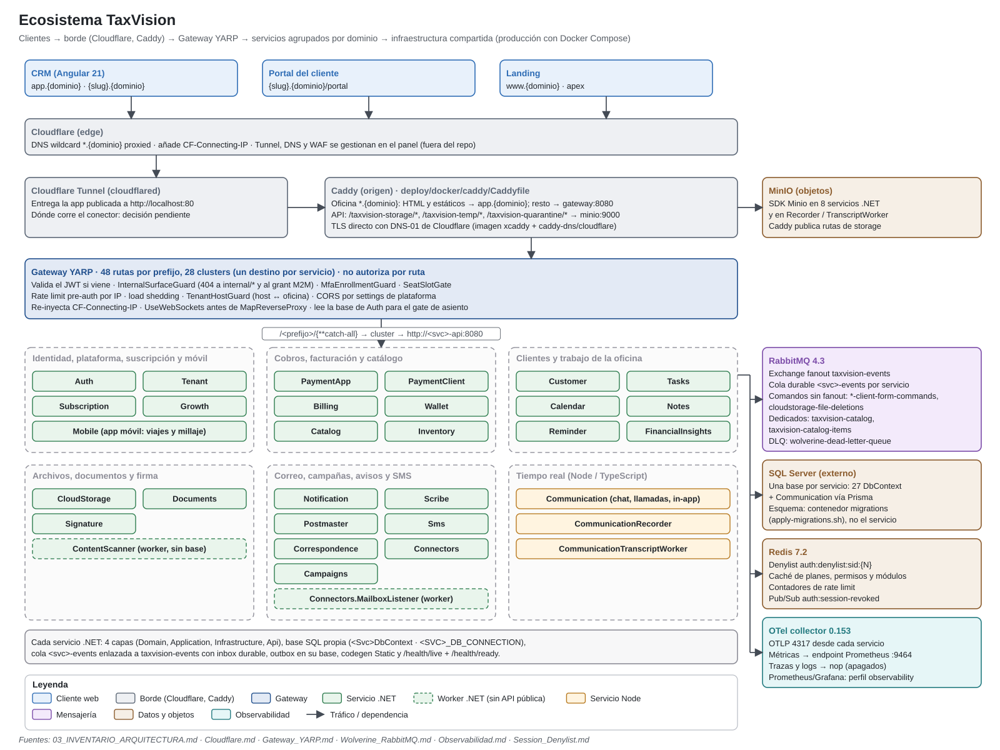

Esta guía responde a una sola pregunta: **qué hay que hacer para que un microservicio nuevo quede integrado de verdad**, no solo "compilando". Un servicio que compila y responde 200 en local puede, en producción:

- quedar inaccesible (403 universal porque su proyección de permisos está vacía);
- regalar una función que se cobra (sin prefijo en `PermissionModuleMap`);
- perder eventos en silencio (sin `PublishMessage<T>()`);
- volver a compilar handlers con Roslyn en producción y disparar la RAM (sin codegen Static);
- dejar trabajo a nombre de un empleado retirado (sin participar en el offboarding);
- desplegar sin esquema (sin bloque en `apply-migrations.sh`).

Todos esos fallos **ya ocurrieron** (ver [cap. 36](#cap-36)). La guía convierte cada uno en un paso, una prueba o un criterio de aceptación.

**Qué reemplaza.** `DEVS/Guia_Creacion_Microservicio.md` (quedó desfasada en el orden guardar/publicar, CI, migraciones, `restart`, cifras), `documents/architecture/Guia_Cablear_Modulo_Plan_Microservicio.md` (modelo de catálogo anterior) y las partes desactualizadas de las guías de notificaciones e `IgnoreQueryFilters`. Las guías de frontend (`DEVS/Guia_Integracion_*.md`) quedan como anexos fuera de alcance.

**Servicios de referencia.**

| Servicio | Úsalo como referencia de | No lo copies para |
|---|---|---|
| **Notes** (principal) | Estructura, capas, `Program.cs`, `Result`/`Error`, consumers con guarda de tenant, proyecciones RBAC/plan/directorio, filtro fail-closed | Comentarios con fases y narrativa; mensajes de `NoteErrors` en español |
| **Customer** | Eventos de dominio (`AggregateRoot` + `UseTaxVisionDomainEvents`), colas punto a punto, `TenantTimeZones` | `DateTime.UtcNow` dentro del agregado |
| **FinancialInsights** | El servicio más nuevo: permisos con pull-recovery, gate de módulo, cuotas por plan, reconciliaciones, módulo vendible | Acquirer M2M sin caché; reconciliaciones sin `ReconciliationRetry` |
| **Reminder** | Agregado rico (transiciones, `RowVersion`, índice de idempotencia), Quartz | Cableado de Wolverine (sin BB-1/BB-2) |
| **Calendar** | Acquirer M2M con caché; prueba de rutas en runtime (`IntegrationEventRoutingTests`) | Conversor UTC propio (no usa `UseUtcDateTimes`) |

---

<a id="cap-02"></a>
## 2. Cómo leer esta guía

### Para quién es

| Lector | Cómo usarla |
|---|---|
| **Junior** | Lee los capítulos 4, 5 y 35 primero. Sigue el procedimiento del [cap. 35](#cap-35) en orden y abre el capítulo temático de cada paso. Copia los fragmentos reales, no los inventes. |
| **Senior** | Usa la [matriz dinámica](#cap-05) para decidir qué capacidades aplican, revisa las secciones "Errores históricos" y "Decisiones pendientes", y valida con los [criterios de aceptación](#cap-37). |
| **Agente IA** | Respeta `AGENTS.md` por encima de todo: un ítem por sesión, rojo → verde → gate, sin `git commit/push/stash/reset/checkout`, sin tocar Docker, sin imprimir secretos, decir qué archivos se tocarán y esperar el OK del dueño. Usa esta guía como mapa, no como permiso. |

### Estructura de cada capítulo temático

Cada capítulo de los temas 6 a 34 tiene las mismas secciones: **Qué es · Por qué existe · Cómo funciona · Implementación actual en TaxVision · Cómo integrarlo en un servicio nuevo · Archivos involucrados · Ejemplo técnico · Integraciones · Errores históricos · Pruebas · Checklist**. Los fragmentos de código son **reales** (tomados de las investigaciones, con ruta y líneas); los comentarios se recortaron.

### Etiquetas

- **Código verificado**: leído en el repo a la fecha de corte.
- **Histórico**: dicho por un documento o la memoria; puede estar desfasado.
- **Recomendación**: propuesta de la investigación; no es una regla vigente hasta que el dueño la acepte.
- **Decisión pendiente**: la decide el dueño o el senior. Lista completa en [Decisiones_Arquitectonicas.md](Referencias/Decisiones_Arquitectonicas.md).

### Convenciones del proyecto que esta guía asume

- Identificadores en inglés; copy visible de la UI en inglés; comunicación con el dueño en español.
- **Comentarios de código cortos y en español**, con el porqué; sin fechas, sin números de fase, sin narrar el bug (guardrail #36 y `AGENTS.md`).
- Pruebas nombradas por clase (`SignatureRequestTests`), sin números de fase.
- El dominio devuelve `Result`/`Error`; no se lanzan excepciones por reglas de negocio.
- Wolverine: **guardar antes de publicar**. En jobs, una unidad por transacción con outbox.
- `BuildingBlocks`: solo piezas **opcionales y aditivas**; no cambiar el comportamiento de lo existente.
- El CI no corre pruebas desde 2026-11-13 (decisión del dueño): **el gate local es la única barrera** (ver [cap. 33](#cap-33)).

### Investigaciones de soporte

Cada capítulo enlaza su investigación en `Investigaciones/`. Si una afirmación de esta guía te parece dudosa, la investigación tiene la evidencia con `ruta:línea`.

---

<a id="cap-03"></a>
## 3. Glosario

| Término | Significado en TaxVision |
|---|---|
| **Acuse (offboarding)** | `UserOffboardingStepCompletedIntegrationEvent` que cada paso del retiro publica; Auth lleva la cuenta N/N. En .NET sale solo (política de `UseTaxVisionRabbitMq`); en Node se publica a mano. |
| **Actor type** | Tipo de identidad del JWT: `TenantEmployee`, `TenantAdmin`, `CustomerPortal`, `PlatformAdmin`, `Service`. Se declara por acción con `[AllowActorTypes]`. |
| **Add-on** | Módulo `Commercial` vendible aparte (`module-addon-{code}`), co-terminado con la suscripción base. |
| **BB-n** | Pieza numerada de BuildingBlocks de la Ola 2 (BB-1 eventos de dominio, BB-2 colas locales durables, BB-3 jobs transaccionales, BB-4 `[MessageIdentity]`, BB-10 base temporal de pruebas, BB-14 guardar antes de publicar…). |
| **Bounded context (BC)** | Frontera de un modelo de dominio con invariantes propios. Puede vivir en su propio servicio o compartir despliegue (Growth: Codes + Referrals). |
| **Codegen Static** | Modo de Wolverine en que los handlers se cargan de código C# pregenerado y versionado (`Internal/Generated`), sin compilar con Roslyn en runtime. Obligatorio en producción. |
| **Consumer** | Clase estática con `Handle(XIntegrationEvent …)` que reacciona a un evento de otro servicio. Nombre en singular (`XxxConsumer`). |
| **Denylist de sesión** | Clave Redis `taxvision:auth:denylist:sid:{sid}` que invalida al instante un access token ya emitido. |
| **DLQ** | Cola de mensajes muertos (`wolverine-dead-letter-queue`; tabla `wolverine_dead_letters`). |
| **Entitlement** | Par clave→valor del plan contratado (`module.<code>`, `seats.max`, `storage.max_bytes`, `financial.documents_per_month`…), calculado por Subscription. |
| **EventKey (Scribe)** | Clave de plantilla en Scribe (p. ej. `tenant.wisp_review_due.v1`). **No** es el `[MessageIdentity]` del evento. |
| **Fail-closed / fail-open** | Ante falta de dato o fallo: denegar / dejar pasar. Cada mecanismo documenta su elección. |
| **Fanout `taxvision-events`** | Exchange RabbitMQ único al que publican los servicios; cada servicio escucha su cola `<svc>-events`. |
| **Fitness test** | Prueba de arquitectura que lee código, reflexión o archivos de despliegue para impedir que se rompa una regla. |
| **Gate (local)** | Comando exacto de pruebas que debe estar verde antes de entregar: `dotnet test TaxVision.slnx --nologo --filter "FullyQualifiedName!~.Integration.&FullyQualifiedName!~.Persistence.&FullyQualifiedName!~ReminderRetentionJobTests"`. |
| **Gate de módulo** | Comprobación, dentro de `[HasPermission]`, de que el plan del tenant incluye el módulo del permiso. 403 `Authz.ModuleUnavailable`. |
| **Handover status** | Pantalla del CRM con el avance N/N del retiro de un empleado (`OffboardingRun`). |
| **Kit (BB)** | Proyecto BB con proyección + consumer + reconciliación reutilizables (`TenantTimeZones`, `CustomerVisibility`). |
| **M2M** | Llamada servicio a servicio con token de `client_credentials` emitido por `POST auth/service-token`. Actor `Service`, sin `sid`. |
| **MessageIdentity** | Nombre estable del contrato en el cable (`[MessageIdentity("...")]`). Cambiarlo rompe mensajes en vuelo y a Node. |
| **Offboarding (retiro)** | Estado terminal `UserStatus.Offboarded` de un empleado; lo ejecuta Auth y lo limpian 27 servicios por coreografía. |
| **Outbox / inbox durable** | Tablas `wolverine_*` en la base de cada servicio: lo publicado se confirma con la transacción de negocio; lo recibido se deduplica por `MessageId`. |
| **PlatformTenant** | Tenant fijo `8f58a521-4c25-4d91-9f4e-7ad5df14c001` usado para operaciones cross-tenant de plataforma. |
| **Proyección local** | Read-model en la base del servicio alimentado por eventos del dueño del dato (permisos, plan, zona, asignaciones, directorios). |
| **Pull-recovery** | Lectura bajo demanda del snapshot de permisos a Auth cuando la proyección local no tiene la fila. |
| **Reconciliation** | Job que repara una proyección contra la fuente de verdad (push del dueño o pull M2M). |
| **Revisión de catálogo** | `ICatalogRevision` de Subscription: cambio de catálogo que viaja en el código y se aplica una vez al arrancar. |
| **Surface** | Claim que limita un token a una superficie (Landing/Account); exige `[AllowSurface]` en el endpoint. |
| **T-DOM / T-APP / T-INT / T-ARQ / T-VIVO** | Tipos de prueba: dominio, aplicación con dobles, integración con SQL real (`.Integration.`), arquitectura/fitness, verificación manual en vivo. |
| **Tenant** | Oficina cliente de la plataforma. El tenant autoritativo sale **siempre** del JWT (HTTP) o del payload del evento (consumers). |
| **`[UserReference]`** | Atributo que clasifica cada referencia a un empleado (`Provenance`, `ActiveWork`, `Credential`, `Private`, `Projection`) para el offboarding. |

---

<a id="cap-04"></a>
## 4. ¿Hace falta un microservicio nuevo?

Investigación: [Arquitectura](Investigaciones/Arquitectura.md) §"¿Hace falta otro microservicio?".

### Criterios vigentes (ADRs del proyecto)

1. **Invariantes propios.** Un servicio propio se justifica si su modelo **no tiene invariantes de consistencia inmediata con otro contexto** y **ningún otro servicio lo llama en su camino de escritura** (ADR-018, Notes).
2. **Mecanismo vs subdominio.** Un mecanismo compartido (un scheduler, un normalizador de imágenes) es una **biblioteca** (BuildingBlocks); un subdominio con **máquina de estados, invariantes y ciclo de vida propios** es un bounded context (ADR-021, Reminder).
3. **De quién es el invariante.** El criterio no es "cuántas tablas" sino quién es dueño de la regla (ADR-022, Tasks).
4. **Despliegue modular.** Dos bounded contexts pueden compartir un despliegue con módulos aislados por prueba (Growth: Codes + Referrals).
5. **Proceso aparte por cómputo, no por dominio.** ContentScanner (ONNX/ffmpeg), CommunicationTranscriptWorker (whisper), MailboxListener (IMAP IDLE) son procesos aparte porque su recurso o ciclo de vida difiere.
6. **Prudencia.** Si un solo equipo mantiene todo, un monolito modular con estas capas suele ser mejor punto de partida (libro, cap. 10.3). Cada servicio nuevo suma ~15 puntos de alta (compose, gateway, migraciones, scripts, secrets, offboarding…).

### Árbol de decisión

| Pregunta | Sí → | No → |
|---|---|---|
| ¿Es una regla o dato que pertenece a un BC existente? | **Módulo dentro de ese servicio** (carpeta de feature en Application/Domain). | Sigue. |
| ¿Es un mecanismo técnico reutilizable sin reglas de negocio? | **Pieza de BuildingBlocks** opcional y aditiva (requiere aprobación). | Sigue. |
| ¿Solo reacciona a eventos de otros para proyectar o avisar, sin modelo propio? | **Consumer en el servicio que ya tiene el modelo** (p. ej. avisos en Notification, nunca un servicio de "envío"). | Sigue. |
| ¿Necesita CPU/memoria/runtime distinto (ML, binarios nativos, conexión persistente)? | **Worker** (proceso aparte; sin API pública o con API interna por clave). | Sigue. |
| ¿Tiene invariantes, ciclo de vida y estados propios, y nadie lo llama al escribir? | **Bounded context nuevo → microservicio** (o módulo de un despliegue modular si comparte equipo y ciclo de despliegue). | Reconsiderar: probablemente es un módulo. |
| ¿Se vende aparte? | Además: **módulo comercial** ([cap. 17](#cap-17)). Vender no justifica por sí solo un servicio. | — |

### Tipos resultantes

| Tipo | Ejemplo real | Qué lleva |
|---|---|---|
| **Bounded context (servicio .NET de 4 capas)** | Notes, Reminder, FinancialInsights | Todo el procedimiento del [cap. 35](#cap-35). |
| **Módulo de un servicio existente** | Client Forms dentro de Tasks (`ClientForms.{Application,Domain}`) | Carpetas y proyectos en el servicio; reutiliza su DbContext/colas; layering propio (`ClientFormsLayeringTests`). |
| **Worker** | ContentScanner, MailboxListener, TranscriptWorker | Dockerfile + compose; sin ruta YARP; sin gate de módulo; puede no tener base. |
| **Consumer** | Avisos de un servicio dentro de Notification | Consumer + plantilla + kind; nada de infraestructura nueva. |
| **Add-on** | `financial_insights` | Módulo `Commercial` con precio; no implica servicio nuevo. |

### Requiere aprobación del dueño

Crear un servicio nuevo, un worker en otro runtime (Node), un exchange distinto de `taxvision-events`, o una pieza de BuildingBlocks. El dueño decide también reposiciones de datos de negocio y ajustes de dinero.

---

<a id="cap-05"></a>
## 5. Matriz dinámica de capacidades

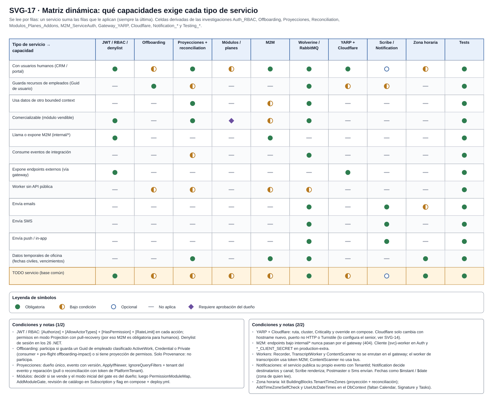

La matriz dice **qué capacidad aplica según lo que hace el servicio**. Primero marca los rasgos del servicio; después aplica cada fila.

### 5.1 Clasificaciones

| Código | Significado |
|---|---|
| **OS** | Obligatoria siempre |
| **OC** | Obligatoria bajo condición (la condición está en la fila) |
| **OP** | Opcional (recomendada si aporta) |
| **NA** | No aplicable |
| **RA** | Requiere aprobación del dueño/senior antes de hacerla |

### 5.2 Rasgos del servicio

| Rasgo | Pregunta |
|---|---|
| **H** — humanos | ¿Expone endpoints que usan empleados, admins, clientes del portal o PlatformAdmin? |
| **E** — recursos de empleados | ¿Guarda algún `Guid` que apunta a un empleado (autor, asignado, responsable, dueño de credencial…)? |
| **D** — datos de otro BC | ¿Necesita en su camino de lectura datos cuyo dueño es otro servicio (permisos, plan, zona, clientes, asignaciones)? |
| **V** — comercializable | ¿Se cobra o depende del plan? |
| **M** — M2M | ¿Llama a endpoints `internal/*` de otros o expone los suyos? |
| **C** — consumer | ¿Reacciona a eventos de otros servicios? |
| **X** — externo | ¿Tiene endpoints alcanzables desde Internet (CRM, portal, público por token, webhooks)? |
| **W** — worker | ¿Es un proceso sin API pública? |
| **N** — avisa | ¿Debe mandar emails, SMS, in-app o push? |
| **T** — tiempo de oficina | ¿Calcula vencimientos, ventanas o fechas civiles en la zona de la oficina? |

### 5.3 Capacidad por condición

| Capacidad | Clasificación | Condición | Capítulo | Checklist |
|---|---|---|---|---|
| 4 proyectos (Domain/Application/Infrastructure/Api) + alta en `.slnx` | OS (salvo W) | W: un proyecto basta (desvío aceptado, ContentScanner) | [7](#cap-07), [8](#cap-08) | `Checklists/Nuevo_Microservicio.md` |
| `Result`/`Error` + registro de códigos en `ErrorHttpMapping` | OS | Todo código nuevo `NotFound`/`Conflict` (si no, responde 400) | [8](#cap-08) | Nuevo_Microservicio |
| BuildingBlocks obligatorios (núcleo, Messaging, Authorization, Web, Infrastructure, EfCore) | OS | — | [9](#cap-09) | Nuevo_Microservicio |
| DbContext fail-closed + `UseUtcDateTimes()` + `InitialCreate` | OS | Si tiene base | [10](#cap-10) | Nuevo_Microservicio |
| Alta de migraciones en deploy (4 lugares) | OS | Si tiene base | [10](#cap-10), [30](#cap-30) | `Checklists/Produccion.md` |
| JWT RS256 + `JwtTenantContextMiddleware` | OC | H o M (receptor) | [11](#cap-11) | `Checklists/Seguridad.md` |
| `[AllowActorTypes]` + `[HasPermission]` + `[RateLimit]` en cada acción | OC | H | [11](#cap-11), [18](#cap-18) | Seguridad |
| Permisos en `PermissionCatalog` + migración `InsertData` + bundles | OC | H | [11](#cap-11) | Seguridad |
| Proyección de permisos (modo `Projection`) + consumers de roles y ciclo de vida + pull-recovery | OC | H | [11](#cap-11), [14](#cap-14) | `Checklists/Proyecciones_Reconciliation.md` |
| Session denylist | OC | H (todo servicio que acepte JWT humano) | [12](#cap-12) | Seguridad |
| Cliente M2M propio en Auth + acquirer con caché | OC | M (llamador), D con reconciliación pull, pull-recovery | [13](#cap-13) | Seguridad |
| Endpoints `internal/*` con `ServiceOnly` (+ PlatformTenant si es cross-tenant) | OC | M (proveedor) | [13](#cap-13) | Seguridad |
| Proyecciones locales con versión | OC | D | [14](#cap-14) | Proyecciones_Reconciliation |
| Reconciliation con `ReconciliationRetry` + URL interna en compose | OC | D | [15](#cap-15) | Proyecciones_Reconciliation |
| `[UserReference]` en toda referencia a empleado | OC | E | [16](#cap-16) | `Checklists/Offboarding.md` |
| Consumer de `UserOffboarded` + registro en `OffboardingParticipants` + pre-flight `offboarding-impact` | OC | E con `ActiveWork`/`Credential`/`Private`; solo proyección de permisos → consumer de ciclo de vida | [16](#cap-16) | Offboarding |
| Prefijo en `PermissionModuleMap` + gate de módulo + catálogo de Subscription + front | OC / RA | V (precio y modo inicial del gate: RA) | [17](#cap-17) | `Checklists/Modulos_Planes.md` |
| Cuota por plan (`EnforceTierQuotas`) | OP | Recomendable si H y existe proyección de plan + acquirer M2M | [18](#cap-18) | Modulos_Planes |
| Cuota de uso de negocio (entitlement numérico) | OC | V con límite de unidades | [17](#cap-17), [18](#cap-18) | Modulos_Planes |
| Wolverine estándar (outbox, `UseTaxVisionRabbitMq`, políticas de fallo/conflicto) | OS (salvo W sin bus) | — | [19](#cap-19) | Nuevo_Microservicio |
| `PublishMessage<T>().ToRabbitExchange("taxvision-events")` por evento | OC | Si publica eventos | [19](#cap-19) | Nuevo_Microservicio |
| Cola `<svc>-events` enlazada al fanout + `IntegrationEventTenantMiddleware` | OC | C | [19](#cap-19) | Nuevo_Microservicio |
| Eventos de dominio BB-1 + colas locales durables BB-2 | OP (Decisión pendiente: hacerlas OS) | Recomendado en servicios nuevos | [19](#cap-19) | Nuevo_Microservicio |
| Exchange dedicado | RA | Solo excepción existente (`taxvision-catalog*`) | [19](#cap-19) | — |
| Codegen Static + `PreGeneratedHandlerCodeTests` + alta en el script | OS (todo servicio con Wolverine) | — | [20](#cap-20) | Nuevo_Microservicio |
| Tenant por JWT/evento (nunca por host) | OS | — | [21](#cap-21) | `Checklists/Tenant_Links.md` |
| Validación Host↔token en ruta pública | OC | X con rutas anónimas por token | [21](#cap-21) | Tenant_Links |
| Enlaces por oficina vía Notification | OC | N con links | [22](#cap-22) | Tenant_Links |
| Plantilla Scribe + kind en catálogo + consumer en Notification | OC | N | [23](#cap-23), [24](#cap-24) | `Checklists/Notificaciones.md` |
| Kit `TenantTimeZones` + fechas tipadas | OC | T | [25](#cap-25) | Proyecciones_Reconciliation |
| Kit `CustomerVisibility` | OC | Muestra datos por cliente y debe respetar asignaciones | [9](#cap-09), [14](#cap-14) | Proyecciones_Reconciliation |
| Ruta + cluster YARP + criticidad + override en compose | OC | X | [26](#cap-26) | `Checklists/YARP_Cloudflare.md` |
| Regla en Caddy | OC | X con URL que el usuario abre en el navegador en host de oficina | [27](#cap-27) | YARP_Cloudflare |
| Cambio en Cloudflare (hostname, DNS, puerto no HTTP, Turnstile) | RA (lo ejecuta el senior a mano) | Hostname nuevo o protocolo no HTTP | [27](#cap-27) | YARP_Cloudflare |
| Dockerfile (`TZ`, `MALLOC_ARENA_MAX`) + bloque compose | OS | — | [28](#cap-28) | Produccion |
| Healthcheck de compose + `curl` en imagen | OC | Otro servicio lo espera con `service_healthy` | [28](#cap-28) | Produccion |
| Publicar un puerto (`ports:`) | RA | Solo protocolos no HTTP justificados (SFU) | [28](#cap-28) | Produccion |
| Alta en scripts de flota (start/stop/restart/codegen) | OS | — | [29](#cap-29) | Nuevo_Microservicio |
| Secrets nuevos en `production-extra` + `deploy.yml` + prueba | OC / RA | Si necesita secretos (los carga el dueño) | [30](#cap-30) | Produccion |
| Colección Postman | OC | H o X | [31](#cap-31) | Nuevo_Microservicio |
| Serilog + OTel + health `/live` y `/ready` + `AddTimeZoneSelfCheck` | OS | — | [32](#cap-32) | Produccion |
| Pruebas mínimas (layering, arquitectura de controllers, codegen, UTC, T-DOM, T-APP) + gate | **OS (todo servicio)** | — | [33](#cap-33) | `Checklists/Testing.md` |
| T-INT (`.Integration.`) contra base local | OC | Persistencia, concurrencia, índices únicos, outbox, dependencias nuevas en handlers | [33](#cap-33) | Testing |
| Pieza nueva en BuildingBlocks | RA | Solo aditiva y opcional | [9](#cap-09) | — |
| Reposición (backfill) de datos de negocio | RA | Siempre la decide el dueño | [10](#cap-10) | — |

### 5.4 Matriz por tipo de servicio

Columnas: **API-H** = API de negocio con humanos · **CONS** = servicio consumer sin endpoints humanos · **WRK** = worker sin API · **VEND** = módulo comercializable · **EMP** = con recursos de empleados · **M2M-P** = expone endpoints internos.

| Capacidad | API-H | CONS | WRK | VEND | EMP | M2M-P |
|---|---|---|---|---|---|---|
| 4 capas + `.slnx` | OS | OS | OP | OS | OS | OS |
| DbContext fail-closed + migraciones | OS | OC (si tiene base) | OC | OS | OS | OS |
| `[AllowActorTypes]`/`[HasPermission]`/`[RateLimit]` | OS | NA | NA | OS | OS | OS (`Service` + `RateLimitExempt`) |
| Proyección de permisos + pull-recovery | OS | NA | NA | OS | OS | NA |
| Session denylist | OS | NA | NA | OS | OS | OP (tokens M2M no tienen `sid`) |
| Cliente M2M | OC | OC | OC | OC | OC | NA |
| Proyecciones + reconciliation | OC | OC | NA | OS (plan) | OC | NA |
| Offboarding | OC (E) | OC (E) | NA (si no persiste ids) | OC (E) | **OS** | NA |
| Gate de módulo + catálogo | NA (salvo V) | NA | NA | **OS** | — | NA |
| Wolverine + codegen Static | OS | OS | OC (si usa bus) | OS | OS | OS |
| Ruta YARP + compose | OS | NA | NA | OS | — | **NA (nunca en el gateway)** |
| Cloudflare | RA (solo hostname nuevo) | NA | NA | RA | — | NA |
| Notificaciones vía Notification | OC (N) | OC (N) | NA | OC | OC | NA |
| Zona horaria | OC (T) | OC (T) | NA | OC | OC | NA |
| Pruebas + gate | **OS** | **OS** | **OS** | **OS** | **OS** | **OS** |

> Regla de lectura: una celda "OC" se resuelve con la condición de la tabla 5.3. Una "RA" se pide antes de escribir código.

---

<a id="cap-06"></a>
## 6. Ecosistema y stack tecnológico

Investigaciones: [03_INVENTARIO_ARQUITECTURA](03_INVENTARIO_ARQUITECTURA.md), [Arquitectura](Investigaciones/Arquitectura.md).

#### Qué es
El conjunto de piezas, versiones y caminos por los que pasa una petición o un evento en TaxVision.

#### Por qué existe
Un servicio nuevo debe usar **exactamente** las versiones y piezas de la flota: no hay `Directory.Packages.props` ni `Directory.Build.props`, así que cada `.csproj` fija su versión y una divergencia (ya existe: Fluid.Core 2.14.0 en Notification frente a 2.31.0) pasa desapercibida.

#### Cómo funciona
- **Camino de una petición:** Cliente → Cloudflare (edge) → Cloudflare Tunnel → Caddy (`:80/:443`, único público) → Gateway YARP (`gateway:8080`) → `<svc>-api:8080` (solo `expose`, nunca `ports`).
- **Camino de un evento:** servicio emisor → outbox SQL → exchange fanout `taxvision-events` → cola `<svc>-events` de cada servicio → inbox durable → handler.
- **Camino M2M:** servicio A → `POST auth/service-token` → `http://<svc>-api:8080/internal/...` por DNS de Docker (nunca por el gateway).
- **Infraestructura:** RabbitMQ `rabbitmq:4.3.2-management`, Redis `redis:7.2.12-alpine`, SQL Server **externo** (el contenedor `db-ready` solo espera su puerto), MinIO, ClamAV, `otel-collector`.

#### Implementación actual en TaxVision
| Pieza | Cantidad | Evidencia (Código verificado) |
|---|---|---|
| Servicios .NET con 4 capas y base propia | 26 | 26 `*DbContext` en `src/Services/*/…/Persistence/` |
| Workers .NET | 2 | `TaxVision.slnx`; compose `connectors-mailbox-listener`, `content-scanner` |
| Servicios Node | 3 | `src/Services/*/package.json` |
| Proyectos BuildingBlocks | 10 | `src/BuildingBlocks/**/*.csproj` |
| Proyectos de pruebas .NET | 31 (30 + biblioteca `BuildingBlocks.Testing`) | `TaxVision.slnx:218-250` |
| Bases EF aplicadas por el deploy | 25 + FinancialInsights condicional | `deploy/docker/migrations/apply-migrations.sh` |

**Stack obligatorio de un servicio .NET nuevo (Código verificado):**

| Componente | Versión | Dónde |
|---|---|---|
| .NET SDK / TargetFramework | 10.0.300 / `net10.0` | `global.json`, cada `.csproj` |
| Imagen build / runtime | `mcr.microsoft.com/dotnet/sdk:10.0.300` / `aspnet:10.0.9` | Dockerfile del Api |
| WolverineFx (+ `.EntityFrameworkCore`, `.RabbitMQ`, `.SqlServer`, `.RuntimeCompilation`) | 6.14.0 | `.csproj` del Api (y `WolverineFx` en Application) |
| Microsoft.EntityFrameworkCore.SqlServer / `.Design` | 10.0.9 | Infrastructure / Api |
| Microsoft.AspNetCore.Authentication.JwtBearer | 10.0.9 | Api |
| HealthChecks.EntityFrameworkCore | 10.0.9 | Api |
| Microsoft.AspNetCore.OpenApi / Swashbuckle.AspNetCore | 10.0.9 / 10.2.2 | Api |
| Serilog, OpenTelemetry | transitivos vía `BuildingBlocks.Web` | — |
| StackExchange.Redis 2.8.16, Polly 8.5.0 | transitivos vía `BuildingBlocks.Infrastructure` | — |
| System.Security.Cryptography.Pkcs | 10.0.13 | Infrastructure |
| Pruebas | xunit 2.9.3, runner 3.1.5, Test.Sdk 17.14.1, EF InMemory 10.0.9, NetArchTest.Rules 1.3.2, Mvc.Testing 10.0.9, System.IdentityModel.Tokens.Jwt 8.19.1 | `deploy/tests/TaxVision.Notes.Tests/*.csproj` |
| Herramienta EF | `dotnet-ef` por manifiesto | `dotnet-tools.json` |

**Condicional según capacidad:** Minio 7.0.0 (objetos), Stripe.net 47.4.0 (cobros), MailKit 4.17.0 (correo), Quartz 3.15.1 (programación persistente), PdfSharp 6.2.0 / Playwright 1.49.0 (PDF), SkiaSharp 3.119.0 (imágenes), Fluid.Core 2.31.0 (Liquid), Ical.Net 5.1.0, ClosedXML 0.105.0 / CsvHelper 33.1.0, HtmlSanitizer 9.1.982, BouncyCastle 2.6.2, FirebaseAdmin 3.1.0, Microsoft.ML.OnnxRuntime 1.31.0. Node: Node 24.22.2, TypeScript 5.6.3, Fastify 5.12.7, Prisma 5.22.0, Socket.IO 4.8.1, amqplib 0.10.4, ioredis 5.4.1, jose 5.9.6, Vitest 5.0.3.

**Histórico (no usar):** `UseRabbitMq(uri).AutoProvision()` directo (sin confirmaciones), JWT HS256 como modo normal, `RetryWithCooldown` por servicio, Loki/Tempo/SQL dentro del compose, MediatR y Mapster (no se usan), `ApplyMigrationsAsync()` al arrancar.

#### Cómo integrarlo en un servicio nuevo
1. Copia las versiones de la tabla al crear los `.csproj` (no subas ni bajes versiones por tu cuenta).
2. Si necesitas un paquete condicional, usa la versión que ya usa otro servicio.
3. Un paquete nuevo que nadie usa es **Requiere aprobación**.

#### Archivos involucrados
`global.json`, `TaxVision.slnx`, `src/Services/<Svc>/**/*.csproj`, `dotnet-tools.json`.

#### Ejemplo técnico
```xml
<!-- src/Services/Notes/TaxVision.Notes.Application/TaxVision.Notes.Application.csproj (referencias) -->
<ProjectReference Include="..\TaxVision.Notes.Domain\TaxVision.Notes.Domain.csproj" />
<ProjectReference Include="..\..\..\BuildingBlocks\BuildingBlocks.csproj" />
<ProjectReference Include="..\..\..\BuildingBlocks\Messaging\BuildingBlocks.Messaging.csproj" />
<PackageReference Include="WolverineFx" Version="6.14.0" />
```

#### Integraciones
Todas las del ecosistema: Auth (JWT, M2M), Tenant (plataforma, zona), Subscription (plan), Customer (clientes), Notification/Scribe/Postmaster (avisos), Gateway, Caddy, Cloudflare.

#### Errores históricos
- Versiones divergentes sin gestión central (Fluid.Core 2.14.0 vs 2.31.0).
- Dependencias Node con rango (`mediasoup ^3.21.0`) e imagen `minio/mc:latest`: no reproducibles.
- La guía antigua decía "2 servicios Node" y "Node ≥ 20.11"; hoy son 3 y Node 24.

#### Pruebas
No hay prueba de versiones. La compatibilidad se verifica con el gate completo.

#### Checklist
- [ ] Versiones iguales a la tabla obligatoria.
- [ ] Ningún paquete nuevo sin aprobación.
- [ ] Ningún patrón histórico (UseRabbitMq directo, MigrateAsync, HS256 como modo normal).

---

<a id="cap-07"></a>
## 7. Estructura de proyectos y solución

Investigación: [Arquitectura](Investigaciones/Arquitectura.md).

#### Qué es
La forma física de un servicio: proyectos, referencias, carpetas y su alta en `TaxVision.slnx`.

#### Por qué existe
Las fitness de capas (`LayeringRulesBase`) y el contenedor `migrations` (que compila `TaxVision.slnx` completo) dependen de esta forma. Un proyecto fuera de la solución no migra en producción ni entra al gate.

#### Cómo funciona
Cuatro proyectos por servicio con dependencias hacia el dominio. Solo el Api es `Microsoft.NET.Sdk.Web` y declara `UserSecretsId`.

| Capa | SDK | Referencias de proyecto | Paquetes | Contiene |
|---|---|---|---|---|
| `TaxVision.<Svc>.Domain` | `Microsoft.NET.Sdk` | `BuildingBlocks.csproj` | ninguno | Agregados, entidades, VOs, enums, `<Agg>Errors`, eventos de dominio, proyecciones locales |
| `TaxVision.<Svc>.Application` | `Microsoft.NET.Sdk` | Domain, `BuildingBlocks.csproj`, `BuildingBlocks.Messaging` | `WolverineFx` | Commands/queries + handlers estáticos, consumers, puertos (`Abstractions/`), DTOs, `AssemblyMarker` |
| `TaxVision.<Svc>.Infrastructure` | `Microsoft.NET.Sdk` | Application, `BuildingBlocks.Infrastructure`, `BuildingBlocks.EfCore` (+ kits) | EF SqlServer, EF Design, `Microsoft.Extensions.Http`, Pkcs | DbContext, configuraciones, migraciones, repositorios, clientes M2M, jobs, `Add<Svc>Infrastructure` |
| `TaxVision.<Svc>.Api` | `Microsoft.NET.Sdk.Web` + `UserSecretsId` | Infrastructure, `BuildingBlocks.csproj`, `BuildingBlocks.Web`, `BuildingBlocks.Messaging`, `BuildingBlocks.Authorization` | JwtBearer, OpenApi, EF Design, HealthChecks.EF, Swashbuckle, `WolverineFx*` | `Program.cs`, controladores, requests, `Internal/Generated`, `Dockerfile` |

#### Implementación actual en TaxVision
Árbol real de Notes (Código verificado, sin `bin/obj/Migrations/Generated`):
```
src/Services/Notes/
├── TaxVision.Notes.Api/          Authorization/  Controllers/  Internal/Generated/WolverineHandlers/  Requests/  Dockerfile  Program.cs
├── TaxVision.Notes.Application/  AssemblyMarker.cs  Notes/{Abstractions,Commands,Consumers,Queries}  Permissions/  Projections/  RateLimiting/
├── TaxVision.Notes.Domain/       Notes/  Permissions/  Projections/  RateLimiting/  ValueObjects/
└── TaxVision.Notes.Infrastructure/  CloudStorage/  Customers/  Jobs/  Permissions/  RateLimiting/  Reconciliation/
                                     Persistence/{Configurations,Migrations,Repositories}  NotesDbContext.cs  NotesDbContextFactory.cs  DependencyInjection.cs
```
Variantes reales: Auth con subcontexto `Onboarding/{Application,Domain,Infrastructure}`; Growth con dos contextos y un Api; Tasks con `ClientForms.{Application,Domain}` y `DataCollection.Engine`; ContentScanner en un solo proyecto (desvío aceptado). Customer usa una carpeta por caso de uso (`Customers/Commands/Create/`) y `Customers/DomainEvents/`.

Los BuildingBlocks "Results, Domain, Persistence, Tenancy, Permissions, ActorTypeAuthorization, Security, Sessions, Caching, TimeZones, RateLimiting, Platform, PurchaseIntentAmount, Common" **no son proyectos**: son carpetas compiladas dentro de `BuildingBlocks.csproj`.

#### Cómo integrarlo en un servicio nuevo
1. Crear los 4 proyectos con `net10.0`, `ImplicitUsings`, `Nullable`; Api con `Sdk.Web` y `UserSecretsId`.
2. Referencias exactamente como la tabla.
3. En `TaxVision.slnx`: `<Folder Name="/src/Services/<Svc>/">` con los 4 `<Project Path=…/>` y el proyecto de pruebas dentro de `<Folder Name="/deploy/tests/">`.
4. `AssemblyMarker` vacío en Application; `DependencyInjection.Add<Svc>Infrastructure` en Infrastructure.
5. Carpetas por concepto de negocio con `Abstractions/Commands/Queries/Consumers`.
6. `public partial class Program;` al final de `Program.cs`.

#### Archivos involucrados
`TaxVision.slnx`, los 4 `.csproj`, `AssemblyMarker.cs`, `DependencyInjection.cs`, `Program.cs`.

#### Ejemplo técnico
```xml
<!-- TaxVision.slnx (forma) -->
<Folder Name="/src/Services/<Svc>/">
  <Project Path="src/Services/<Svc>/TaxVision.<Svc>.Domain/TaxVision.<Svc>.Domain.csproj" />
  <Project Path="src/Services/<Svc>/TaxVision.<Svc>.Application/TaxVision.<Svc>.Application.csproj" />
  <Project Path="src/Services/<Svc>/TaxVision.<Svc>.Infrastructure/TaxVision.<Svc>.Infrastructure.csproj" />
  <Project Path="src/Services/<Svc>/TaxVision.<Svc>.Api/TaxVision.<Svc>.Api.csproj" />
</Folder>
<Folder Name="/deploy/tests/">
  <Project Path="deploy/tests/TaxVision.<Svc>.Tests/TaxVision.<Svc>.Tests.csproj" />
</Folder>
```

#### Integraciones
Contenedor `migrations` (compila la solución), gate (corre los proyectos de la solución), `scripts/migrate-local.ps1` (descubre por `*ModelSnapshot.cs`).

#### Errores históricos
- `BuildingBlocks.csproj` referencia `WolverineFx` (por `[SagaIdentity]`), así que el **ensamblado** Domain arrastra Wolverine de forma transitiva; la fitness controla tipos, no ensamblados. No uses tipos de Wolverine en Domain.
- Archivo `BuildingBlocks.Web/Tenancy/ITenantContext.cs` que contiene la clase `TenantContext`: no repetir (un archivo, un tipo).

#### Pruebas
`<Svc>LayeringTests : LayeringRulesBase` (ver [cap. 33](#cap-33)).

#### Checklist
- [ ] 4 proyectos con referencias correctas.
- [ ] Alta en `.slnx` (src y tests).
- [ ] `AssemblyMarker`, `Add<Svc>Infrastructure`, `public partial class Program;`.

---

<a id="cap-08"></a>
## 8. Capas: Domain, Application, Infrastructure y API

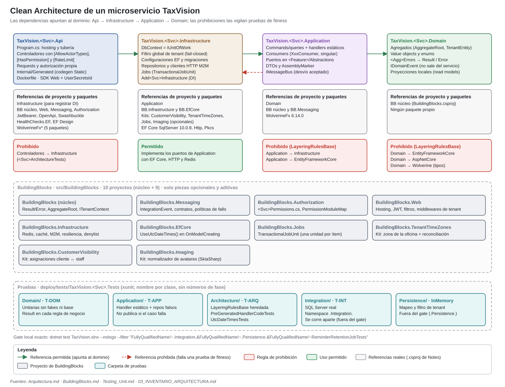

Investigaciones: [Arquitectura](Investigaciones/Arquitectura.md), [Guardrails](Referencias/Guardrails.md).

#### Qué es
Clean Architecture con DDD táctico: el dominio no depende de nada técnico; Application orquesta casos de uso; Infrastructure implementa puertos; Api es una capa fina de transporte.

#### Por qué existe
Mantener las reglas de negocio probables sin infraestructura y evitar que una consulta de datos, un `ChangeStatus(x)` genérico o una publicación antes de guardar se cuelen en el modelo.

#### Cómo funciona
- **Domain**: agregado `sealed`, constructor privado, `{ get; private set; }`, colecciones por backing field + `AsReadOnly()`, factory `Create(...)` que devuelve `Result<T>`, **una transición = un método con nombre de negocio** y su evento, VOs con validación en construcción, cero `System.Linq`, sin `virtual`. La hora llega por parámetro (`TimeProvider` en el handler), no con `DateTime.UtcNow` dentro del agregado.
- **Application**: handler `public static class XHandler` con `Handle(cmd, deps…, CancellationToken ct)`; patrón **load → validate/mutate → persist → publish**; `Handle` ≤ ~30 líneas con métodos privados por fase (guardrail #1). Repositorios declarados en `Application/<Feature>/Abstractions`. **Desvío aceptado:** Application referencia `WolverineFx` e inyecta `IMessageBus`.
- **Infrastructure**: DbContext (que **es** el `IUnitOfWork`), configuraciones EF, repositorios con `IgnoreQueryFilters()` + `TenantId` explícito, clientes HTTP M2M, jobs.
- **Api**: controladores finos: identidad desde el JWT (`this.TryGetTenantAndUser`), `bus.InvokeAsync<Result<T>>`, `result.Error.ToHttpStatusCode()`.

**Result/Error (Código verificado):** `src/BuildingBlocks/Results/Result.cs` (`IsSuccess`, `IsFailure`, `Error`; leer `Value` de un fallo lanza), `Error.cs` (`sealed record Error(string Code, string Message)` + `Error.None` + `RetryAfterSeconds`). `ConflictException` (lanzada por el DbContext) → 409 vía `ExceptionHandlingMiddleware`; `ModuleUnavailableException` → 403. `ErrorHttpMapping.ToHttpStatusCode()` (`src/BuildingBlocks/BuildingBlocks.Web/Results/ErrorHttpMapping.cs`) es una **lista explícita de códigos** con **default 400**.

#### Implementación actual en TaxVision
`Program.cs` de referencia (Notes, orden real):

| # | Paso |
|---|---|
| 1 | `builder.Host.UseTaxVisionSerilog("notes-service")` |
| 2 | `AddControllers().AddJsonOptions(JsonStringEnumConverter).AddActorTypeAuthorization()` |
| 3 | `AddOpenApi()`, `AddSwaggerGen()` |
| 4 | `AddBuildingBlocks()` |
| 5 | `AddTimeZoneSelfCheck()` |
| 6 | `Add<Svc>Infrastructure(builder.Configuration)` |
| 7 | `AddRedisCache`, `AddSessionDenylist`, `AddTaxVisionJwtAuthentication`, `AddTaxVisionOpenTelemetry(…, "<svc>-service")` |
| 8 | `IAuthorizationPolicyProvider → PermissionPolicyProvider`; `ModuleGateRegistration.AddModuleGate`; `AddUserPermissionsSource(config, Assembly.GetExecutingAssembly())` |
| 9 | Autorización por recurso (`AddResourceOwnershipOptions`, `AddOwnershipAuthorization<T>()`) si aplica |
| 10 | Rate limit: `AddTaxVisionRedis`, `IRateCounter → RedisRateCounter`, lectores de plan bajo `RateLimit:EnforceTierQuotas`, `AddTieredRateLimiting()` |
| 11 | Health checks: `AddDbContextCheck<XDbContext>("sql-server", tags: ["ready"])` + `TcpEndpointHealthCheck` de RabbitMQ |
| 12 | `UseWolverine(...)` (ver [cap. 19](#cap-19)) |
| 13 | `AddTaxVisionClientIpForwarding` |
| 14 | Pipeline: `UseTaxVisionClientIp` → (Dev) OpenAPI/Swagger → `CorrelationIdMiddleware` → `UseSerilogRequestLogging` → `ExceptionHandlingMiddleware` → (no Dev) `UseHttpsRedirection` → `UseAuthentication` → `JwtTenantContextMiddleware` → `SessionDenylistMiddleware` → `UseAuthorization` |
| 15 | `/health/live` (sin checks), `/health/ready` (tag `ready`), `MapControllers()`, `app.Run()`, `public partial class Program;` |

#### Cómo integrarlo en un servicio nuevo
1. Modela el agregado con las reglas de Domain.
2. Escribe el handler con el patrón load → validate → persist → **publish después de guardar**.
3. Controlador fino; nunca leas `tenantId`/`userId` del body ni de la query.
4. Registra cada código de error nuevo (`<Agg>.NotFound`, `<Agg>.Conflict`…) en `ErrorHttpMapping` (cambio aditivo en BuildingBlocks); si no, responde 400.
5. Copia el `Program.cs` de Notes y cambia nombre, DbContext, eventos y cola.

#### Archivos involucrados
`Domain/<Feature>/<Agg>.cs`, `Domain/<Feature>/<Agg>Errors.cs`, `Domain/ValueObjects/*.cs`, `Application/<Feature>/Commands/*.cs`, `Api/Controllers/*.cs`, `Api/Program.cs`, `src/BuildingBlocks/BuildingBlocks.Web/Results/ErrorHttpMapping.cs`.

#### Ejemplo técnico
Handler real (Notes, `CreateNoteCommand.cs:31-91`, extracto):
```csharp
public static class CreateNoteHandler
{
    public static async Task<Result<NoteResponse>> Handle(
        CreateNoteCommand command, INoteRepository notes, ICustomerDirectoryRepository customerDirectory,
        IHtmlSanitizer sanitizer, IUnitOfWork unitOfWork, IMessageBus bus, ICorrelationContext correlation,
        ILogger<Note> logger, TimeProvider clock, CancellationToken ct)
    {
        await SoftVerifyCustomerReferenceAsync(command, customerDirectory, logger, ct);

        var referenceResult = NoteReference.Create(command.TargetType, command.TargetId);
        if (referenceResult.IsFailure)
            return Result.Failure<NoteResponse>(referenceResult.Error);
        // ... contenido y color con el mismo patrón ...
        var noteResult = Note.Create(command.TenantId, command.AuthorUserId, contentResult.Value,
            referenceResult.Value, command.Visibility, colorResult.Value, clock.GetUtcNow().UtcDateTime);
        if (noteResult.IsFailure)
            return Result.Failure<NoteResponse>(noteResult.Error);

        var note = noteResult.Value;
        await notes.AddAsync(note, ct);
        await unitOfWork.SaveChangesAsync(ct);          // primero guardar

        await bus.PublishAsync(new NoteCreatedIntegrationEvent   // después publicar
        {
            TenantId = note.TenantId, CorrelationId = correlation.CorrelationId, NoteId = note.Id,
            AuthorUserId = note.CreatedByUserId, TargetType = note.Reference.TargetType.ToString(),
            TargetId = note.Reference.TargetId, Visibility = note.Visibility.ToString(), CreatedAtUtc = note.CreatedAtUtc,
        });
        return Result.Success(NoteResponse.From(note));
    }
}
```
Acción de controlador real (Notes, `NotesController.cs:90-114`):
```csharp
[HttpPost]
[HasPermission(NotesPermissions.Manage)]
[RateLimit("notes.g.create")]
[ProducesResponseType<NoteResponse>(StatusCodes.Status201Created)]
public async Task<IActionResult> Create(CreateNoteRequest request, CancellationToken ct)
{
    if (!this.TryGetTenantAndUser(out var tenantId, out var userId))
        return Unauthorized();

    var result = await bus.InvokeAsync<Result<NoteResponse>>(
        new CreateNoteCommand(tenantId, userId, request.Html, request.TargetType, request.TargetId,
            request.Visibility, request.ColorKind), ct);
    return result.IsSuccess
        ? CreatedAtAction(nameof(GetById), new { id = result.Value.Id }, result.Value)
        : StatusCode(result.Error.ToHttpStatusCode(), result.Error);
}
```

#### Integraciones
Wolverine (handlers y transacción), BuildingBlocks.Results/Web, EF Core.

#### Errores históricos
- `Customer.ChangeStatus(TenantSettingsStatus)` escondía cinco reglas y hubo que partirlo (guardrail #2).
- La guía antigua publicaba **antes** de guardar (§3.3): con `InvokeAsync`, un fallo del save reintenta en línea y filtra lo ya publicado (T-8 Client Forms: dos `CustomerCreationFromFormRequested` para un run).
- `try/catch` dentro del handler no cubre la base caída: Wolverine abre la transacción **antes** del cuerpo.
- Un `<Agg>.NotFound` no registrado en `ErrorHttpMapping` responde 400 en vez de 404.
- Comentarios con fases y narrativa en el servicio de referencia (`NotesDbContext.cs:19-28`, `Notes/Program.cs:60-172`): no se copian.
- **Decisión pendiente:** `NoteErrors` tiene mensajes en español y el controlador devuelve `result.Error` en el cuerpo; la regla dice copy de UI en inglés. Para servicios nuevos, escribe `Error.Message` en inglés.

#### Pruebas
T-DOM por transición y por VO; T-APP del handler con dobles a mano (publica lo que debe y no publica si falla); `HandlerSizeFitnessTests` si el servicio tiene handlers grandes; `NotesArchitectureTests`-like para controladores; `SaveBeforePublishTests` (global).

#### Checklist
- [ ] Agregado `sealed`, ctor privado, `private set`, `Create()` → `Result<T>`.
- [ ] Ningún `ChangeStatus` genérico; sin `System.Linq` en Domain.
- [ ] Hora inyectada (`TimeProvider`), nunca `DateTime.UtcNow` en el agregado.
- [ ] Handler ≤ ~30 líneas; guardar antes de publicar.
- [ ] Controlador fino con identidad del JWT.
- [ ] Códigos nuevos en `ErrorHttpMapping`; mensajes en inglés.

---

<a id="cap-09"></a>
## 9. BuildingBlocks

Investigación: [BuildingBlocks](Investigaciones/BuildingBlocks.md).

#### Qué es
La biblioteca compartida de la flota: 10 proyectos y 14 carpetas compiladas en el núcleo.

#### Por qué existe
Que lo transversal (resultados, tenancy, autorización, mensajería, rate limit, observabilidad, zonas) se haga **igual** en todos los servicios y que un `Program.cs` no tenga lógica propia.

#### Cómo funciona
Dependencias entre proyectos (Código verificado):
```
BuildingBlocks (núcleo) ── WolverineFx
Messaging ─────────────── núcleo, WolverineFx
Authorization ─────────── (sin referencias)
EfCore ────────────────── EF Core 10.0.9
Jobs ──────────────────── núcleo, EF Relational, WolverineFx.EntityFrameworkCore
TenantTimeZones ───────── núcleo, Messaging, EF Relational, Http, Caching.Memory
CustomerVisibility ────── núcleo, Messaging, EF Relational, Http
Imaging ───────────────── núcleo, SkiaSharp 3.119.0
Infrastructure ────────── núcleo, Authorization, Messaging, Redis, Polly, SqlClient, Pkcs
Web ───────────────────── núcleo, Authorization, Infrastructure, Messaging, ASP.NET Core, JwtBearer, OTel, Serilog, WolverineFx.RabbitMQ
```
**Regla del proyecto:** en BuildingBlocks solo se agregan piezas **opcionales y aditivas**; nunca se cambia el comportamiento por defecto (afectaría a 26 servicios a la vez). Cada pieza nueva es Requiere aprobación.

#### Implementación actual en TaxVision
| Pieza | Responsabilidad | Cuándo | Uso |
|---|---|---|---|
| Results | `Result`, `Error`, `ConflictException`, `ModuleUnavailableException` | Siempre | 26/26 |
| Domain | `BaseEntity`, `TenantEntity`, `AggregateRoot`, `ITenantOwned`, `[UserReference]` | Siempre | 26/26 |
| Persistence | `IUnitOfWork` | Siempre | 26/26 |
| Tenancy | `ITenantContext`, `PlatformTenant` | Siempre | 26/26 |
| Authorization (proyecto) | Constantes `*Permissions.cs`, `PermissionModuleMap`, scopes M2M, `SlotGating` | Con `[HasPermission]` | 26/26 |
| Permissions | Puertos de proyección de permisos y `IPermissionsSnapshotClient` | Con humanos | 26/26 |
| ActorTypeAuthorization | `ActorType`, `ClaimNames`, extensiones de claims | Siempre | 26/26 |
| Security | `ISecretProtector`, `ExpiringValueCache` | Secretos en BD; tokens M2M | según pieza |
| Sessions | `ISessionDenylistReader` | Siempre con JWT humano | 26 |
| Messaging (proyecto) | `IntegrationEvent`, contratos `*IntegrationEvents`, políticas de fallo/conflicto | Siempre | 26/26 |
| Caching | `ICacheService` | Caché distribuida | 26/26 |
| TimeZones | `IanaTimeZone`, `CivilDate`, `LocalDay`, `WallTime`, `ZonedTimeFormatter`… | Toda fecha civil o zona | 19 |
| TenantTimeZones (kit) | Proyección de zona por oficina + consumer + reconciliación | Fechas en zona de oficina | 12 |
| CustomerVisibility (kit) | Proyección de asignaciones cliente↔staff + reconciliación | Filtrar por cliente asignado | 11 |
| EfCore | `UseUtcDateTimes()` | Siempre (final de `OnModelCreating`) | 23 |
| Jobs | `TransactionalJobUnit.RunAsync/RunEachAsync` | Jobs que escriben y publican | 12 |
| RateLimiting | Catálogo `RateLimitPolicyCatalog.<Svc>.cs` y resolución de cuotas | Siempre con endpoints | 26/26 |
| Platform | `PlatformSettingsSnapshot`, `OAuthReturnRedirectPolicy` | URLs públicas, orígenes, redirecciones | 11 + Gateway |
| PurchaseIntentAmount | Firma HMAC de montos | Solo cobros de plataforma | 3 |
| Common | `ICorrelationContext`, `PagedResult<T>`, `ReconciliationRetry` | Siempre | 26/26 |
| Web (proyecto) | Hosting, seguridad, autorización, tenancy, middlewares, `ErrorHttpMapping`, `[RateLimit]`, webhooks, health, OTel | Siempre | 26/26 + Gateway |
| Infrastructure (proyecto) | Redis, lectores cacheados, resiliencia HTTP, protectores, `ServiceTokenHttpAcquisition`, denylist reader | Siempre | 26/26 + Gateway |
| Imaging | Normalizador de avatares | Solo fotos de perfil | 2 |

Piezas de pruebas reutilizables (`deploy/tests/TaxVision.BuildingBlocks.Testing`, alias `BbTesting`): `LayeringRulesBase`, `PreGeneratedCodeRules`, `SaveBeforePublishRules`, `JobPublishingRulesBase`, `ConstructorBusRules`, `IntegrationIsolationRules`, `LocalQueueDurabilityRules`, `DomainEventHandlerConventionRules`, `DomainEventEnvelopeRoundTrip`, `HandlerOutboxProbes`, `TemporaryTestDatabase`, `MigrationTestDatabase`, `TemporaryDatabaseTestFramework`.

#### Cómo integrarlo en un servicio nuevo
| Necesidad | BuildingBlocks |
|---|---|
| Siempre | núcleo, `Messaging`, `Authorization`, `Web`, `Infrastructure`, `EfCore` |
| Job que escribe y publica | + `Jobs` |
| Fechas en zona de oficina | + `TenantTimeZones` |
| Datos por cliente con asignación | + `CustomerVisibility` |
| Fotos de perfil | + `Imaging` |
| Fija montos que cobra PaymentApp | `PurchaseIntentAmount` (`AddPurchaseIntentAmountSigning`) |
| Cifra secretos en su base | `AddSecretProtection` / `AddRotatingSecretProtection` |
| Emite eventos de dominio | `UseTaxVisionDomainEvents()` + `AggregateRoot` |

Piezas por servicio que se agregan **dentro** de BuildingBlocks (aditivas): `src/BuildingBlocks/Authorization/<Svc>Permissions.cs`, `src/BuildingBlocks/RateLimiting/Catalog/RateLimitPolicyCatalog.<Svc>.cs`, contratos en `src/BuildingBlocks/Messaging/<Svc>IntegrationEvents/`, prefijo en `PermissionModuleMap.cs` (si vende), códigos en `ErrorHttpMapping.cs`.

#### Archivos involucrados
`src/BuildingBlocks/**`; en el servicio: `Program.cs`, `DependencyInjection.cs`, `<Svc>DbContext.cs`.

#### Ejemplo técnico
Kit de asignaciones (Notes, `DependencyInjection.cs:57-61` y `NotesDbContext.cs:48-53`):
```csharp
services.AddCustomerVisibilityProjection<NotesDbContext>();
services.AddCustomerVisibilityReconciliation<Reconciliation.NotesPlatformTokenProvider>(configuration);

modelBuilder.ApplyConfigurationsFromAssembly(Assembly.GetExecutingAssembly());
modelBuilder.ApplyCustomerAssignmentProjection();
ApplyFailClosedTenantFilter(modelBuilder);
base.OnModelCreating(modelBuilder);
modelBuilder.UseUtcDateTimes();
// En UseWolverine:
options.Discovery.IncludeType(typeof(BuildingBlocks.CustomerVisibility.CustomerAssignmentsProjectionConsumer));
```
`AddBuildingBlocks()` real (`src/BuildingBlocks/BuildingBlocks.Web/Common/DependencyInjection.cs`):
```csharp
public static IServiceCollection AddBuildingBlocks(this IServiceCollection services)
{
    services.AddScoped<TenantContext>();
    services.AddScoped<ITenantContext>(sp => sp.GetRequiredService<TenantContext>());
    services.AddScoped<CorrelationContext>();
    services.AddScoped<ICorrelationContext>(sp => sp.GetRequiredService<CorrelationContext>());
    services.Configure<MvcOptions>(options => options.Filters.Add<RetryAfterHeaderFilter>());
    services.AddOptions<SlotGatingOptions>().BindConfiguration(SlotGatingOptions.SectionName);
    return services;
}
```

#### Integraciones
Todos los capítulos siguientes usan piezas de BuildingBlocks.

#### Errores históricos
- `ITenantContext.cs` (núcleo) dice que sin tenant los DbContext "deben degradar a sin filtro"; el código y el guardrail #12 hacen **fail-closed**. Gana el código.
- La guía antigua decía que OTel vivía en `BuildingBlocks.Infrastructure`; vive en `BuildingBlocks.Web/Observability`.
- "Ningún servicio usa `BuildingBlocks.Jobs`" (2026-11-05): hoy lo usan 12.
- Kit `TenantTimeZones`/`CustomerVisibility` sin su migración en el servicio → la tabla no existe y el consumer falla.
- Mover un contrato de carpeta sin conservar `[MessageIdentity]` cambia el nombre en el cable.

#### Pruebas
Las de cada pieza viven en `deploy/tests/TaxVision.BuildingBlocks.Tests`. En el servicio: heredar `LayeringRulesBase`, `UtcDateTimesTests`, `LocalQueueDurabilityRules`, `DomainEventHandlerConventionRules` (si emite eventos de dominio), `JobPublishingRulesBase` (si tiene jobs).

#### Checklist
- [ ] 6 BuildingBlocks obligatorios referenciados.
- [ ] Kits según necesidad, cada uno con su migración y su `IncludeType`.
- [ ] Piezas aditivas creadas (`<Svc>Permissions.cs`, catálogo de rate limit, contratos).
- [ ] Ningún cambio de comportamiento en BuildingBlocks existente.

---

<a id="cap-10"></a>
## 10. EF Core y migraciones

Investigaciones: [Migraciones](Investigaciones/Migraciones.md), [Guardrails](Referencias/Guardrails.md) #8–#12.

#### Qué es
La persistencia de cada servicio (SQL Server propio, un DbContext) y el ciclo de vida de su esquema.

#### Por qué existe
El filtro de tenant es la red de seguridad del aislamiento entre oficinas; la conversión UTC evita fechas corridas; y el esquema debe llegar a producción por un único camino controlado.

#### Cómo funciona
- **DbContext** `sealed : DbContext, IUnitOfWork`, recibe `ITenantContext`; `OnModelCreating`: `ApplyConfigurationsFromAssembly` → `Apply…Projection()` de kits → filtro fail-closed → `base.OnModelCreating` → **`UseUtcDateTimes()` al final**.
- **Filtro fail-closed**: `EffectiveTenantId => HasTenant ? TenantId : Guid.Empty` como miembro de la instancia (EF cachea el modelo por tipo; cerrar sobre el servicio congelaría el primer tenant); se aplica a todo `ITenantOwned`.
- **`SaveChangesAsync`** traduce `DbUpdateConcurrencyException` → `ConflictException("Persistence.ConcurrencyConflict")` y `SqlException` 2601/2627 → `ConflictException("Persistence.UniqueConstraint")`.
- **Ningún DbContext usa `EnableRetryOnFailure`** (incompatible con la transacción de Wolverine y con `TransactionalJobUnit`).
- **`IgnoreQueryFilters()`** solo si se cumple una de 4 condiciones: (a) el id sale del JWT del propio actor; (b) validación post-fetch del `TenantId`; (c) lookup por secreto global no adivinable; (d) operación cross-tenant deliberada con gate estricto. Si es el único control de aislamiento, es un IDOR: agrega `tenantId` a la firma. Hace falta en handlers vía `bus.InvokeAsync`, consumers, jobs y endpoints anónimos (Wolverine corre en un scope nuevo cuyo `TenantContext` puede estar vacío).
- **Migraciones**: las crea el desarrollador con `dotnet ef migrations add`, se aplican **en local de inmediato** con `scripts/migrate-local.ps1`, y en producción las aplica **el contenedor `migrations` del deploy**. **Los servicios no migran al arrancar** (no hay `Database.Migrate`/`MigrateAsync`/`EnsureCreated` en `src/`); al arrancar solo Wolverine crea sus tablas `wolverine_*`.

#### Implementación actual en TaxVision
- 26 DbContext con filtro (Código verificado); 23 con `UseUtcDateTimes()` (Calendar, Signature y Tasks usan un conversor propio y no tienen `UtcDateTimesTests`).
- 26 design-time factories con `ITenantContext` de diseño (`HasTenant = false`).
- `scripts/migrate-local.ps1`: sin parámetros solo informa; `-Apply` (pregunta), `-Yes`, `-Service A,B`, `-SkipEf`, `-SkipPrisma`, `-AllowRemote`, `-Force`, `-UseEfToDetect`. Conexión como ASP.NET en Development (user-secrets del Api → `appsettings.Development.json` → `appsettings.json`); nunca imprime contraseñas; compara `[Migration]` con `__EFMigrationsHistory`.
- Producción (`.github/workflows/deploy.yml`): build con `--profile tools` (reconstruye la imagen `migrations`), `docker compose … --profile tools run --rm migrations`, después Prisma de Communication, después `up -d`. `apply-migrations.sh` usa `set -eu`: falta una variable → **no migra nada**.
- Seeding: `HasData` para referencia estable; `InsertData`/`UpdateData` en migraciones para catálogo de permisos; seeders idempotentes al arrancar para datos que dependen de configuración (Scribe, Subscription, Tenant, Postmaster, Growth, Auth).
- **Migración ≠ reconciliation ≠ reposición:** la migración cambia esquema (y catálogo determinista) en el deploy; la reconciliación repara proyecciones en runtime ([cap. 15](#cap-15)); una reposición de datos de negocio la decide el dueño.

#### Cómo integrarlo en un servicio nuevo
1. `Persistence/<Svc>DbContext.cs` con la forma de Notes (fragmento abajo).
2. `Persistence/<Svc>DbContextFactory.cs` copiado de Notes (`ConnectionStrings__Default` + `ITenantContext` de diseño).
3. `Persistence/Configurations/`: un `IEntityTypeConfiguration<T>` `sealed` por entidad; `ValueGeneratedNever()` en hijas con Guid de dominio; `IsRowVersion()` en raíces con escritura concurrente; `builder.Ignore(...)` en propiedades calculadas y en `DomainEvents`.
4. `DependencyInjection.cs`: `AddDbContext<XDbContext>(o => o.UseSqlServer(conn))` + `AddScoped<IUnitOfWork>(p => p.GetRequiredService<XDbContext>())`.
5. Crear `InitialCreate` **aunque el DbContext esté vacío** y aplicarla: `./scripts/migrate-local.ps1 -Apply -Yes -Service <Svc>`. La cadena de desarrollo sale de los **user-secrets del servicio**, no de `.env`.
6. Producción, **cuatro lugares**: bloque `apply_migration` en `deploy/docker/migrations/apply-migrations.sh`; `<SVC>_DB_CONNECTION` (con `:?`) en el servicio `migrations` del compose; la misma variable en `<svc>-api`; y la variable en el `.env` que arma `deploy.yml` (secret en GitHub, lo carga el dueño, ver [cap. 30](#cap-30)).
7. Nombres de migración sin número de fase; las ya aplicadas **no se renombran**.

#### Archivos involucrados
`<Svc>DbContext.cs`, `<Svc>DbContextFactory.cs`, `Persistence/Configurations/*`, `Persistence/Migrations/*`, `DependencyInjection.cs`, `scripts/migrate-local.ps1`, `deploy/docker/migrations/apply-migrations.sh`, `deploy/docker/docker-compose.yml` (servicios `migrations` y `<svc>-api`), `.github/workflows/deploy.yml`.

#### Ejemplo técnico
DbContext real (Notes, comentarios recortados):
```csharp
public sealed class NotesDbContext(DbContextOptions<NotesDbContext> options, ITenantContext tenantContext)
    : DbContext(options), IUnitOfWork
{
    public DbSet<Note> Notes => Set<Note>();
    public DbSet<NoteAttachment> NoteAttachments => Set<NoteAttachment>();
    public DbSet<CustomerAssignmentProjection> CustomerAssignmentProjections => Set<CustomerAssignmentProjection>();

    protected override void OnModelCreating(ModelBuilder modelBuilder)
    {
        modelBuilder.ApplyConfigurationsFromAssembly(Assembly.GetExecutingAssembly());
        modelBuilder.ApplyCustomerAssignmentProjection();
        ApplyFailClosedTenantFilter(modelBuilder);
        base.OnModelCreating(modelBuilder);
        // Al final: también cubre las proyecciones y tipos agregados arriba.
        modelBuilder.UseUtcDateTimes();
    }

    private Guid EffectiveTenantId => tenantContext.HasTenant ? tenantContext.TenantId : Guid.Empty;

    private void ApplyFailClosedTenantFilter(ModelBuilder modelBuilder)
    {
        var contextConstant = Expression.Constant(this);
        var effectiveTenantIdAccess = Expression.Property(contextConstant, nameof(EffectiveTenantId));
        foreach (var entityType in modelBuilder.Model.GetEntityTypes())
        {
            if (!typeof(ITenantOwned).IsAssignableFrom(entityType.ClrType)) continue;
            var parameter = Expression.Parameter(entityType.ClrType, "e");
            var tenantProperty = Expression.Property(parameter, nameof(ITenantOwned.TenantId));
            var filter = Expression.Lambda(Expression.Equal(tenantProperty, effectiveTenantIdAccess), parameter);
            modelBuilder.Entity(entityType.ClrType).HasQueryFilter(filter);
        }
    }
    // SaveChangesAsync: DbUpdateConcurrencyException → ConflictException("Persistence.ConcurrencyConflict"),
    // SqlException 2601/2627 → ConflictException("Persistence.UniqueConstraint").
}
```
Configuración de hija (Notes, `NoteAttachmentConfiguration.cs:9-28`, extracto):
```csharp
builder.ToTable("NoteAttachments");
builder.HasKey(a => a.Id);
builder.Property(a => a.Id).ValueGeneratedNever();
builder.Property(a => a.Status).HasConversion<int>().IsRequired();
builder.HasIndex(a => new { a.NoteId, a.CloudStorageFileId }).IsUnique();
```
Bloque de producción (`apply-migrations.sh`):
```sh
apply_migration \
  "Notes" \
  "src/Services/Notes/TaxVision.Notes.Infrastructure/TaxVision.Notes.Infrastructure.csproj" \
  "src/Services/Notes/TaxVision.Notes.Api/TaxVision.Notes.Api.csproj" \
  "$NOTES_DB_CONNECTION"
```
Comandos locales:
```powershell
./scripts/migrate-local.ps1                       # informe, no toca nada
dotnet ef migrations add <Nombre> --project <Infra.csproj> --startup-project <Api.csproj> --context <Svc>DbContext
./scripts/migrate-local.ps1 -Apply -Yes -Service <Svc>
```

#### Integraciones
Wolverine (transacción y tablas `wolverine_*`), kits de BuildingBlocks (tablas de proyección), deploy (contenedor `migrations`), Auth (catálogo de permisos por migración).

#### Errores históricos
- **Migración generada y no aplicada** → `Invalid column name` lento (21–190 s) → p99 alto → **503 de load shedding en toda la flota**.
- **Servicio sin bloque en `apply-migrations.sh`** (o sin variable en `migrations`) → deploy verde sin esquema, o `set -eu` corta **todas** las migraciones ("unbound variable", precedente Billing/Documents).
- **Imagen `migrations` vieja** → el paso "aplicaba" sin aplicar nada (corregido con `--profile tools` en el build).
- **Connectors sin migración inicial** → "Cannot open database" en el primer arranque (guardrail #11).
- **`CustomerAssignment.Create` con `Id = Guid.NewGuid()` sin `ValueGeneratedNever()`** → EF emitió `UPDATE` sobre una fila inexistente y tumbó la asignación de clientes en producción (guardrail #10).
- **Owned type compartido entre filas** (`Money`, `TaskReference`) → columnas NULL o "is part of a key": la copia va dentro de la factory del agregado; probar con ≥ 2 filas.
- **Renombrar un miembro de enum con `HasConversion<string>()`** sin `ValueConverter` con alias legacy → una fila huérfana tumba el arranque.
- **Wolverine ejecutó middleware y handler en scopes distintos** (CloudStorage `ScanFileHandler`) → consultas con 0 filas: motivo de `IgnoreQueryFilters()` + `TenantId` explícito.
- Comentario del compose "como los servicios migran al arrancar": **falso** para EF.
- Cadena leída de `.env` en vez de user-secrets apuntó a otra base (casi se borraron datos reales).

#### Pruebas
| Riesgo | Prueba | Dónde |
|---|---|---|
| `DateTime` no leído como UTC | `UtcDateTimesTests.Every_datetime_column_is_read_as_utc` (corre en el gate; `UseSqlServer("Server=unused…")` sin conectar) | copiar de `Notes.Tests/Architecture/` |
| Hija nueva hace `UPDATE` | DbContext real (InMemory) que afirme `EntityState.Added` y relea en un contexto nuevo, **fuera** de carpetas `Persistence/` | servicio |
| Owned compartido | crear ≥ 2 filas en una operación | `TaskItemOwnedReferenceTests` (Tasks) |
| Migración con datos previos | `MigrationTestDatabase` | `BuildingBlocks.Testing/Integration/` |
| Concurrencia / índice único / outbox atómico | T-INT con `TemporaryTestDatabase` en `.Integration.` | servicio |
| Aislamiento de tenant | `TenantIsolationTests` (ver [cap. 33](#cap-33) sobre `.Persistence.`) | patrón Auth/Notification |

#### Checklist
- [ ] DbContext `sealed`, `IUnitOfWork`, filtro fail-closed, `UseUtcDateTimes()` al final.
- [ ] Factory de diseño con `ITenantContext` falso.
- [ ] `ValueGeneratedNever()`, `IsRowVersion()`, `Ignore()` donde corresponde.
- [ ] `InitialCreate` creada **y aplicada en local**.
- [ ] Cuatro lugares de producción tocados.
- [ ] `IgnoreQueryFilters()` solo con una de las 4 condiciones y comentario breve que diga cuál.
- [ ] Antes de un índice único sobre tabla con datos: consulta previa de duplicados (solo `SELECT`).

---

<a id="cap-11"></a>
## 11. Auth, RBAC, actor types y aislamiento por tenant

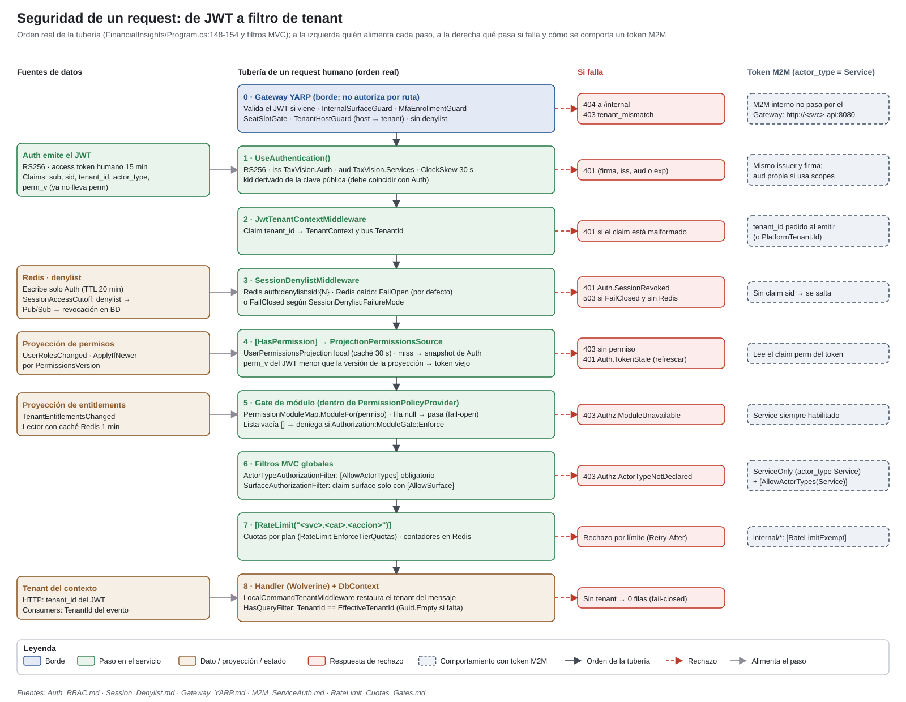

Investigación: [Auth_RBAC](Investigaciones/Auth_RBAC.md). Checklist: [Checklists/Seguridad.md](Checklists/Seguridad.md).

#### Qué es
El modelo de acceso de cinco capas: autenticación JWT → actor type (`[AllowActorTypes]`) → permiso (`[HasPermission]`, + gate de módulo) → frontera de tenant (filtro EF fail-closed) → ownership (ABAC por recurso), más la denylist de sesión ([cap. 12](#cap-12)).

#### Por qué existe
Cada capa cerró un incidente: un rol personalizado llamado "PlatformAdmin" llegó a habilitar el bypass (por eso PlatformAdmin se decide **solo** por `actor_type`); acciones sin declarar actor quedaban abiertas (por eso el filtro es fail-closed); el orden de middleware al revés devolvió 403/vacío en 11 servicios.

#### Cómo funciona
Pipeline real de un request humano (FinancialInsights `Program.cs:148-154`):
```
UseAuthentication()                       → valida JWT (RS256, iss, aud, exp; ClockSkew 30 s)
UseMiddleware<JwtTenantContextMiddleware>  → sella TenantContext + bus.TenantId desde tenant_id (401 si malformado)
UseMiddleware<SessionDenylistMiddleware>   → 401 si el sid está revocado
UseAuthorization()                         → [Authorize], [HasPermission] (+ gate de módulo)
  filtros MVC: ActorTypeAuthorizationFilter (sin [AllowActorTypes] → 403 Authz.ActorTypeNotDeclared)
               SurfaceAuthorizationFilter (token con surface solo donde haya [AllowSurface])
  [RateLimit("...")] (resource filter)
Handler → LocalCommandTenantMiddleware → HasQueryFilter fail-closed
```
- **JWT**: RS256 si hay `Jwt:PublicKeyPem` o `Jwt:PublicKeyPath`; si no, cae a HS256 con `Jwt:Secret`. Issuer `TaxVision.Auth`, audiencia `TaxVision.Services` (humanos y M2M). Access token humano 15 min; token solo-MFA 10 min; M2M 10 min. Claims humanos: `sub`, `email`, `jti`, `sid`, `tenant_id`, `actor_type`, `zoneinfo`, `perm_v`, opcionales `customer_id`, `is_owner`, `role`, `amr`, `surface`, `mfa_enroll`, `reauth_at`. **El token humano no lleva `perm`**: los permisos viajan como versión (`perm_v`) y se leen de la proyección local.
- **Actor types**: `TenantEmployee`, `TenantAdmin`, `CustomerPortal`, `PlatformAdmin`, `Service`. `GetActorType()` devuelve `null` si falta (fail-closed). TenantAdmin **no** tiene bypass; PlatformAdmin sí.
- **`[HasPermission("x")]`** = policy `perm:x` construida por `PermissionPolicyProvider` contra `IUserPermissionsSource`. Modo obligatorio **`Projection`** (`ProjectionPermissionsSource`): PlatformAdmin → true; `Service` → claim `perm` del token M2M; sin `sub`/`tenant_id` → false; caché 30 s; miss → **pull-recovery** a Auth (`internal/tenants/{t}/users/{u}/permissions-snapshot`) y persiste; sin snapshot → **fail-closed**; `perm_v` del JWT menor que la proyección → 401 `Auth.TokenStale` (el front refresca).
- `AddUserPermissionsSource(config, assembly)` **revienta al arrancar** si hay `[HasPermission]` y el modo no es `Projection`.
- **Catálogo**: constantes en `src/BuildingBlocks/Authorization/<Svc>Permissions.cs`; definición con GUID fijo en `src/Services/Auth/Domain/Roles/PermissionCatalog.cs`; banderas `IsAssignableByTenant`, `PlatformOnly`, `IsDangerous` (fuera del bundle automático), `IsReserved`, `AllowedActorTypes`. Bundle TenantAdmin automático (todo lo que no sea portal/PlatformOnly/IsDangerous/IsReserved/`ExcludeFromAdminBundle`); Employee y Customer Portal por lista explícita.
- **Permisos nuevos**: `PermissionCatalog` + migración de Auth que solo hace `InsertData` en `Permissions`. **Nunca** `INSERT INTO RolePermissions` para roles de sistema: `SystemRolePermissionsSyncService` (al arrancar Auth) concede, sube versión y publica; si la migración ya concedió, el sync no ve diferencia y las proyecciones nunca se enteran.
- **Tenant**: HTTP → `JwtTenantContextMiddleware`; consumers → `IntegrationEventTenantMiddleware` (`Guid.Empty` → excepción); comandos locales → `LocalCommandTenantMiddleware` (su comentario advierte que el tenant no siempre llega al scope del handler: de ahí `IgnoreQueryFilters()` + `TenantId` explícito). `tenant_id` **siempre** del token, nunca del body/query.

#### Implementación actual en TaxVision
- 26 servicios .NET con `HasQueryFilter` fail-closed y `PermissionPolicyProvider`; 15 con gate de módulo ([cap. 17](#cap-17)).
- Reparación de proyecciones en Auth: `PermissionsBackfillService` (al arrancar), `SystemRolePermissionsSyncService`, `PermissionsReconciliationService` (cada 6 h re-publica `UserRolesChanged` de los activos, lotes de 50, sin subir versión).
- `RolePermissionsChanged` **ya no** se usa para recomponer permisos de usuarios: Auth hace fan-out y publica un `UserRolesChanged` por titular (`RolePermissionsFanOut.cs`). Recomponer en el consumidor resucitaba permisos denegados.
- Códigos estables de denegación: `Auth.TokenStale`, `Authz.ActorTypeNotDeclared`, `Authz.PermissionDenied`, `Authz.ModuleUnavailable`, `Auth.SurfaceNotAllowed`. Métrica `authz.decision{result,layer}`.

#### Cómo integrarlo en un servicio nuevo
1. Constantes en `src/BuildingBlocks/Authorization/<Svc>Permissions.cs`.
2. Entradas en `PermissionCatalog.cs` con GUID nuevo, carpeta UI, descripción, `IsCustomerPortal`; marcar `IsDangerous`/`PlatformOnly` si aplica. Employee/Portal: agregar a su lista en `SystemRoleDefaults`. Migración de Auth solo con `InsertData`.
3. `Program.cs`: `AddActorTypeAuthorization()`, `AddRedisCache`, `AddSessionDenylist`, `AddTaxVisionJwtAuthentication`, `PermissionPolicyProvider` singleton, `AddModuleGate` (si vende), `AddUserPermissionsSource`; middlewares de tenant en Wolverine; orden de pipeline exacto.
4. `appsettings.json`: `"Authorization": { "PermissionsSource": "Projection" }`; compose: `Authorization__PermissionsSource: Projection`.
5. Proyección `UserPermissionsProjection` + consumers + lector/escritor con pull-recovery ([cap. 14](#cap-14)); cliente M2M para el pull ([cap. 13](#cap-13)).
6. Cada acción: `[Authorize]` (o en el controller), `[AllowActorTypes(...)]`, `[HasPermission(...)]` y `[RateLimit(...)]`/`[RateLimitExempt("razón")]`. Para exigir un permiso solo a un actor en un endpoint compartido: `[HasPermissionForActor]`.
7. Repositorios con `IgnoreQueryFilters()` + `TenantId` explícito.

#### Archivos involucrados
`src/BuildingBlocks/Authorization/<Svc>Permissions.cs`, `src/Services/Auth/Domain/Roles/PermissionCatalog.cs`, migración de Auth, `Program.cs`, `appsettings.json`, compose, controladores, proyección y consumers.

#### Ejemplo técnico
Controlador real (FinancialInsights, `ImportBatchesController.cs:23-35`):
```csharp
[ApiController]
[Authorize]
[Route("financial/import-batches")]
[AllowActorTypes(ActorType.TenantEmployee, ActorType.TenantAdmin, ActorType.PlatformAdmin)]
public sealed class ImportBatchesController(...) : ControllerBase
{
    [HttpPost]
    [HasPermission(FinancialInsightsPermissions.Import)]
    [RateLimit("financial.i.import_batch_create")]
    public async Task<IActionResult> Create([FromBody] CreateImportBatchRequest request, CancellationToken ct)
```
Catálogo (`PermissionCatalog.cs:538-559`):
```csharp
new(
    new Guid("a1000000-0000-0000-0000-0000000001a0"),
    FinancialImport,
    "financial_insights",
    "Import client bank statements into Financial Insights",
    false
),
```
Registro (`Program.cs:39-59`):
```csharp
builder.Services.AddControllers()
    .AddJsonOptions(o => o.JsonSerializerOptions.Converters.Add(new JsonStringEnumConverter()))
    .AddActorTypeAuthorization();
builder.Services.AddRedisCache(builder.Configuration);
builder.Services.AddSessionDenylist(builder.Configuration);
builder.Services.AddTaxVisionJwtAuthentication(builder.Configuration);
builder.Services.AddSingleton<IAuthorizationPolicyProvider, PermissionPolicyProvider>();
ModuleGateRegistration.AddModuleGate(builder.Services, builder.Configuration);
builder.Services.AddUserPermissionsSource(builder.Configuration, Assembly.GetExecutingAssembly());
```

#### Integraciones
Auth (catálogo, eventos, snapshot), Subscription (entitlements para el gate), Redis (denylist, caché de módulos), RabbitMQ, Communication Node (espejo de exenciones del mapa).

#### Errores históricos
| Falta | Síntoma |
|---|---|
| `[AllowActorTypes]` | 403 `Authz.ActorTypeNotDeclared` para todos salvo PlatformAdmin |
| Modo `Projection` | El servicio no arranca |
| Tabla/consumer de `UserPermissionsProjection` | 403 a todo humano |
| Pull-recovery o su secreto M2M | Usuarios anteriores al servicio: 403 hasta el próximo cambio de rol o la re-publicación de 6 h |
| Permiso en catálogo + `InsertData` | Nadie lo tiene → 403 |
| Permiso en el bundle | Admin/empleado sin el permiso → 403 |
| Grant por migración | Proyecciones sin el permiso → 403 |
| Prefijo en `PermissionModuleMap` | La función se regala |
| Front sin refrescar ante `Auth.TokenStale` | 401 en bucle |
| `IgnoreQueryFilters()` + tenant explícito en repo | Handlers que ven 0 filas |
- Documento senior: recomponer en `RolePermissionsChanged` y `JwtTenantContextMiddleware` antes de `UseAuthentication`: ambos **incorrectos** frente al código actual.
- `ExcludeFromAdminBundle: true` en los permisos de FinancialInsights dejó el menú invisible para todos.

#### Pruebas
- Existentes reutilizables (BuildingBlocks): `PermissionsSourceTests`, `UserPermissionsSourceRegistrationTests`, `TenantModuleEntitlementsSourceTests`, `ActorTypeAuthorizationFilterTests`, `SurfaceAuthorizationFilterTests`, `JwtTenantContextMiddlewareTests`, `IntegrationEventTenantMiddlewareTests`, `LocalCommandTenantMiddlewareTests`; Auth: `PermissionCeilingTests`, `RolePermissionsFanOutTests`.
- Del servicio nuevo: fitness de controllers (`[AllowActorTypes]`, `[HasPermission]` o justificación, `[RateLimit]`/`[RateLimitExempt]`); consumer de `UserRolesChanged` (crea, aplica mayor, ignora menor, re-aplica igual); `RolePermissionsChanged` no altera códigos efectivos; ciclo de vida (desactivado → 403; evento viejo no reactiva); pull-recovery (miss + Auth responde → persiste; Auth caído → fail-closed); repositorio aislado aunque el `TenantContext` esté vacío; T-INT con JWT real → 200 y sin fila → 403; prueba de 403 con actor sin permiso (no solo PlatformAdmin).

#### Checklist
- [ ] Constantes, catálogo con GUID, bundles, migración `InsertData` (sin grants).
- [ ] Pipeline en el orden exacto.
- [ ] `PermissionsSource=Projection` en appsettings y compose.
- [ ] Proyección + consumers + pull-recovery + cliente M2M.
- [ ] Cada acción con actor, permiso y rate limit.
- [ ] `tenant_id` solo del token.

---

<a id="cap-12"></a>
## 12. Session denylist

Investigación: [Session_Denylist](Investigaciones/Session_Denylist.md). Checklist: [Checklists/Seguridad.md](Checklists/Seguridad.md).

#### Qué es
Revocación inmediata de sesiones: una entrada en Redis invalida un access token ya emitido sin esperar su `exp`.

#### Por qué existe
El access token dura 15 min. Revocar en la base solo corta el **próximo refresh**; sin denylist, un empleado retirado, un tenant suspendido o un refresh robado seguirían valiendo hasta 15 min.

#### Cómo funciona
- **Escritura (solo Auth):** clave `auth:denylist:sid:{sessionId:N}` → física `taxvision:auth:denylist:sid:{N}` (por `InstanceName = "taxvision:"`), TTL 20 min. Corte completo en orden: (1) denylist de todos los `sid`, (2) aviso Pub/Sub `auth:session-revoked`, (3) revocación en BD (`SessionAccessCutoff`).
- **Endpoints de revocación:** `DELETE auth/sessions/{sessionId}` (una) y `DELETE auth/sessions` (todas). **No existe** `POST …/revoke`.
- **Lectura (.NET):** `SessionDenylistReader` sobre `ICacheService.GetAsync<bool?>` (propaga el fallo de Redis a propósito); `SessionDenylistMiddleware`: se salta si `Enabled=false`, si no hay usuario o **si no hay claim `sid`** (tokens M2M); revocada → 401 `Auth.SessionRevoked`; Redis caído → `FailOpen` (default) deja pasar o `FailClosed` → 503 `Auth.SessionDenylistUnavailable`; ambos cuentan `authz.session_denylist_unavailable{mode}`.
- **Sockets (Communication):** el handshake consulta la denylist (fail-closed por defecto), un watcher del canal `auth:session-revoked` expulsa sockets vivos y cada socket se cierra al `exp` de su token.
- El **Gateway no consulta la denylist**: cada servicio es responsable.

#### Implementación actual en TaxVision
`AddSessionDenylist` + middleware en 25 servicios .NET además de Auth (que registra su propio `AccessTokenDenylist`). Ningún `appsettings` ni el compose define `SessionDenylist`: todos corren `Enabled=true, FailOpen`.

#### Cómo integrarlo en un servicio nuevo
1. `AddRedisCache(config)` **antes** de `AddSessionDenylist(config)` (sin Redis previo falla al resolver `ICacheService`).
2. `app.UseMiddleware<SessionDenylistMiddleware>()` entre `JwtTenantContextMiddleware` y `UseAuthorization()`.
3. Misma `ConnectionStrings:Redis` que Auth (`redis:6379` en compose); no cambies el `InstanceName`.
4. **Recomendación:** dejar explícito `SessionDenylist__FailureMode` en compose aunque sea el default.
5. Si el servicio abre WebSockets propios: validar denylist en el handshake, suscribirse a `auth:session-revoked` y cerrar al `exp`.

#### Archivos involucrados
`Program.cs`, compose (`ConnectionStrings__Redis`), `src/BuildingBlocks/BuildingBlocks.Web/Session/SessionDenylistMiddleware.cs`, `SessionDenylistOptions.cs`.

#### Ejemplo técnico
```csharp
// FinancialInsights Program.cs:51-53,148-154
builder.Services.AddRedisCache(builder.Configuration);
builder.Services.AddSessionDenylist(builder.Configuration);
builder.Services.AddTaxVisionJwtAuthentication(builder.Configuration);
// ...
app.UseAuthentication();
app.UseMiddleware<BuildingBlocks.Web.Tenancy.JwtTenantContextMiddleware>();
app.UseMiddleware<SessionDenylistMiddleware>();
app.UseAuthorization();
```
```yaml
ConnectionStrings__Redis: redis:6379
# SessionDenylist__Enabled: "true"
# SessionDenylist__FailureMode: FailOpen
```
Respuestas que el frontend distingue: 401 `Auth.SessionRevoked` → cerrar sesión local; 401 `Auth.TokenStale` → refrescar; 503 `Auth.SessionDenylistUnavailable` → solo con `FailClosed`.

#### Integraciones
Redis compartido, Auth (escritor y Pub/Sub), Communication (sockets), offboarding ([cap. 16](#cap-16)).

#### Errores históricos
- Documento senior con ruta `POST /auth/sessions/{sid}/revoke`: no existe.
- INV-09: tras el handshake nada re-validaba el socket; ya corregido (cierre al `exp` y expulsión por Pub/Sub).
- Redis distinto o `InstanceName` distinto: revocaciones invisibles **sin error**.
- **Decisión pendiente:** .NET fail-open vs Communication fail-closed ante Redis caído (ventana V1 del offboarding).

#### Pruebas
`SessionDenylistMiddlewareTests` (`Returns_401_when_the_session_is_in_the_denylist`, `Ignores_service_tokens_that_have_no_sid_claim`, FailOpen/FailClosed), `SessionDenylistReaderTests`, `SessionAccessCutoffTests` (orden y TTL). Servicio nuevo: fitness de registro y orden; T-INT con `sid` denylistado en Redis real → 401; token M2M no consulta Redis.

#### Checklist
- [ ] `AddRedisCache` antes de `AddSessionDenylist`.
- [ ] Middleware entre tenant y autorización.
- [ ] Redis e `InstanceName` iguales a Auth.
- [ ] `FailureMode` explícito (recomendado).

---

<a id="cap-13"></a>
## 13. M2M / ServiceAuth

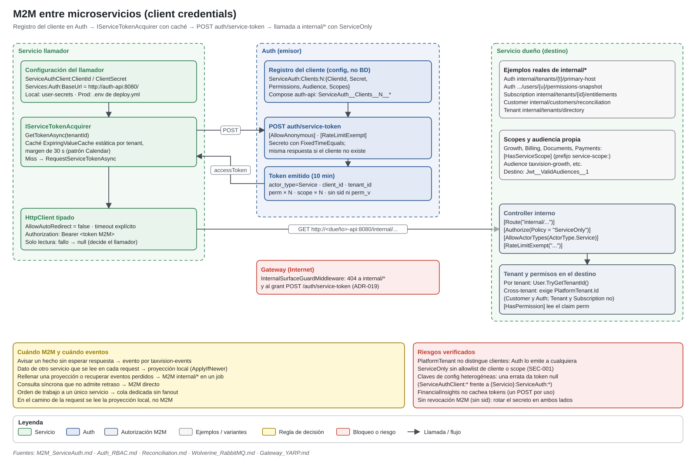

Investigación: [M2M_ServiceAuth](Investigaciones/M2M_ServiceAuth.md). Checklist: [Checklists/Seguridad.md](Checklists/Seguridad.md).

#### Qué es
Autenticación servicio a servicio por `client_credentials`: el llamador pide un token a Auth y llama a endpoints `internal/*` del destino por la red de Docker.

#### Por qué existe
Reconciliaciones, pull-recovery de permisos, catálogo de cuotas, host de oficina, render de Scribe y otros flujos necesitan leer de la fuente de verdad sin pasar por el Gateway ni usar identidad humana.

#### Cómo funciona
- **Emisión:** `POST auth/service-token` (`[AllowAnonymous]`, `[RateLimitExempt]`) con `{ clientId, clientSecret, tenantId }` → `{ accessToken, expiresInSeconds, tokenType }`. Clientes por configuración `ServiceAuth:Clients:N:{ClientId, Secret, Permissions:[…], Audience, Scopes:[…]}`; comparación en tiempo constante; misma respuesta para cliente desconocido o secreto erróneo.
- **Solo dentro de la red:** cada servicio pide el token directo a `http://auth-api:8080`. El Gateway responde 404 al grant (`InternalSurfaceGuardMiddleware`, junto con `/internal/**`), y Auth frena por dirección los fallos de credenciales con `IServiceClientThrottler` (Redis, 20 fallos en 15 min → `Auth.LockedOut` 429 con `Retry-After`). Cuenta por IP y nunca por `clientId`, para que nadie pueda bloquear a propósito el token de un servicio real; si Redis no responde, el grant sigue funcionando (la barrera principal es el Gateway). Token: `sub` determinista por `clientId`, `tenant_id` pedido, `actor_type=Service`, `client_id`, `perm` × N, `scope` × N, **sin `sid` ni `perm_v`**, vida 10 min.
- **Adquisición:** `IServiceTokenAcquirer.GetTokenAsync(tenantId)` + helper `HttpClient.RequestServiceTokenAsync`; caché con `ExpiringValueCache` **estática** por `tenantId` con margen de 30 s (patrón Calendar; `AddHttpClient<>` registra el acquirer como transient).
- **Tenant del token:** llamadas por tenant con el `tenantId` del caso de uso; llamadas cross-tenant (reconciliaciones) con `PlatformTenant.Id`.
- **Destino:** policy local `ServiceOnly` = `RequireClaim("actor_type","Service")`; controller `[Route("internal/…")]` + `[Authorize(Policy = "ServiceOnly")]` + `[AllowActorTypes(ActorType.Service)]` + `[RateLimitExempt("…")]`. Permisos M2M por claim `perm`. El gate de módulo, el rate limit y la denylist no aplican al actor `Service`. El Gateway devuelve **404** a cualquier path con segmento `internal`.

#### Implementación actual en TaxVision
- Auth registra 32 clientes (`ServiceAuth__Clients__0..31` en compose; el 31 es FinancialInsights).
- Claves de configuración del llamador heterogéneas: 18 servicios usan `ServiceAuthClient:{ClientId,ClientSecret}`, 6 usan `{Servicio}:ServiceAuth:*`.
- Endpoints cross-tenant que exigen PlatformTenant: `internal/customers/reconciliation`, `internal/customers/assignments/reconciliation`, `internal/users/*/reconciliation`. **Sin** esa comprobación: `internal/tenants/directory`, `internal/tenants/{t}/users/{u}/permissions-snapshot`, `internal/tenants/{t}/entitlements` (estos dos usan el `tenantId` de la ruta).
- FinancialInsights no cachea tokens (un POST por uso).

#### Cómo integrarlo en un servicio nuevo
1. **Cliente propio** `{servicio}-worker` en Auth con los **mínimos** permisos/scopes: compose de `auth-api` (`ServiceAuth__Clients__<N>__*`, índice `N` nuevo y sin repetir) y user-secrets locales de Auth (`ServiceAuth:Clients:<N>:*`).
2. **Llamador**: compose `ServiceAuthClient__ClientId/ClientSecret` con las **mismas** variables, `Services__Auth__BaseUrl: http://auth-api:8080/`; local en user-secrets con la clave **exacta** que bindea la clase de opciones.
3. Acquirer con caché (patrón Calendar) y log de advertencia si falta configuración.
4. `HttpClient` tipado con `AllowAutoRedirect = false` y timeout explícito. Los clientes de solo-lectura **no lanzan**: devuelven `null` y el llamador decide.
5. Secrets nuevos en `production-extra` + línea en el job `deploy` + caso en `ProductionExtraSecretsDeployTests` ([cap. 30](#cap-30)).
6. **Endpoints propios internos**: bajo `internal/`, `ServiceOnly`, actor `Service`, `RateLimitExempt`; si es cross-tenant, exigir PlatformTenant. Nunca registrarlos en el Gateway.

#### Archivos involucrados
Compose (`auth-api` y `<svc>-api`), `deploy.yml`, `Infrastructure/<Feature>/ServiceTokenAcquirer.cs`, `DependencyInjection.cs`, `Program.cs` (policy `ServiceOnly`), controladores `Internal*Controller.cs`, `ProductionExtraSecretsDeployTests.cs`.

#### Ejemplo técnico
Acquirer con caché (Calendar, `ServiceTokenAcquirer.cs:35-72`):
```csharp
internal sealed class ServiceTokenAcquirer(HttpClient http, IOptions<ServiceAuthClientOptions> options,
    ILogger<ServiceTokenAcquirer> logger) : IServiceTokenAcquirer
{
    private static readonly TimeSpan RefreshBuffer = TimeSpan.FromSeconds(30);
    private static readonly ExpiringValueCache<Guid, string> _cache = new(RefreshBuffer);

    public async Task<string?> GetTokenAsync(Guid tenantId, CancellationToken ct = default)
    {
        var opt = options.Value;
        if (string.IsNullOrWhiteSpace(opt.ClientId) || string.IsNullOrWhiteSpace(opt.ClientSecret))
        {
            logger.LogWarning("ServiceAuthClient is not configured; cannot acquire a service token.");
            return null;
        }
        try
        {
            return await _cache.GetOrCreateAsync(tenantId, async innerCt =>
            {
                var grant = await http.RequestServiceTokenAsync(opt.ClientId, opt.ClientSecret, tenantId, innerCt);
                return (grant.AccessToken, grant.ExpiresAtUtc);
            }, ct);
        }
        catch (ServiceTokenAcquisitionException ex)
        {
            logger.LogWarning(ex, "Could not acquire a service token for tenant {TenantId}.", tenantId);
            return null;
        }
    }
}
```
Compose (secreto omitido):
```yaml
# auth-api
ServiceAuth__Clients__31__ClientId: ${FINANCIAL_INSIGHTS_SERVICE_CLIENT_ID:-financial-insights-worker}
ServiceAuth__Clients__31__Secret: ${FINANCIAL_INSIGHTS_SERVICE_CLIENT_SECRET:-}
ServiceAuth__Clients__31__Permissions__0: cloudstorage.file.view
# financial-insights-api
Services__Auth__BaseUrl: http://auth-api:8080/
ServiceAuthClient__ClientId: ${FINANCIAL_INSIGHTS_SERVICE_CLIENT_ID:-financial-insights-worker}
ServiceAuthClient__ClientSecret: ${FINANCIAL_INSIGHTS_SERVICE_CLIENT_SECRET:-}
```
Endpoint interno:
```csharp
[ApiController]
[Route("internal/tenants")]
[Authorize(Policy = "ServiceOnly")]
[AllowActorTypes(ActorType.Service)]
public sealed class InternalTenantDirectoryController(IMessageBus bus) : ControllerBase
{
    [HttpGet("directory")]
    [RateLimitExempt("M2M interno (actor_type=Service), nunca expuesto en el Gateway público.")]
    public async Task<ActionResult<IReadOnlyList<TenantResponse>>> GetDirectory(
        [FromQuery] int page = 1, [FromQuery] int size = 100, CancellationToken ct = default) { … }
}
// Program.cs
builder.Services.AddAuthorizationBuilder()
    .AddPolicy("ServiceOnly", policy => policy.RequireClaim("actor_type", "Service"));
// Cross-tenant: if (!User.TryGetTenantId(out var t) || t != PlatformTenant.Id) return Forbid();
```

#### Integraciones
Auth (emisión), destinos `internal/*` (Auth, Tenant, Customer, Subscription, CloudStorage, Scribe…), reconciliaciones ([cap. 15](#cap-15)), pull-recovery ([cap. 11](#cap-11)), cuotas ([cap. 18](#cap-18)), enlaces ([cap. 22](#cap-22)).

#### Errores históricos
- **E-12 Calendar:** `deploy.yml` no escribía `CALENDAR_SERVICE_CLIENT_SECRET`; Auth y Calendar quedaron con secreto vacío y **todo el M2M de Calendar se apagó en silencio** en producción.
- Clave de user-secrets mal escrita → 401 `Auth.InvalidClient` que aflora tres capas después.
- Subscription sin `Subscription:ServiceAuth` → el pull-recovery nunca funcionó → 403.
- Notification sin `scribe.render` en su cliente → 403 en el render.
- Índice `N` repetido tras un merge → un cliente pisa a otro.

#### Pruebas
Existentes: `IssueServiceTokenHandlerTests` (dirección frenada → `Auth.LockedOut` sin mirar el secreto; secreto erróneo o cliente desconocido → un fallo contado; cliente válido → nada contado), `ServiceClientThrottlerTests` (sin Redis el grant no se bloquea ni se rompe), `ServiceClientThrottlerIntegrationTests` (umbral por dirección contra el Redis local), `InternalSurfaceGuardMiddlewareTests` (el Gateway responde 404 al grant y sus variantes de ruta), `JwtTokenGeneratorTests`, `ServiceClientSecretsDeployWiringTests`, `ProductionExtraSecretsDeployTests`, `ExpiringValueCacheTests`, `InternalRouteConventionFitnessTests`. Servicio nuevo: acquirer sin config → null + warning; con config → un solo POST para N llamadas; cancelación propagada; cliente HTTP sin token → no llama; 401/403/5xx → null; endpoint interno: token humano → 403; token Service de otro tenant → 403 si cross-tenant.

#### Checklist
- [ ] Cliente propio en Auth con permisos mínimos e índice único.
- [ ] Mismas variables en Auth y en el llamador; clave de config exacta.
- [ ] Acquirer con caché estática por tenant.
- [ ] `ServiceAuthClient__AuthBaseUrl` apunta a `http://auth-api:8080` (el grant no pasa por el Gateway).
- [ ] Secrets en `production-extra` + `deploy.yml` + prueba.
- [ ] Endpoints propios bajo `internal/` con `ServiceOnly` (+ PlatformTenant si cross-tenant).

---

<a id="cap-14"></a>
## 14. Proyecciones locales

Investigación: [Proyecciones](Investigaciones/Proyecciones.md). Checklist: [Checklists/Proyecciones_Reconciliation.md](Checklists/Proyecciones_Reconciliation.md).

#### Qué es
Read-models en la base del servicio alimentados por eventos del dueño del dato: permisos, plan/módulos, zona horaria, asignaciones de clientes, directorios.

#### Por qué existe
En el camino de la request se lee **la proyección local**, no a otro servicio por HTTP (la revisión de FinancialInsights marcó como 🔴 las llamadas en vivo a Customer y Auth en cada request). Los eventos llevan el estado completo (event-carried state transfer).

#### Cómo funciona
- El dueño declara `PublishMessage<TEvento>().ToRabbitExchange("taxvision-events")`; cada servicio recibe todos los eventos en su cola y Wolverine invoca solo los que tienen handler.
- Consumers compartidos (fuera del `.Application` del servicio) se incluyen a mano con `Discovery.IncludeType(...)`.
- Tenant del scope por `IntegrationEventTenantMiddleware`; tiendas con `IgnoreQueryFilters()` + `TenantId` del evento; `correlation.Push(evt.CorrelationId ?? EventId)`.
- **Upsert idempotente con versión monotónica del dueño** (`ApplyIfNewer`): reentregas y desorden no deshacen cambios.

| Proyección | Versión | Regla |
|---|---|---|
| UserPermissions | `PermissionsVersion` (Auth) | descarta `version < actual`; igual se re-aplica |
| UserPermissions (ciclo de vida) | `LifecycleUpdatedAtUtc` | descarta `observedAt < actual` |
| RolePermissions | versión del rol | **no** se une a los permisos del usuario |
| TenantPlanCode / TenantEntitlements | `RevisionNumber` (Subscription) | descarta `revision < actual` |
| TenantTimeZone | `SourceVersion` o `SourceUpdatedAtUtc` | aplica solo si es más nuevo |
| CustomerAssignment | `Version` (`UpdatedAtUtc` del cliente) | `<=` aplicado → ignora; si no, reemplaza el set |
| Directorios | versión del dueño o fecha del evento | lo más viejo se descarta; `name=null` no borra |

#### Implementación actual en TaxVision
| Proyección | Dueño | Evento(s) | Consumidores | Reparación |
|---|---|---|---|---|
| `UserPermissionsProjection` (+ `Authz*`) | Auth | `UserRolesChanged` + `UserDeactivated/Offboarded/Reactivated` | 21 servicios + 4 `Authz*` + Communication | Pull-recovery; Auth re-publica (arranque, sync, 6 h) |
| `RolePermissionsProjection` | Auth | `RolePermissionsChanged` | los mismos | re-publicación de Auth |
| `TenantPlanCodeProjection` | Subscription | `TenantEntitlementsChanged` | 25 servicios | Subscription re-encola cada 24 h **solo si cambió** |
| `TenantEntitlementsProjection` | Subscription | `TenantEntitlementsChanged` | FinancialInsights | pull + job 6 h |
| `TenantTimeZoneProjection` (kit) | Tenant | `TenantCreated`, `TenantUpdated` | 12 servicios | job 12 h con `ReconciliationRetry` |
| `CustomerAssignmentProjection` (kit) | Customer | `CustomerAssignmentsChanged` (snapshot del set) | 11 servicios | job 12 h con `ReconciliationRetry` |
| Directorios de oficinas/clientes/empleados, políticas de contacto, destinatarios | Tenant / Customer / Auth | varios | FI, Postmaster, Calendar, Notes, Tasks, Customer, Notification, Sms, Signature | jobs propios (muchos sin reintento corto) |

#### Cómo integrarlo en un servicio nuevo
1. Por cada dato ajeno: identifica **dueño único** y evento con estado completo.
2. Entidad `TenantEntity` con `ApplyIfNewer` y, si hay ciclo de vida, `SetActive(bool, observedAtUtc)`; índice único `(TenantId, <Id>)`; migración aplicada en local.
3. Consumer estático idempotente con `correlation.Push`, guardar y **después** invalidar caché.
4. Kits compartidos: `Add…Projection<TDbContext>()`, `modelBuilder.Apply…Projection()`, `Discovery.IncludeType(consumer)`, migración.
5. **Reparación obligatoria** (pull bajo demanda y/o reconciliación, [cap. 15](#cap-15)).
6. **No derivar permisos de usuario desde `RolePermissionsChanged`.**
7. El lector de permisos filtra `IsActive && HasPermissionsSnapshot` (`ProjectionPermissionsSource` no conoce `IsActive`).
8. Plan del tenant: si el servicio enforza el gate o depende de cuotas, añade pull de entitlements (patrón FI `TenantEntitlementsResolver`); la reconciliación de Subscription **no repara consumidores**.

#### Archivos involucrados
`Domain/Projections/*.cs`, `Application/Projections/Consumers/*.cs`, `Infrastructure/Persistence/*Readers.cs`, configuraciones EF, migraciones, `Program.cs` (`IncludeType`), `DependencyInjection.cs`.

#### Ejemplo técnico
Entidad (FinancialInsights `AccessProjections.cs:8-76`, extracto):
```csharp
public sealed class UserPermissionsProjection : TenantEntity
{
    [UserReference(UserReferenceKind.Projection, HandledBy = "UserLifecyclePermissionsProjectionConsumer")]
    public Guid UserId { get; private set; }
    public int PermissionsVersion { get; private set; }
    public string PermissionCodesJson { get; private set; } = "[]";
    public bool IsActive { get; private set; }
    public bool HasPermissionsSnapshot { get; private set; }
    public DateTime LifecycleUpdatedAtUtc { get; private set; }

    public void ApplyIfNewer(int version, IReadOnlyCollection<string> codes, IReadOnlyCollection<Guid> roleIds)
    {
        if (version < PermissionsVersion)
            return;
        PermissionsVersion = version;
        PermissionCodesJson = JsonSerializer.Serialize(codes.Distinct(StringComparer.Ordinal).ToArray());
        HasPermissionsSnapshot = true;
        UpdatedAtUtc = DateTime.UtcNow;
    }

    public void SetActive(bool active, DateTime observedAtUtc)
    {
        if (observedAtUtc < LifecycleUpdatedAtUtc)
            return;
        IsActive = active;
        LifecycleUpdatedAtUtc = observedAtUtc;
    }
}
```
Consumer (`ProjectionConsumer.cs:21-46`):
```csharp
public static async Task Handle(UserRolesChangedIntegrationEvent evt, IFinancialProjectionRepository projections,
    IUnitOfWork unitOfWork, ICorrelationContext correlation, CancellationToken ct)
{
    using (correlation.Push(CorrelationOf(evt)))
    {
        var row = await projections.FindUserPermissionsAsync(evt.TenantId, evt.UserId, ct);
        if (row is null)
            projections.AddUserPermissions(UserPermissionsProjection.Create(
                evt.TenantId, evt.UserId, evt.PermissionsVersion, evt.PermissionCodes, evt.RoleIds));
        else
            row.ApplyIfNewer(evt.PermissionsVersion, evt.PermissionCodes, evt.RoleIds);
        await unitOfWork.SaveChangesAsync(ct);
    }
}
```
Lector + escritor con una clase (`DependencyInjection.cs:68-74`):
```csharp
services.AddScoped<FinancialUserPermissionsReader>();
services.AddScoped<IUserPermissionsProjectionReader>(sp => sp.GetRequiredService<FinancialUserPermissionsReader>());
services.AddScoped<IUserPermissionsProjectionWriter>(sp => sp.GetRequiredService<FinancialUserPermissionsReader>());
```
Plan del tenant con handler compartido (Notes):
```csharp
public static class TenantPlanCodeProjectionConsumer
{
    public static Task Handle(TenantEntitlementsChangedIntegrationEvent evt, ITenantPlanCodeProjectionRepository repository,
        ITenantPlanCodeCacheInvalidator planCodeCache, IUnitOfWork unitOfWork, ICorrelationContext correlation,
        ILogger<TenantPlanCodeProjection> logger, CancellationToken ct) =>
        TenantPlanCodeProjectionHandler.Handle(evt, repository, planCodeCache, unitOfWork, correlation, logger,
            TenantPlanCodeProjection.Create, ct);
}
```

#### Integraciones
Auth, Subscription, Tenant, Customer (dueños); reconciliation; gate de módulo; rate limit; offboarding (`[UserReference(Projection)]`).

#### Errores históricos
- Doc senior y cabecera de `PermissionsProjectionConsumers.cs` (CloudStorage) piden recomponer la unión en `RolePermissionsChanged`: **incorrecto**, resucitaba denies.
- Proyecciones Node con bugs de mapeo (`ActorType` ausente, casing); hoy el evento exige `ActorType`.
- `TenantTimeZoneChangedIntegrationEvent` **no** lo procesa el consumer compartido: no lo uses como fuente de la proyección.
- Sin borrado físico de tenants: un tenant eliminado queda `IsActive=false` o con módulos `[]`.
- Servicio nacido después de los datos → proyección vacía para todo lo anterior (403, gate abierto, nombres vacíos) hasta reconciliar.

#### Pruebas
Por consumer: crea si no existe; aplica versión mayor; ignora menor; duplicado no cambia nada; `TenantId` vacío → excepción; tenant A no ve filas de B; desactivar → lector null; reactivar sin fila → no crea fila vacía. Fitness: el `Program.cs` incluye los consumers compartidos y declara `PublishMessage` de lo que publica. Referencias: FI `ProjectionConsumerTests` (`User_deny_event_removes_permission_and_role_event_cannot_restore_it`, `Tenant_module_projection_keeps_newest_revision_and_empty_means_disabled`), `ModuleGateWiringFitnessTests`.

#### Checklist
- [ ] Tabla + índice único + migración aplicada.
- [ ] Consumer idempotente con versión del dueño.
- [ ] `IncludeType` de consumers compartidos.
- [ ] Reparación (pull y/o reconciliación).
- [ ] Invalidación de caché tras guardar.
- [ ] Pruebas de orden, duplicado y aislamiento.

---

<a id="cap-15"></a>
## 15. Reconciliation (reconciliación)

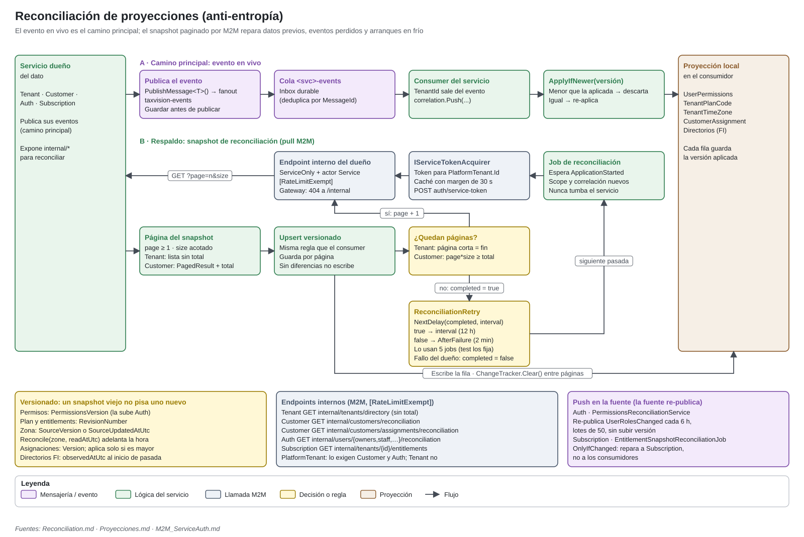

Investigación: [Reconciliation](Investigaciones/Reconciliation.md). Checklist: [Checklists/Proyecciones_Reconciliation.md](Checklists/Proyecciones_Reconciliation.md).

#### Qué es
Anti-entropía: jobs que reparan una proyección local contra la fuente de verdad para (a) datos anteriores al servicio, (b) eventos perdidos, (c) arranques en frío.

#### Por qué existe
Los eventos son el camino principal, pero un servicio nuevo nace sin historia y un consumer caído pierde ventanas. Sin reconciliación, la proyección queda vacía o vieja durante horas.

#### Cómo funciona
- **Push (la fuente re-publica):** Auth re-emite `UserRolesChanged` (arranque, sync de roles, cada 6 h); Subscription re-encola recálculos de entitlements cada 24 h con `OnlyIfChanged` (repara a Subscription, **no** a los consumidores).
- **Pull (el consumidor pagina un endpoint interno M2M):** zona horaria (`internal/tenants/directory`), asignaciones (`internal/customers/assignments/reconciliation`), clientes (`internal/customers/reconciliation`), empleados/dueños/portal (`internal/users/*/reconciliation`), entitlements (`internal/tenants/{id}/entitlements`).
- **Patrón de job:** espera `ApplicationStarted`; lee `Enabled/IntervalHours/PageSize`; scope y correlación nuevos por pasada; devuelve `bool completed`; nunca tumba el servicio; espera `ReconciliationRetry.NextDelay(completed, interval)`.
- **Reintento corto (`ReconciliationRetry`):** 2 min tras una pasada fallida (en vez de esperar 12 h). Nació el 2026-11-15 tras un incidente en producción: los jobs corrieron antes de que Auth respondiera y quedaron esperando el intervalo completo.
- **Versión antes de escribir:** comparar la versión del dueño (o `observedAtUtc` fijado al **inicio** de la pasada); sin diferencias no escribe; guarda por página y `ChangeTracker.Clear()` entre páginas.

#### Implementación actual en TaxVision
- `ReconciliationRetry` lo usan **5 jobs** (fijados por `ReconciliationRetryTests`): `TenantTimeZoneReconciliationJob`, `CustomerAssignmentReconciliationJob` y `TenantCustomerFullReconciliationJob` de Calendar, Notes y Tasks.
- **Al menos 10 jobs siguen sin reintento corto**: FI (clientes completos, nombres, entitlements), Customer (empleados), Notification (destinatarios, directorio), Correspondence/Signature (clientes), Sms (política de contacto), Calendar (nombres). FI tenant directory usa un reintento propio de 5 min.
- URL de Tenant: `TenantTimeZoneReconciliationOptions.TenantBaseUrl` → `PlatformSettings:TenantBaseUrl` → **`http://localhost:5217`** por defecto (en un contenedor, `localhost` es el propio contenedor: la reconciliación nunca llega). Compose: ancla `x-platform-settings-env` con `PlatformSettings__TenantBaseUrl: http://tenant-api:8080`; 7 servicios con `TenantTimeZones__Reconciliation__TenantBaseUrl` explícito. Mismo riesgo con `CustomerVisibilityReconciliationOptions.CustomerBaseUrl` (default `http://localhost:5263`).

#### Cómo integrarlo en un servicio nuevo
1. Identifica el endpoint fuente y si exige PlatformTenant.
2. Token M2M de PlatformTenant disponible (cliente registrado en Auth, [cap. 13](#cap-13)).
3. **URL interna explícita en compose** (`http://<servicio>-api:8080`) o heredar `<<: *platform-settings-env`; nunca depender del default.
4. Reconciliador idempotente y versionado; guarda por página.
5. Job con `ReconciliationRetry.NextDelay(completed, interval)` y agrega el archivo al `[InlineData]` de `ReconciliationRetryTests`.
6. Logs con conteos y warning cuando la fuente no responde.
7. Antes de **re-publicar** un evento (backfill), revisa todos sus consumidores, sobre todo los que mandan correos.

#### Archivos involucrados
`Infrastructure/<Feature>/*ReconciliationJob.cs`, `*Reconciler.cs`, token provider, `DependencyInjection.cs`, `appsettings.json`, compose, `deploy/tests/TaxVision.BuildingBlocks.Tests/Common/ReconciliationRetryTests.cs`.

#### Ejemplo técnico
```csharp
// src/BuildingBlocks/Common/ReconciliationRetry.cs:7-13
public static class ReconciliationRetry
{
    public static readonly TimeSpan AfterFailure = TimeSpan.FromMinutes(2);
    public static TimeSpan NextDelay(bool completed, TimeSpan interval) =>
        completed || interval <= AfterFailure ? interval : AfterFailure;
}
```
```csharp
// TenantTimeZoneReconciliationJob.cs:21-45 (bucle compartido)
await WaitForStartedAsync(serviceProvider.GetRequiredService<IHostApplicationLifetime>(), stoppingToken);
var options = serviceProvider.GetRequiredService<IOptions<TenantTimeZoneReconciliationOptions>>().Value;
if (!options.Enabled) return;
var interval = TimeSpan.FromHours(Math.Max(1, options.IntervalHours));
while (!stoppingToken.IsCancellationRequested)
{
    var completed = await RunOnceSafeAsync(Math.Clamp(options.PageSize, 1, 200), stoppingToken);
    try { await Task.Delay(ReconciliationRetry.NextDelay(completed, interval), stoppingToken); }
    catch (TaskCanceledException) { break; }
}
```
```csharp
// Proveedor de token PlatformTenant (FinancialInsights)
internal sealed class FinancialTenantTimeZoneTokenProvider(IServiceTokenAcquirer tokenAcquirer)
    : ITenantTimeZoneTokenProvider
{
    public Task<string?> GetServiceTokenAsync(CancellationToken ct = default) =>
        tokenAcquirer.GetTokenAsync(PlatformTenant.Id, ct);
}
```
```yaml
# compose del servicio (URLs internas explícitas)
Services__Auth__BaseUrl: http://auth-api:8080/
Services__Customer__BaseUrl: http://customer-api:8080/
TenantTimeZones__Reconciliation__TenantBaseUrl: http://tenant-api:8080
# CustomerVisibility__Reconciliation__CustomerBaseUrl: http://customer-api:8080
```

#### Integraciones
Tenant, Customer, Auth, Subscription (fuentes); M2M; compose; proyecciones.

#### Errores históricos
- **Incidente 2026-11-15:** jobs de reconciliación corrieron antes que Auth y esperaron 12 h → proyecciones vacías tras el deploy. Origen de `ReconciliationRetry`.
- FinancialInsights: directorio de oficinas vacío (arreglado 2026-11-14) y worker que dejaba documentos esperando plan (cerrado con `Portal_import_heals_a_missing_plan_row_instead_of_failing`).
- URL por defecto a `localhost` dentro del contenedor: el servicio arranca "bien" y nunca reconcilia; solo la fitness de compose lo detecta.
- La reconciliación de suscripciones habría mandado "tu suscripción venció" cada día si se re-publicaba sin revisar consumidores.

#### Pruebas
Existentes: `ReconciliationRetryTests`, `TenantTimeZoneReconcilerTests`, `TenantTimeZoneReconciliationDeployTests`, `ComposeInternalBaseUrlWiringTests`, `AssignmentVisibilityDeployWiringTests`, FI `TenantDirectoryReconciliationTests`, `TenantEntitlementsReconciliationTests`. Servicio nuevo: inserta faltantes en varias páginas; corrige desfasados; no pisa una fila más nueva; sin diferencias no escribe; fuente caída o sin token → `completed=false` sin lanzar; job en `ReconciliationRetryTests`; URL en las fitness de compose.

#### Checklist
- [ ] Endpoint fuente y exigencia de PlatformTenant identificados.
- [ ] Token de PlatformTenant disponible.
- [ ] URL interna explícita en compose; nada a `localhost`.
- [ ] Reconciliador idempotente, versionado, por página.
- [ ] `ReconciliationRetry.NextDelay` + entrada en `ReconciliationRetryTests`.
- [ ] Logs con conteos.

---

<a id="cap-16"></a>
## 16. Offboarding de empleados (capítulo crítico)

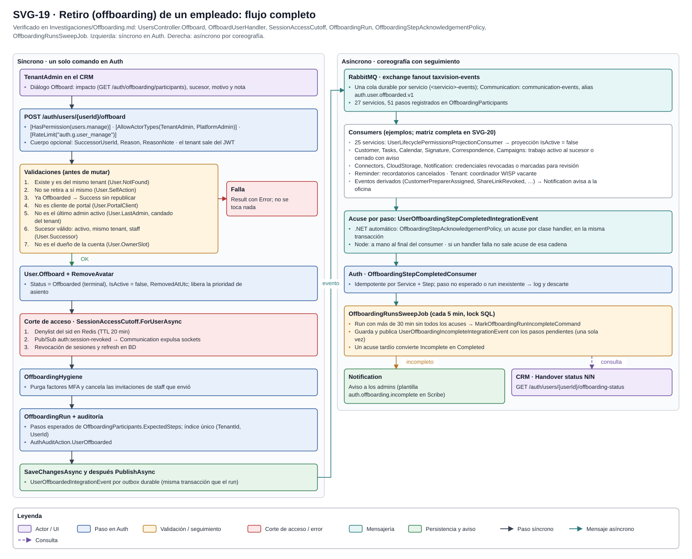

Investigaciones: [Offboarding](Investigaciones/Offboarding.md), [Offboarding_Integraciones](Investigaciones/Offboarding_Integraciones.md). Checklist: [Checklists/Offboarding.md](Checklists/Offboarding.md).

> **REGLA OBLIGATORIA:** un servicio que guarda recursos de empleados (cualquier `Guid` que apunte a un usuario staff) **no está integrado** hasta que se haya **evaluado** su participación en el retiro y esa participación esté **probada**: anotaciones `[UserReference]` completas, consumer (si corresponde), registro en `OffboardingParticipants`, pre-flight (si corresponde), pruebas del servicio y los tres fitness de offboarding en verde, y verificación manual en "Handover status".
>
> **Regla de oro:** si tu servicio guarda un `Guid` que apunta a un empleado, decide hoy qué le pasa cuando la oficina lo retira.

#### Qué es
El retiro (offboard) de un empleado de su oficina: estado **terminal** `UserStatus.Offboarded` (no se reactiva; invariante `Offboarded ⇒ IsActive == false`). Lo ejecuta **Auth**; la limpieza la hacen **27 servicios en 51 pasos** por coreografía.

#### Por qué existe
Un empleado que se va no puede seguir viendo datos de clientes ni puede quedar trabajo a su nombre: clientes asignados, tareas, citas, borradores, firmas pendientes, campañas que disparan "en su nombre", buzones personales que siguen poleando, enlaces públicos, push a su teléfono.

#### Cómo funciona

**Flujo síncrono en Auth** (`POST /auth/users/{userId}/offboard`, `users.manage` + `TenantAdmin`/`PlatformAdmin`, `auth.g.user_manage`; cuerpo opcional `SuccessorUserId`, `Reason`, `ReasonNote`):
1. Carga el objetivo (otro tenant → `User.NotFound`); nadie se retira a sí mismo.
2. **Idempotente**: ya retirado → éxito sin republicar.
3. Rechaza cliente de portal; si es TenantAdmin activo, candado y exige otro admin activo; el dueño de la cuenta no se puede retirar.
4. Valida sucesor (≠ objetivo, existe, mismo tenant, activo, actor staff) y motivo/nota **antes** de mutar.
5. `User.Offboard` → quita avatar → **corte de acceso** (`SessionAccessCutoff`: denylist → Pub/Sub → BD) → higiene (MFA purgado, invitaciones de staff canceladas) → `OffboardingRun` con los pasos esperados → auditoría.
6. **Guarda y después publica** `UserOffboardedIntegrationEvent` al fanout.

**Flujo asíncrono:** cada servicio consume `UserOffboardedIntegrationEvent` (Node: alias `auth.user.offboarded.v1`) y deja sus datos coherentes. **Tu servicio nunca corta el acceso**: eso ya pasó cuando te llega el evento.

**Acuse N/N:** en .NET, `UseTaxVisionRabbitMq` enciende `AcknowledgeOffboardingSteps()`: la política inserta un postprocesador que publica un acuse por **clase handler** (`Service` = segundo tramo del ensamblado, `Step` = nombre de la clase), dentro de la misma transacción; si un handler lanza, no sale ningún acuse de esa cadena. En Node el acuse se encola a mano. Auth registra acuses (idempotente por `Service+Step`); `OffboardingRunsSweepJob` (cada 5 min) marca incompleta una corrida a los **30 min** y publica `UserOffboardingIncompleteIntegrationEvent` → Notification avisa a los admins (una sola vez). El CRM muestra "Handover status N/N".

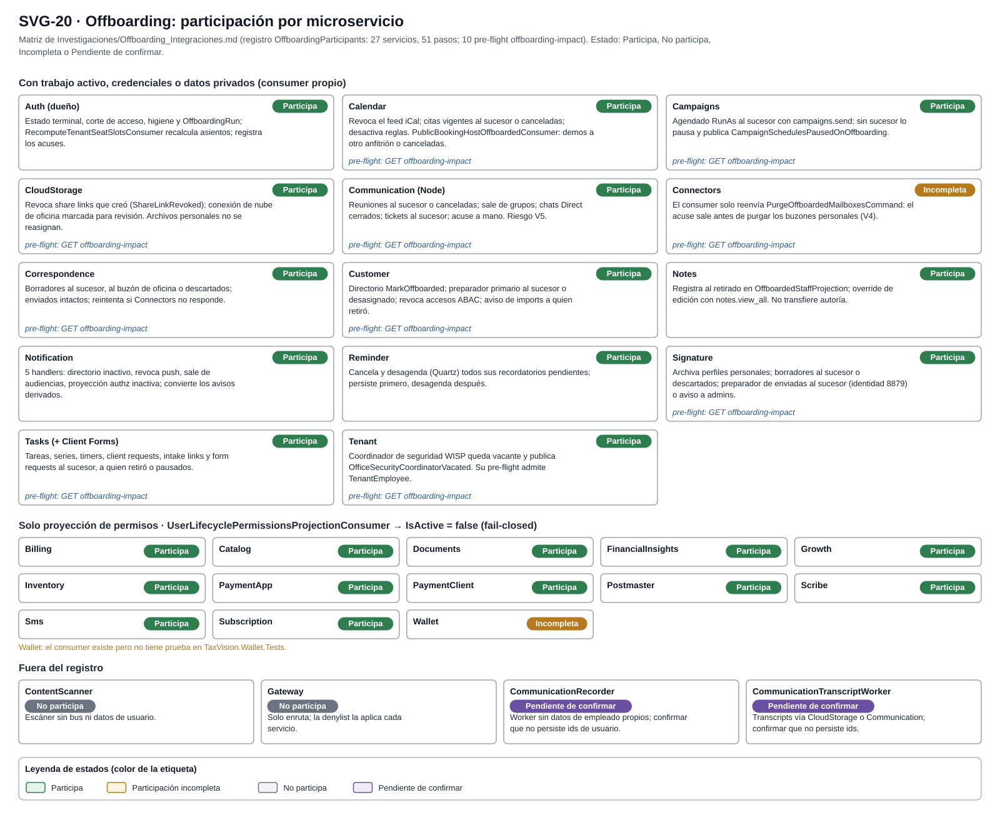

**Clasificación de referencias (`[UserReference(Kind, HandledBy, Via, Note)]`):**

| Kind | Qué se hace | `HandledBy` |
|---|---|---|
| `Provenance` | **No se toca** (autoría, auditoría, cadena HMAC, identidad 8879, `CreatedByUserId`, runs enviados) | no |
| `ActiveWork` | Al sucesor validado localmente; sin sucesor: desasignar, pausar, cancelar con aviso, pasar a quien retiró o rutar a la oficina | obligatorio |
| `Credential` | Revocar y purgar (tokens OAuth, feed iCal, share links, push) | obligatorio |
| `Private` | Cancelar o archivar (recordatorios, preferencias, perfiles de firma) | obligatorio |
| `Projection` | Marcar inactiva | obligatorio |

Si la corrige otro servicio por evento derivado: `HandledBy = "Servicio:Clase"` + `Via = "EventoA|EventoB"`. Falso positivo: agregar a `NotUserReferences` con el porqué.

**Diferencias que hay que tener claras:**

| Operación | Reversible | Qué hace | Evento |
|---|---|---|---|
| Desactivar (suspender) | Sí | `IsActive=false`, corte de acceso | `UserDeactivatedIntegrationEvent` |
| **Retirar (offboard)** | **No** | Todo lo anterior + MFA, invitaciones, avatar, `OffboardingRun` | `UserOffboardedIntegrationEvent` (Auth no emite además `UserDeactivated`) |
| Anonimizar | — | **No implementado** (plan futuro) | — |
| Borrar usuario | — | **Prohibido / no existe** | — |
| Re-invitar al mismo email | — | Cuenta nueva; el Guid viejo queda como registro | — |

**Regla retiro ⊇ suspensión:** todo servicio que maneja `UserDeactivated` debe manejar `UserOffboarded` (lo exige `Every_service_that_handles_suspension_also_handles_offboarding`).

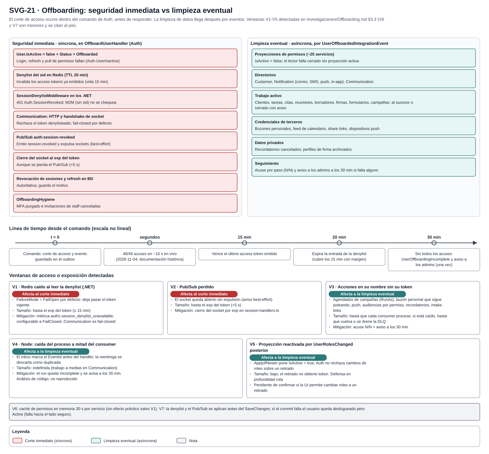

**Seguridad inmediata vs limpieza eventual.** Al instante: `IsActive=false` (login/refresh/pull de permisos fallan), denylist del `sid` (TTL 20 min), middleware de denylist en los .NET (401), Communication fail-closed, Pub/Sub de expulsión de sockets, cierre de sockets al `exp`, revocación en BD, MFA purgado. Eventual: proyecciones, directorios, trabajo activo, credenciales de terceros, avisos privados.

**Ventanas de acceso indebido conocidas (V1–V8):**

| # | Ventana | Tamaño | Mitigación |
|---|---|---|---|
| V1 | Redis caído al chequear denylist en .NET (`FailOpen`) | ≤ 15 min | Métrica; configurable a `FailClosed` |
| V2 | Pub/Sub perdido: socket abierto | hasta `exp` + 5 s | Cierre por `exp` |
| V3 | Acciones "en su nombre" sin su token (agendados de campañas, buzón que polea, push, recordatorios, intake links) mientras un consumer no corre | segundos; indefinido si un consumer está caído | Acuse N/N + aviso a 30 min |
| V4 | Connectors acusa al **reenviar** el comando de purga, no al purgar | indefinida si la purga muere en la DLQ | Alerta de DLQ |
| V5 | Node: caída a mitad del consumer deja el `EventId` marcado y el paso no acusa | indefinida | Run `Incomplete` + aviso |
| V6 | `UserRolesChanged` posterior reactiva la proyección (`ApplyIfNewer` → `IsActive=true`) | bajo (sin token posible) | Reconciliador de Auth solo republica activos |
| V7 | Caché de permisos 30 s | ≤ 30 s | Token ya denylisteado |
| V8 | Denylist y Pub/Sub antes del `SaveChanges` | falla hacia seguridad | El admin reintenta |

#### Implementación actual en TaxVision
- Registro: `src/Services/Auth/Application/Offboarding/OffboardingParticipants.cs:25-143` (27 servicios, 51 pasos). Pre-flight: 10 rutas `offboarding-impact` con `users.manage` (Calendar, Campaigns, CloudStorage, Communication, Connectors, Correspondence, Customer, Signature, Tasks, Tenant); descubrible en `GET /auth/offboarding/participants`.
- Consumidor transversal en 25 servicios: `UserLifecyclePermissionsProjectionConsumer` (patrón `Billing.Application/Permissions/Consumers/UserLifecyclePermissionsProjectionConsumer.cs:15-70`).
- Matriz resumida (detalle en [Offboarding_Integraciones](Investigaciones/Offboarding_Integraciones.md)):

| Servicio | Acción principal | Estado |
|---|---|---|
| Auth | Estado terminal, corte, higiene, run, recálculo de asientos | Participa |
| Calendar | Revoca feed iCal, reasigna o cancela citas, quita de demos públicas | Participa |
| Campaigns | Agendados al sucesor (`campaigns.send`) o pausa con aviso | Participa |
| CloudStorage | Revoca share links; conexión de oficina **a revisión** (no se corta a ciegas) | Participa |
| Communication (Node) | Reuniones, grupos, chats, tickets, grabaciones; acuse a mano | Participa (riesgo V5) |
| Connectors | Purga buzones personales; buzones de oficina a revisión | **Participación incompleta** (V4) |
| Correspondence | Borradores al sucesor o se descartan | Participa |
| Customer | Preparador → sucesor o desasigna; revoca accesos; snapshot de asignaciones | Participa |
| Notes | Registra retirado; override de edición para `notes.view_all` | Participa |
| Notification | Directorio inactivo, revoca push, sale de audiencias; avisos a admins | Participa |
| Reminder | Cancela y desagenda sus pendientes | Participa |
| Signature | Archiva perfiles; borradores/preparador al sucesor o aviso | Participa (D-2 pendiente) |
| Tasks (+ Client Forms) | Tareas, series, timers, avisos, intake links, form requests | Participa |
| Tenant | Coordinador WISP queda vacante + aviso | Participa |
| Billing, Catalog, Documents, FinancialInsights, Growth, Inventory, PaymentApp, PaymentClient, Postmaster, Scribe, Sms, Subscription | Proyección de permisos inactiva | Participa |
| Wallet | Proyección inactiva | **Participación incompleta** (sin prueba del consumer) |
| ContentScanner, Gateway | Sin datos de empleado | No participa |
| Recorder, TranscriptWorker | Workers | No participa (pendiente confirmar que no persisten ids) |

#### Cómo integrarlo en un servicio nuevo (15 pasos)
1. **Inventario de referencias**: toda propiedad `Guid`/`Guid?` persistida que encaje con el patrón del fitness (`*UserId`, `*By`, `*ByActorId`, `ActorId`, `SenderId`, `Owner*Id`, `Assigned*Id`, `Assignee*Id`, `Responsible*Id`, `Host*Id`, `Organizer*Id`, `Preparer*Id`, `RunAs*Id`, `Successor*Id`, `Coordinator*Id`, `Caller*Id`, `Callee*Id`, `Agent*Id`, `Invitee*Id`, `Author*Id`; excluye los que terminan en `Tenant|File|Customer|PortalUser|Participant|Signer|Session|Version|Template|Message|Folder` + `Id`). En Node: campos del `schema.prisma`.
2. **Clasificar** cada una con `[UserReference(...)]` (Prisma: `/// @userReference(Kind, handledBy: …, note: "…")`).
3. **¿Participa?** Solo `Provenance` y sin proyección de permisos → no participa (no se registra). Con proyección de permisos → al menos `UserLifecyclePermissionsProjectionConsumer`. Con `ActiveWork|Credential|Private` → consumer propio **y** pre-flight.
4. **Invariantes**: quién puede heredar (activo, mismo tenant, permiso que exige la acción), qué pasa sin sucesor, qué es historial intocable.
5. **Usar el evento existente** `UserOffboardedIntegrationEvent` (campos: `TenantId`, `UserId`, `SuccessorUserId?`, `OffboardedByUserId?`, `RemovedAtUtc`, `OccurredOn`, `CorrelationId`, `Email` solo si de verdad identificas por email). No inventes otro. Retiro ⊇ suspensión.
6. **Consumer** `public static class <Recurso>UserOffboardedConsumer` con `Handle(UserOffboardedIntegrationEvent msg, …)` en `Application/.../Consumers`; `correlation.Push(msg.CorrelationId ?? EventId)`; sucesor revalidado localmente; lotes con keyset por `Id`; guardar antes de publicar derivados. Un consumer por responsabilidad (cada uno acusa por separado).
7. **Eventos derivados** propios en `BuildingBlocks/Messaging/<Svc>IntegrationEvents/` con `[MessageIdentity]` y `PublishMessage<T>()`; nunca un campo `required` nuevo en un evento vivo.
8. **Wolverine**: `UseTaxVisionRabbitMq` (enciende el acuse), outbox, transacciones, `ApplyStandardFailurePolicies`, cola enlazada, `IntegrationEventTenantMiddleware`. Si el consumer solo **reenvía** un comando local, el acuse sale antes del trabajo: evítalo o registra como paso el handler que trabaja.
9. **Idempotencia por estado**: consultas que solo devuelven lo que todavía apunta al retirado; operaciones sin efecto si ya están hechas. Todos los handlers del mensaje en un servicio corren en una cadena: si uno falla, los demás se repiten.
10. **Histórico**: no tocar `Provenance`, auditoría, documentos firmados, cadenas HMAC, runs enviados.
11. **Orden y duplicados**: no asumir orden; para proyecciones con estado, `OccurredOn` o versión.
12. **Fallos**: dependencia caída → lanzar (Wolverine reintenta 1 s/5 s/15 s y DLQ); llamadas irreversibles a proveedores después del commit y best-effort.
13. **Registro y pre-flight**: entrada `new(...)` con literales en `OffboardingParticipants.cs` (el test lo lee del fuente); si hay `ActiveWork|Credential|Private`, `GET /<svc>/offboarding-impact/{userId}` con `[HasPermission(UserManagementPermissions.UsersManage)]`, `[AllowActorTypes]`, `[RateLimit]`; si identificas por email, `POST` con `{ "email" }` en el cuerpo (**nunca PII en la URL**) y `AcceptsEmail: true`. Texto opcional en el CRM (`offboard-impact.service.ts`).
14. **Pruebas del servicio**: con sucesor; sin sucesor; sucesor inválido (otro tenant, inactivo, sin permiso); reentrega no repite efectos ni avisos; historial intacto; conteo del pre-flight; proyección inactiva; consultas EF nuevas con prueba de traducción en `.Integration.`. Y los tres fitness de `TaxVision.BuildingBlocks.Tests/Offboarding/`.
15. **Verificación de punta a punta (manual)**: sembrar trabajo del empleado, retirarlo desde el CRM, comprobar N/N en "Handover status" y que el recurso quedó en el sucesor/cerrado; revisar DLQ y logs `Offboarding step ... rejected` / `has no offboarding run`. (El E2E automatizado fue descartado por el dueño.)

#### Archivos involucrados
Entidades de Domain (atributos), `Application/<Feature>/Consumers/*UserOffboardedConsumer.cs`, `Api/Controllers/*` (pre-flight), `src/Services/Auth/Application/Offboarding/OffboardingParticipants.cs`, contratos derivados, `src/BuildingBlocks/Domain/UserReferenceAttribute.cs`, `deploy/tests/TaxVision.BuildingBlocks.Tests/Offboarding/*`.

#### Ejemplo técnico
```csharp
// Anotación de una proyección (FinancialInsights AccessProjections.cs:12)
[UserReference(UserReferenceKind.Projection, HandledBy = "UserLifecyclePermissionsProjectionConsumer")]
public Guid UserId { get; private set; }
```
```csharp
// Forma de un consumer de trabajo activo (patrón de los consumers reales)
public static class TasksUserOffboardedConsumer
{
    public static async Task Handle(UserOffboardedIntegrationEvent msg, /* repos, uow, bus, correlation */ CancellationToken ct)
    {
        using (correlation.Push(msg.CorrelationId ?? msg.EventId.ToString()))
        {
            // 1. revalidar sucesor localmente (activo, mismo tenant, permiso de la acción)
            // 2. por lotes (keyset por Id): lo que aún apunta al retirado → sucesor o fallback con aviso
            // 3. guardar; después publicar eventos derivados
        }
    }
}
```

#### Integraciones
Auth (dueño, run, acuses), Session denylist, proyecciones de permisos, Notification + Scribe (avisos), CRM (diálogo y Handover status), RabbitMQ (fanout y DLQ).

#### Errores históricos
- **Entrada de FinancialInsights dejó el gate rojo** por contratos de offboarding (referencias sin anotar).
- **P-1 Connectors** acusa al reenviar, no al purgar (V4).
- **P-2 Inbox de Node** sin recuperación ante caída (V5).
- **P-3** `ApplyIfNewer` reactiva proyecciones y Auth acepta cambios de roles sobre un retirado (V6).
- **P-4** Sin re-ejecución del handover: la única vía es la DLQ.
- **P-6** Aviso de incompleto una sola vez, sin escalado.
- **P-7** El `Email` viaja en el evento y queda en outbox/inbox de todos los servicios.
- Wallet sin prueba de su consumer de permisos.

#### Pruebas
Existentes (Auth): `OffboardUserHandlerPathsTests`, `UserManagementCommandsTests`, `UserLifecycleTests`, `OffboardingRunTrackingTests` (16), `OffboardedEmailReuseTests`, `LastAdminGuardConcurrencyIntegrationTests`. Fitness obligatorios (BuildingBlocks): `UserReferenceContractTests` (12 casos), `OffboardingParticipantsContractTests` (7, incluye `The_registry_lists_exactly_the_real_offboarding_consumers`), `OffboardingStepAcknowledgementPolicyTests`. Huecos conocidos: 403 por actor en el endpoint de retiro, carrera de dos retiros, "token viejo → 401" y "socket expulsado" a nivel de integración, `UserRolesChanged` posterior, consumer de Wallet.

#### Checklist
- [ ] Todas las referencias anotadas (`[UserReference]` / `@userReference`).
- [ ] Decisión documentada: participa / no participa (con justificación).
- [ ] Consumer idempotente, sin orden asumido, sucesor revalidado, fallback con aviso.
- [ ] Retiro ⊇ suspensión.
- [ ] Paso(s) en `OffboardingParticipants`; `ImpactPath` si corresponde.
- [ ] Pre-flight con `users.manage`, sin PII en la URL.
- [ ] El acuse refleja trabajo terminado (no un reenvío).
- [ ] Pruebas del servicio + 3 fitness verdes.
- [ ] Verificación manual en "Handover status" (N/N).
- [ ] Ventanas del servicio documentadas (qué sigue pasando "en nombre" del retirado hasta que el consumer corre).

---

<a id="cap-17"></a>
## 17. Módulos, planes, add-ons, entitlements y gates

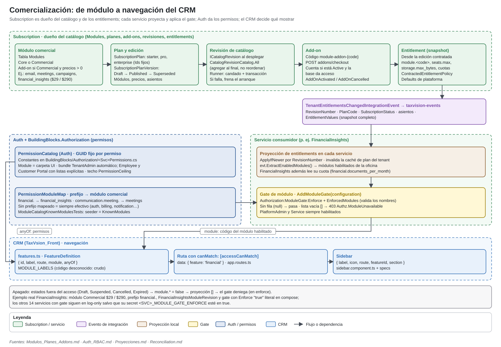

Investigaciones: [Modulos_Planes_Addons](Investigaciones/Modulos_Planes_Addons.md), [Auth_RBAC](Investigaciones/Auth_RBAC.md) §1.8. Checklist: [Checklists/Modulos_Planes.md](Checklists/Modulos_Planes.md).

#### Qué es
La cadena que convierte "esta oficina pagó X" en "este endpoint responde": módulo comercial → plan/edición → entitlements → proyección en cada servicio → gate de módulo en cada request → front.

#### Por qué existe
FinancialInsights entró **sin ser vendible**: sin plan, sin precio de add-on, permisos excluidos del bundle del admin (nadie veía el menú), módulo insertado con SQL crudo, cuota fija en `appsettings`, landing sin tocar. Un módulo nuevo **siempre** requiere código en tres capas a la vez (permisos+gate, catálogo+revisión, front).

#### Cómo funciona
| Pieza | Dueño | Dónde |
|---|---|---|
| Módulo (`customers`, `signatures`, `documents`, `planner`, `email`, `meetings`, `comms`, `campaigns`, `wallet`, `financial_insights`) | Subscription, tabla `Modules` | `Subscription.Domain/Catalog/Module.cs`; seeder `SubscriptionModuleCatalogSeeder.cs` |
| Categoría `Core` / `Commercial`; vendible si `Commercial` y ambos precios > 0 | Subscription | `ModuleCategory.cs`, `Module.cs:17-18` |
| Plan (`starter`, `pro`, `enterprise`) y edición (Draft → Published → Superseded/Archived) | Subscription | `PlanCatalog.cs`, `SubscriptionPlanVersion` |
| Revisión de catálogo (se aplica una vez al desplegar) | Subscription | `ICatalogRevision`, `CatalogRevisionCatalog.All`, `CatalogRevisionRunner`, tabla `CatalogRevisions` |
| Entitlements (snapshot desde la **edición contratada**) | Subscription | `ContractedEntitlementPolicy`, `EntitlementKeyCatalog`, `TenantEntitlementsChangedIntegrationEvent` |
| Permiso → módulo | BuildingBlocks | `src/BuildingBlocks/Authorization/PermissionModuleMap.cs` |
| Gate en cada request | BuildingBlocks + config por servicio | `ModuleGateSettings`, `ModuleGateRegistration`, `TenantModuleEntitlementsSource` |
| Front | CRM `features.ts`, portal, landing | `TaxVsion_Front/src/app/core/access/features.ts` |

- **Mapa** (el primero que calza gana; `communication.meeting.` va **antes** de `communication.`): `customers.`→customers, `financial.`→financial_insights, `signature.`→signatures, `documents.`/`cloudstorage.`/`scribe.`→documents, `calendar.`/`reminders.`/`tasks.`/`notes.`→planner, `correspondence.`/`connectors.`/`postmaster.`/`email.`→email, `communication.meeting.`→meetings, `communication.`/`comms.`→comms, `campaigns.`→campaigns, `wallet.`→wallet. Exentos: `communication.notification.read`, `communication.support.open`, `communication.support.agent`. Sin módulo = **siempre efectivo** (auth, billing, subscription, tenant, notification, sms, growth, catalog, inventory…).
- **Gate:** vive dentro de `PermissionPolicyProvider`, después de conceder el permiso. Config `Authorization:ModuleGate:Enforce` + `EnforcedModules` (lista vacía con `Enforce=true` = todos; nombre desconocido con enforce **revienta el arranque**). Semántica de la fuente: PlatformAdmin y Service siempre habilitados; sin tenant no gatea; **sin fila (`null`) → no gatea (fail-open)**; **lista vacía `[]` → deniega** (suscripción vencida). Lector con caché Redis 1 min (`null` no se cachea, `[]` sí). Un endpoint sin `[HasPermission]` **no pasa por el gate**.
- **Revisiones:** `CatalogRevisionRunner` con candado distribuido; cada revisión en su transacción con fila en `CatalogRevisions`; una aplicada no se repite; una que falla **frena el arranque** de Subscription. Orden actual: R1 rebaseline, R2 single enterprise (solo Enterprise a la venta, $99/$999, 3 asientos, 15 GB), R3 descripciones, R4 FinancialInsights, legacy editions. **No tomar el seeder como fuente de precios** (siembra precios viejos que R2 corrige en el mismo arranque).

#### Implementación actual en TaxVision
- 15 servicios con gate cableado (la fuente del conteo es la **prueba de fitness** `ModuleGateWiringFitnessTests.The_fourteen_gated_services_are_still_wired`, que afirma **15** pese a su nombre). 14 de ellos en compose con `${<SVC>_MODULE_GATE_ENFORCE:-false}` y lista literal; **FinancialInsights con `"true"` literal** (deniega desde el primer día).
- `ModuleCatalogKnownModulesTests` exige que los códigos del seeder sean exactamente `PermissionModuleMap.KnownModules`.

#### Cómo integrarlo en un servicio nuevo (módulo vendible)
0. **Decidir si se vende.** No comercializar si es transversal (notificaciones, soporte, usuarios, facturación propia), de plataforma (`PlatformOnly`, sin módulo), un worker interno, parte básica de todos los planes (módulo `Core`), algo que se cobra por consumo (primitiva propia como wallet top-up o asientos), o un permiso sin endpoint (`IsReserved`).
1. **Permisos**: constantes en `BuildingBlocks/Authorization/<Svc>Permissions.cs`.
2. **Prefijo → módulo** en `PermissionModuleMap.cs`, respetando "más específico primero".
3. **Catálogo de Auth** con GUID nuevo y migración `InsertData`; Employee/Portal en `SystemRoleDefaults`; Admin automático (sin `ExcludeFromAdminBundle` salvo motivo).
4. **Módulo en Subscription**: fila en `SubscriptionModuleCatalogSeeder.Definitions` (`Commercial(…, precio mensual, anual)`) para bases nuevas + migración idempotente `IF NOT EXISTS` para existentes.
5. **Revisión de catálogo** (precio por la ruta de dominio `MarkAsCommercial` + `SetAsAddon`, planes que lo incluyen, re-anclaje solo si el cliente "solo gana"), agregada **al final** de `CatalogRevisionCatalog.All`, Id `AAAA-MM-DD-<nombre>` nunca reutilizado. Si hay ediciones viejas con otros términos: revisión de ediciones heredadas. Incluirlo en `SubscriptionPlanCatalogSeeder`.
6. **Cuota como entitlement** (`<prefijo>.<clave>`) con default en `EntitlementKeyCatalog.PlatformDefaults`, nunca en `appsettings`.
7. **Servicio**: consumer de `TenantEntitlementsChangedIntegrationEvent` con `ApplyIfNewer` + invalidador de las dos cachés; reconciliación M2M al arrancar (pull de entitlements); `AddModuleGate`; `AddCachedTenantEntitlementModulesReader<T>()`; `[HasPermission]` en cada endpoint.
8. **Compose**: `Authorization__ModuleGate__Enforce` y `Authorization__ModuleGate__EnforcedModules__0: <módulo>` (lista **literal**, nunca variable). **Decisión pendiente:** modo inicial (secret `${VAR:-false}` como los 14 o `"true"` literal como FinancialInsights); si usa secret, agrégalo a `deploy.yml` y a `ModuleGateDeployWiringTests`.
9. **Frontends**: CRM `features.ts` (`FEATURES` + `MODULE_LABELS`), `app.routes.ts` (`canMatch: [accessCanMatch]`, `data: { feature }`), sidebar con `featureId`, `plan-picker-modal`, `access-view`, `role-visuals`; portal y landing (`module-labels.ts`, `MODULE_DESCRIPTIONS`). Mismo nombre visible en los tres.
10. **Actualizar el contador** de `ModuleGateWiringFitnessTests` (15 → 16) en el mismo cambio.
11. **Verificar**: migraciones aplicadas; fila en `CatalogRevisions`; log `Module gate registered: ENFORCING (modules: …)` o `log-only`; oficina con el módulo lo ve (menú y /account "Included in your plan"); sin el módulo → 403 y oferta de add-on.

#### Archivos involucrados
`PermissionModuleMap.cs`, `<Svc>Permissions.cs`, `PermissionCatalog.cs` + migración de Auth, `SubscriptionModuleCatalogSeeder.cs`, migración de Subscription, `Application/Catalog/Revisions/*Revision.cs`, `ICatalogRevision.cs` (`All`), `SubscriptionPlanCatalogSeeder.cs`, `EntitlementKeyCatalog.cs`, consumer y proyección del servicio, `Program.cs`, compose, `deploy.yml`, fitness del gate, archivos del CRM/portal/landing.

#### Ejemplo técnico
```csharp
// PermissionModuleMap.cs:51
("financial.", "financial_insights"),
```
```sql
-- Migración idempotente de Subscription (bases existentes)
IF NOT EXISTS (SELECT 1 FROM [Modules] WHERE [Code] = 'financial_insights')
    INSERT INTO [Modules] ([Id], [Code], [Name], [Description], [Category], [AddonPriceMonthlyUsd], [AddonPriceYearlyUsd])
    VALUES ('b2000000-0000-0000-0000-00000000000a', 'financial_insights', 'Financial Insights',
            'Bank statement imports and financial analysis.', 'Commercial', NULL, NULL);
```
```csharp
public sealed class FinancialInsightsModuleRevision : ICatalogRevision
{
    public const string ModuleCode = "financial_insights";
    public const decimal AddonMonthlyUsd = 29m;
    public const decimal AddonYearlyUsd = 290m;
    private static readonly string[] IncludedIn = ["enterprise", "pro"];
    public string Id => "2026-11-13-r4-financial-insights";
    // ApplyAsync: module.MarkAsCommercial(); module.SetAsAddon(29, 290);
    //             plan.ReviseModules(...); subscription.RebaselineVersion(...) solo si no pierde módulos
}
```
```csharp
// Cuota como entitlement (FinancialInsightsEntitlementCatalog.cs)
public const string DocumentsPerMonth = "financial.documents_per_month";
public static IReadOnlyCollection<EntitlementSeed> Defaults { get; } =
    [new(DocumentsPerMonth, EntitlementValueType.Int, 200.ToString(CultureInfo.InvariantCulture))];
```
```yaml
Authorization__PermissionsSource: Projection
Authorization__ModuleGate__Enforce: ${TUSERVICIO_MODULE_GATE_ENFORCE:-false}
Authorization__ModuleGate__EnforcedModules__0: tumodulo
```

#### Integraciones
Subscription, Auth (permisos, bundles, techo `PermissionCeiling`, `/auth/me/effective-access`), BuildingBlocks (mapa, gate, caché), cada servicio (proyección + gate), PaymentApp (cobro de add-ons), Communication Node (espejo de exenciones, `taxvision-catalog`), CRM/portal/landing.

#### Errores históricos
- FinancialInsights entró sin plan, sin precio, con `ExcludeFromAdminBundle`, módulo por SQL crudo, sin codegen Static, perfil compose que no se desplegaba, cuota fija de 10 documentos.
- Orden de prefijos: `communication.meeting.` después de `communication.` regalaría Meetings en todos los planes.
- Lista de módulos como variable en compose: secret vacío → enforce de **todos**.
- `Guia_Cablear_Modulo_Plan_Microservicio.md` describe `PlanModuleCatalog`, `ModuleAddOnCatalog`, `MinPlanTier`: **superado** (hoy manda la tabla `Modules` de Subscription; `MinPlanTier` y `PlanModules` de Auth se eliminaron).
- `Guia_Facturacion_AddOns.md` §9 lista precios y módulos que ya no existen.
- **Fail-open sin proyección**: un servicio nuevo con gate no tiene fila para los tenants existentes hasta que su plan cambie (Subscription no repara consumidores).
- `wallet` es módulo en el backend pero transversal en el CRM (Decisión pendiente).

#### Pruebas
Existentes: `ModuleCatalogKnownModulesTests`, `CatalogRevisionsTests`, `EntitlementKeyCatalogTests`, `GatedModuleFitnessTests` (Auth), `ModuleGateSettingsTests`, `ModuleGateWiringFitnessTests`, `ModuleGateDeployWiringTests`, `NoPlanNameLogicFitnessTests`, `TenantModuleEntitlementsSourceTests`. Módulo nuevo: seeder ↔ mapa; prueba del mapa (ningún prefijo existente lo tapa); revisión idempotente; consumer de entitlements + invalidador; gate con `Enforce=true` (403 sin módulo, 200 con módulo, `[]` deniega, sin fila pasa); contadores de fitness; bundles; specs del front.

#### Checklist
- [ ] Decisión "se vende / no se vende" escrita.
- [ ] Permisos + prefijo + catálogo de Auth + bundles.
- [ ] Módulo en seeder + migración idempotente + revisión al final de `All`.
- [ ] Cuota como entitlement con default.
- [ ] Proyección + invalidador + pull de entitlements + `AddModuleGate`.
- [ ] Compose con lista literal; modo inicial aprobado por el dueño.
- [ ] Contador de fitness actualizado.
- [ ] Front (CRM, portal, landing) con el mismo nombre.

---

<a id="cap-18"></a>
## 18. Rate limiting vs cuotas

Investigación: [RateLimit_Cuotas_Gates](Investigaciones/RateLimit_Cuotas_Gates.md).

#### Qué es
Siete mecanismos distintos que no hay que confundir:

| Mecanismo | Pregunta | Dónde | Respuesta | Ante fallo |
|---|---|---|---|---|
| Rate limit de seguridad (pre-auth) | ¿Esta IP martilla login/reset/registro? | Gateway `GatewayRateLimiting` | 429 | config por defecto |
| Load shedding | ¿La flota está saturada? | Gateway `LoadSheddingMiddleware` | 503 `LoadShedding.Active` | — |
| Rate limit tiered | ¿Este usuario/tenant excede su ritmo en este endpoint? | Servicio, `[RateLimit]` + Redis | 429 `RateLimit.Exceeded` | **fail-open** |
| Cuota por plan | ¿Cuánto ritmo le corresponde a su plan? | `PlanRateLimits` de Subscription | escala el número | cuota base |
| Gate de módulo | ¿Su plan incluye el módulo? | `PermissionPolicyProvider` | 403 `Authz.ModuleUnavailable` | sin fila → no gatea |
| Cuota de uso de negocio | ¿Le quedan unidades este mes? | Dominio del servicio (entitlement numérico) | `Result` de negocio | según servicio |
| Gate de asientos | ¿El usuario tiene asiento pagado? | Gateway `SeatSlotGateMiddleware` | 4xx en `Enforce` | registra fallo |

#### Por qué existe
Separar seguridad (IP en el borde), ritmo (Redis distribuido por tenant/usuario) y negocio (dominio). Confundirlos produce 429 donde debía haber un error de plan.

#### Cómo funciona
- **`[RateLimit("<svc>.<cat>.<slug>")]`** es un `IAsyncResourceFilter` (corre antes del model binding). Partición `Token` toma el route value `token` (rutas públicas con credencial en la URL); el resto necesita `tenant_id` y `sub`: **si faltan, deja pasar sin contar** (métrica `missing_claims`). Categoría M (dinero que sale) audita el 429. Respuesta con headers `X-RateLimit-Policy/Layer/Limit/Remaining/Reset`.
- **`[RateLimitExempt("razón")]`** para M2M interno, health, emisión de token.
- **Catálogo central** `RateLimitPolicyCatalog.Define(name, category, primaryPartition, overlayLayers, quota, windowSeconds, algorithm, overlayQuota)` (un `partial` por servicio). `GetByName` lanza `KeyNotFoundException` si el nombre no existe (→ 500). Particiones soportadas: `Tenant|User`, `User`, `Tenant`, `Token`; overlay solo `[Tenant]`; otra combinación → `NotSupportedException`.
- **Taxonomía A..Q**: A–E pre-auth/público/webhook, F–L tenant (F lectura, G escritura, H listados, I bulk, J cómputo caro…), M money-out, N reveal, O sockets, P health, Q load shedder. Solo F..O escalan por plan.
- **Cuotas por plan**: `RateLimitQuotaResolver` + `ITenantPlanCodeReader` (proyección local, caché Redis 5 min) + `HttpPlanRateLimitReader` (catálogo `GET internal/plan-rate-limits` por M2M, caché 5 min, último bueno 24 h, back-off 30 s). Se activa con `RateLimit:EnforceTierQuotas=true` registrando los lectores **antes** de `AddTieredRateLimiting()`.

#### Implementación actual en TaxVision
26/26 servicios con tiered rate limit; `EnforceTierQuotas` heterogéneo en compose (variable, `"true"` literal, `"false"` literal; Decisión pendiente). Gateway: `PreAuthByIp` 30/60 s por IP+path para login, MFA, password, confirmación de correo, invitaciones, `POST /tenants` y comandos públicos de Calendar.

#### Cómo integrarlo en un servicio nuevo
1. Define las políticas en `src/BuildingBlocks/RateLimiting/Catalog/RateLimitPolicyCatalog.<Svc>.cs`.
2. Endpoint humano: partición `Tenant|User` + overlay `Tenant`, categoría según el árbol.
3. Endpoint público con credencial en la ruta: partición `Token` y parámetro de ruta `token`; si es sensible, regla en `PreAuthByIp` del Gateway ([cap. 26](#cap-26)).
4. Endpoint M2M: `[RateLimitExempt("M2M interno …")]`.
5. `Program.cs`: `AddTaxVisionRedis`, `IRateCounter → RedisRateCounter`, lectores de plan bajo `EnforceTierQuotas`, `AddTieredRateLimiting()`.
6. `EnforceTierQuotas=true` **solo** cuando existen la proyección de plan y el acquirer M2M.
7. Límite de unidades = entitlement numérico aplicado en el dominio con `Result`, **nunca** con el rate limiter; período anclado al inicio de la suscripción en la zona de la oficina.

#### Archivos involucrados
`RateLimitPolicyCatalog.<Svc>.cs`, `Program.cs`, `Infrastructure/DependencyInjection.cs` (lectores, invalidador), compose (`RateLimit__EnforceTierQuotas`, `SubscriptionClient__BaseUrl`, `ConnectionStrings__Redis`).

#### Ejemplo técnico
```csharp
// RateLimitPolicyCatalog.FinancialInsights.cs
public static readonly RateLimitPolicyDefinition FinancialImportBatchCreate = Define(
    "financial.i.import_batch_create",
    RateLimitCategory.I,
    RateLimitPartitionDimension.Tenant | RateLimitPartitionDimension.User,
    [RateLimitPartitionDimension.Tenant],
    quota: 60,
    windowSeconds: 600,
    RateLimitAlgorithm.FixedWindow,
    overlayQuota: 600
);
```
```csharp
// FinancialInsights Program.cs:61-72
builder.Services.AddTaxVisionRedis(
    builder.Configuration.GetConnectionString("Redis")
        ?? throw new InvalidOperationException("ConnectionStrings:Redis is missing."));
builder.Services.AddSingleton<IRateCounter, RedisRateCounter>();
if (builder.Configuration.GetValue<bool>("RateLimit:EnforceTierQuotas"))
{
    builder.Services.AddSingleton<ITenantPlanCodeReader, ScopedTenantPlanCodeReader>();
    builder.Services.AddSingleton<IPlanRateLimitReader, ScopedPlanRateLimitReader>();
}
builder.Services.AddTieredRateLimiting();
```

#### Integraciones
Redis, Subscription (`PlanRateLimits`, `internal/plan-rate-limits`), proyección de plan, M2M, Gateway.

#### Errores históricos
- `[RateLimit]` en endpoint anónimo sin partición `Token` no limita nada (declarar una partición no la implementa).
- El grant M2M (`POST /auth/service-token`) no usa `[RateLimit]` ni `PreAuthByIp`: el Gateway no lo publica y su freno es de dominio (`IServiceClientThrottler`, por dirección), igual que el login con `ILoginThrottler`. Un endpoint anónimo nuevo que deba quedar dentro de la red se agrega al guard del Gateway, no se "protege" con un límite.
- Política inexistente → 500 en runtime.
- Servicio nuevo sin proyección de plan → cuota base para todos (429 prematuros a tenants grandes).

#### Pruebas
Existentes: `RateLimitFitnessFunctionsTests`, `RateLimitPolicyCatalogTests`, `RateLimitQuotaResolverTests`, `TieredRateLimitEvaluatorTests`, `HttpPlanRateLimitReaderTests`, FI `FinancialInsightsRateLimitPolicyTests` (`Policies_have_the_agreed_quotas`). Servicio nuevo: fitness de controllers (`[RateLimit]`/`[RateLimitExempt]`, nombre existente, política propia); cuotas acordadas; T-INT con Redis real (exceder → 429 con `Retry-After`); cuota de negocio N+1 → error de dominio.

#### Checklist
- [ ] Políticas en el catálogo con categoría y partición correctas.
- [ ] Cada acción con `[RateLimit]` o `[RateLimitExempt("razón")]`.
- [ ] `EnforceTierQuotas` solo con proyección de plan y M2M.
- [ ] Cuotas de negocio en el dominio, no en el limitador.

---

<a id="cap-19"></a>
## 19. Wolverine y RabbitMQ

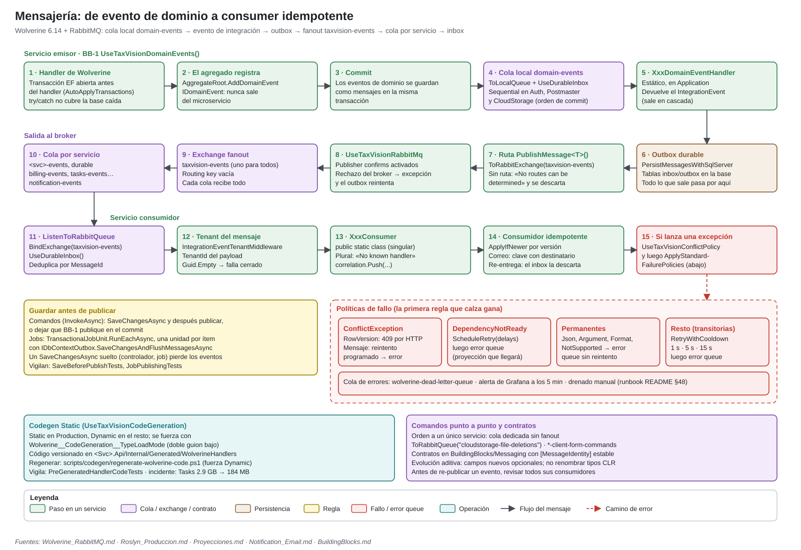

Investigación: [Wolverine_RabbitMQ](Investigaciones/Wolverine_RabbitMQ.md).

#### Qué es
El bus de mensajes de la flota: Wolverine 6.14 (handlers, outbox/inbox durable en SQL Server, transacciones EF) sobre RabbitMQ.

#### Por qué existe
Comunicar hechos entre bounded contexts sin acoplamiento temporal, con entrega "al menos una vez" y consumidores idempotentes.

#### Cómo funciona
- **Topología:** un exchange fanout **`taxvision-events`**; una cola durable por servicio `<svc>-events` enlazada con routing key vacía y `UseDurableInbox()`. Cada servicio recibe todos los eventos y Wolverine invoca solo los que tienen handler. **Los servicios nuevos publican siempre a `taxvision-events`.** Los exchanges dedicados `taxvision-catalog` (Subscription → Communication) y `taxvision-catalog-items` (Catalog) son **excepciones existentes**; uno nuevo es Requiere aprobación. Comandos punto a punto a un único destino: `ToRabbitQueue(...)` (`cloudstorage-file-deletions`, `*-client-form-commands`).
- **Sin ruta, se descarta:** un evento sin `options.PublishMessage<T>().ToRabbitExchange("taxvision-events")` se descarta en silencio ("No routes can be determined for Envelope…" en el log del emisor).
- **Transporte:** `options.UseTaxVisionRabbitMq(uri)` = `UseRabbitMq(uri).AutoProvision()` + confirmaciones del publicador (un canal cerrado por 403 hacía que el outbox borrara la fila "como enviada") + acuse automático de offboarding.
- **Pila estándar:** `PersistMessagesWithSqlServer`, `UseDurableOutboxOnAllSendingEndpoints`, `UseEntityFrameworkCoreTransactions().WithDbContextAbstraction<IUnitOfWork, XDbContext>()` + `AutoApplyTransactions`, `UseTaxVisionConflictPolicy()` **antes** de `ApplyStandardFailurePolicies()`.
- **Fallos:** `DependencyNotReadyException` → reintento programado y luego error queue; permanentes (`JsonException`, `ArgumentException`, `FormatException`, `NotSupportedException`) → error queue sin reintento; resto → 1 s, 5 s, 15 s → DLQ (`wolverine-dead-letter-queue`). `InvalidOperationException`, `NullReferenceException` y `KeyNotFoundException` son transitorias a propósito (la proyección puede no haber llegado).
- **Guardar antes de publicar:** en handlers con `InvokeAsync`, `SaveChangesAsync` y después `PublishAsync` (o que BB-1 publique en el commit). En jobs, `TransactionalJobUnit.RunEachAsync` (una unidad por ítem con transacción + outbox).
- **Eventos de dominio (BB-1):** `UseTaxVisionDomainEvents()` saca los `IDomainEvent` de los agregados rastreados al confirmar la transacción y los guarda en la cola local durable `domain-events`; un `XxxDomainEventHandler` estático **devuelve** el evento de integración (cascada por el outbox). Requisitos: `AddDbContext` normal (no `AddDbContextWithWolverineIntegration`), `Ignore(x => x.DomainEvents)`, y solo se despacha dentro de un handler de Wolverine o con `IDbContextOutbox.SaveChangesAndFlushMessagesAsync` (un `SaveChangesAsync` suelto pierde los eventos). Quita la publicación manual o el evento sale dos veces.
- **Colas locales durables (BB-2):** `UseTaxVisionDurableLocalQueues()`.
- **Identidad:** `[MessageIdentity]` obligatorio en todo contrato (BB-4). Contratos nuevos con alias `<servicio>.<entidad>.<evento>.v1`; los viejos conservan su nombre CLR completo. Nunca cambiar una identidad existente (rompe mensajes en vuelo, outbox, DLQ y a Node). Evolución solo aditiva (campos opcionales; nunca `required` nuevo en un evento vivo).
- **Nombres de handlers en singular** (`XxxConsumer`, `XxxHandler`): con sufijo plural Wolverine no los descubre.
- **Cuándo EDA y cuándo M2M:** hecho sin respuesta → evento; dato ajeno en cada request → proyección local; rellenar proyección o eventos perdidos → M2M en reconciliación; consulta síncrona que no admite retraso → M2M directo; orden a un único servicio → cola dedicada.

#### Implementación actual en TaxVision
294 líneas `PublishMessage<T>().ToRabbitExchange("taxvision-events")`; `UseTaxVisionRabbitMq` en 27 Program.cs; BB-1 en 17 servicios; BB-2 en 19; 341 contratos con `[MessageIdentity]` (285 nombre CLR, 54 `.v1`); 8 eventos de PaymentClient sin ruta en `KnownUnroutedPendingOwner` (pendiente del dueño).

#### Cómo integrarlo en un servicio nuevo
1. Contrato en `src/BuildingBlocks/Messaging/<Svc>IntegrationEvents/` heredando `IntegrationEvent`, con `[MessageIdentity("<svc>.<entidad>.<evento>.v1")]`.
2. `PublishMessage<T>().ToRabbitExchange("taxvision-events")` en el `Program.cs` emisor, **en el mismo cambio**.
3. Cola `ListenToRabbitQueue("<svc>-events", q => q.BindExchange("taxvision-events", string.Empty)).UseDurableInbox()`.
4. Middlewares `IntegrationEventTenantMiddleware` (para `IIntegrationEvent`) y `LocalCommandTenantMiddleware`.
5. **Recomendado:** activar BB-1 y BB-2 y heredar `DomainEventHandlerConventionRules` y `LocalQueueDurabilityRules` (Decisión pendiente: hacerlos obligatorios).
6. Consumers estáticos en singular, con `correlation.Push(...)` en la primera línea e idempotentes.
7. Si lo consume Node: mapa `CLR_TYPE_TO_EVENT_TYPE` en `consumer-runtime.ts` o lista de ignorados (eventos con alias `.v1` ya llegan con el alias en `type`).
8. Regenerar codegen de emisor y receptor ([cap. 20](#cap-20)).
9. Diagnóstico: "No routes can be determined" en el emisor = falta `PublishMessage`; "No known handler" en el receptor = nadie lo maneja (normal si es de otro servicio; bug si el handler existe con nombre plural o fuera de `Discovery`).

#### Archivos involucrados
`Api/Program.cs`, `src/BuildingBlocks/Messaging/<Svc>IntegrationEvents/*.cs`, `Application/**/Consumers/*.cs`, `Application/**/DomainEvents/*.cs`, `src/Services/Communication/src/infrastructure/rabbit/consumer-runtime.ts` (si aplica).

#### Ejemplo técnico
```csharp
// FinancialInsights Program.cs:83-123 (recortado)
builder.Host.UseWolverine(options =>
{
    options.UseTaxVisionCodeGeneration(builder.Environment, builder.Configuration, typeof(Program).Assembly);
    options.Discovery.IncludeAssembly(typeof(AssemblyMarker).Assembly);
    options.ServiceLocationPolicy = ServiceLocationPolicy.AllowedButWarn;

    options.UseTaxVisionRabbitMq(rabbitUri);
    options.PersistMessagesWithSqlServer(sqlConn);
    options.Policies.UseDurableOutboxOnAllSendingEndpoints();
    options.UseEntityFrameworkCoreTransactions().WithDbContextAbstraction<IUnitOfWork, FinancialInsightsDbContext>();
    options.Policies.AutoApplyTransactions();

    options.UseTaxVisionConflictPolicy();
    options.ApplyStandardFailurePolicies();
    options.UseTaxVisionDomainEvents();

    // Publicados: sin ruta, Wolverine descarta el evento.
    options.PublishMessage<FinancialImportBatchCompletedIntegrationEvent>().ToRabbitExchange("taxvision-events");

    options.Policies.ForMessagesOfType<IIntegrationEvent>()
        .AddMiddleware(typeof(BuildingBlocks.Web.Tenancy.IntegrationEventTenantMiddleware));
    options.Policies.AddMiddleware(typeof(BuildingBlocks.Web.Tenancy.LocalCommandTenantMiddleware));

    options.ListenToRabbitQueue("financial-insights-events", queue => queue.BindExchange("taxvision-events", string.Empty))
        .UseDurableInbox();
});
```
```csharp
[MessageIdentity("financial.import_batch.completed.v1")]
public sealed record FinancialImportBatchCompletedIntegrationEvent : IntegrationEvent
{
    public Guid BatchId { get; init; }
    public Guid CustomerId { get; init; }
    public Guid CreatedByUserId { get; init; }
}

public static class ImportBatchCompletedDomainEventHandler
{
    public static FinancialImportBatchCompletedIntegrationEvent Handle(ImportBatchCompletedDomainEvent completed, Envelope envelope) =>
        new()
        {
            TenantId = completed.TenantId,
            OccurredOn = completed.CompletedAtUtc,
            CorrelationId = envelope.CorrelationId ?? string.Empty,
            BatchId = completed.BatchId,
        };
}
```
```csharp
// Job con una unidad por transacción (Auth PermissionsBackfillService.cs:73-80)
var summary = await TransactionalJobUnit.RunEachAsync<Guid, AuthDbContext>(
    scopeFactory, pending, RepublishAsync, logger, cancellationToken);
```

#### Integraciones
RabbitMQ, SQL Server (tablas `wolverine_*`), Communication Node (mismo fanout), todas las proyecciones, offboarding, notificaciones.

#### Errores históricos
- Evento sin ruta: demo pública 2026-11-13 (el correo "ya tienes una demo" nunca salió; 3 eventos de Calendar sin ruta); H-12: cuatro incidentes (CloudStorage, Auth, PaymentClient…).
- Publicar antes de guardar: T-8 Client Forms (dos `CustomerCreationFromFormRequested` por run).
- Handlers con sufijo plural (`CustomerEmailDirectoryConsumers`, `AuditChainAppenderConsumers` con 0 filas de auditoría): "No known handler".
- Sin confirmaciones del publicador: mensajes perdidos con canal cerrado por 403.
- `CatalogChangedIntegrationEvent` llenaba logs de "No known handler" en servicios que no lo manejan.
- La guía antigua y el libro: `UseRabbitMq(...).AutoProvision()` directo, `AddDbContextWithWolverineIntegration`, alias `.v1` en un docstring, exchange por servicio: **reemplazados**.
- Las pruebas de aplicación con `FakeMessageBus` pasan aunque falte la ruta (así se escapó E-16).

#### Pruebas
Existentes: `EventRoutingContractTests` (texto; no ve eventos en cascada), `IntegrationEventRoutingTests` (runtime, **solo Calendar**), `NodeInteropContractTests`, `HandlerNamingContractTests`, `HandlerTransactionContractTests`, `MessageIdentityTests`, `SaveBeforePublishTests`, `DomainEventHandlerConventionRules`, `LocalQueueDurabilityRules`. Servicio nuevo: copiar `IntegrationEventRoutingTests` de Calendar (rutas en runtime), `DomainEventHandlerConventionTests` (si emite eventos de dominio), `LocalQueueDurabilityTests`, T-APP por consumer (`ApplyIfNewer`), T-INT de atomicidad del outbox (patrón Wallet), `PreGeneratedHandlerCodeTests`.

#### Checklist
- [ ] Contrato con `[MessageIdentity]` `.v1` en `BuildingBlocks/Messaging`.
- [ ] `PublishMessage<T>()` a `taxvision-events` por cada evento.
- [ ] Cola `<svc>-events` enlazada + inbox durable + middlewares de tenant.
- [ ] Conflict policy antes de failure policies.
- [ ] Guardar antes de publicar; jobs con `TransactionalJobUnit`.
- [ ] Handlers en singular; `correlation.Push` primero.
- [ ] Prueba de rutas en runtime.

---

<a id="cap-20"></a>
## 20. Roslyn en producción y codegen Static

Investigación: [Roslyn_Produccion](Investigaciones/Roslyn_Produccion.md).

#### Qué es
El modo en que Wolverine carga sus handlers: **Static** (código C# pregenerado y versionado en `Internal/Generated` del Api) o **Dynamic** (compila con Roslyn dentro del proceso al primer uso).

#### Por qué existe
Incidente del 2026-11-13: Tasks llegó a 3,5 GB en producción. El heap .NET seguía en 50–130 MB: Wolverine en Dynamic compilaba cada handler con Roslyn al primer uso (+500/+900 MB por endpoint), y glibc retenía la memoria nativa. Tras desplegar Static: Tasks 184 MB (antes 2,9 GB), Auth 217 MB (antes 1,7 GB). Medición local: pico 1 479 MB (Dynamic) vs 333 MB (Static); primera apertura 1,5 s vs 0,15 s.

#### Cómo funciona
- `options.UseTaxVisionCodeGeneration(builder.Environment, builder.Configuration, typeof(Program).Assembly)` como **primera línea** de `UseWolverine`. Regla: si la clave `Wolverine:CodeGeneration:TypeLoadMode` (variable `Wolverine__CodeGeneration__TypeLoadMode`, **doble guion bajo**) está fijada, se usa; si no, `Static` solo en `Production` y `Dynamic` en el resto. El código generado vive en el **Api**.
- Compose: los 28 servicios con `ASPNETCORE_ENVIRONMENT: Production` → Static. Flota local: `start-fleet.ps1` fija Static.
- **Regeneración:** `scripts/codegen/regenerate-wolverine-code.ps1` (todos o `-Service <Svc>`) pone `TAXVISION_CODEGEN_WRITE=1` y **fuerza Dynamic** mientras regenera (en Static Wolverine solo descubre los handlers del registro existente: un handler nuevo quedaría fuera sin aviso), y corre la prueba de frescura del servicio, que reescribe `Internal/Generated`.
- `dotnet run -- codegen write/preview` **no sirve** en TaxVision: los servicios terminan en `app.Run()`, el argumento se ignora y el host arranca entero.
- Imágenes .NET con `ENV MALLOC_ARENA_MAX=2` (lo exige `DotnetImageMallocArenaTests`).
- Wolverine 6.14 **no valida al arrancar** que exista el código pregenerado: si falta el tipo de un handler, revienta el primer mensaje de ese tipo.

#### Implementación actual en TaxVision
26 servicios + MailboxListener con `UseTaxVisionCodeGeneration`; 26 `PreGeneratedHandlerCodeTests`; `WolverineFx.RuntimeCompilation` sigue referenciado (Roslyn en la imagen, no se usa en Static). **Ninguna prueba exige** que un `Program.cs` nuevo llame `UseTaxVisionCodeGeneration` ni que el servicio tenga su `PreGeneratedHandlerCodeTests` (hueco; Decisión pendiente).

#### Cómo integrarlo en un servicio nuevo
1. Primera línea de `UseWolverine`: `options.UseTaxVisionCodeGeneration(...)`.
2. Agregar `"<Svc>"` al arreglo `$all` de `scripts/codegen/regenerate-wolverine-code.ps1`.
3. Crear `Architecture/<Svc>RoutingHostFactory.cs` (host `Testing` sin infraestructura) y `Architecture/PreGeneratedHandlerCodeTests.cs` con las dos pruebas y la colección `DisableParallelization = true`.
4. Regenerar: `powershell -ExecutionPolicy Bypass -File scripts\codegen\regenerate-wolverine-code.ps1 -Service <Svc>`.
5. Verlas en rojo una vez (borrar un archivo de `Internal/Generated` o agregar un handler sin regenerar).
6. Dockerfile con `ENV MALLOC_ARENA_MAX=2` y `ENV TZ=Etc/UTC`.
7. **Cuándo regenerar:** al agregar/quitar/renombrar un handler o consumer, cambiar sus parámetros (servicios inyectados, `Envelope`, `CancellationToken`), agregar middleware/políticas (`AddMiddleware`, `UseTaxVisionDomainEvents`, `ListenForPlatformSettings`, `Discovery.IncludeType`) o cambiar la política de transacciones.
8. Probar en local en Static cuando tocas un handler: `$env:Wolverine__CodeGeneration__TypeLoadMode = "Static"`.
9. Tras el deploy: en el log, "code generation mode is Static" y "Using pre-generated Wolverine HandlerRegistry".

#### Archivos involucrados
`Api/Program.cs`, `Api/Internal/Generated/WolverineHandlers/*.cs` (CSharpier los ignora), `scripts/codegen/regenerate-wolverine-code.ps1`, `deploy/tests/TaxVision.<Svc>.Tests/Architecture/{<Svc>RoutingHostFactory,PreGeneratedHandlerCodeTests}.cs`, Dockerfile.

#### Ejemplo técnico
```csharp
// WolverineCodeGenerationExtensions.cs:37-44
var forced = configuration[TypeLoadModeKey];
if (!string.IsNullOrWhiteSpace(forced))
    return Enum.Parse<TypeLoadMode>(forced, ignoreCase: true);
return environment.IsProduction() ? TypeLoadMode.Static : TypeLoadMode.Dynamic;
```
```csharp
[CollectionDefinition(nameof(PreGeneratedHandlerCodeTests), DisableParallelization = true)]
public sealed class PreGeneratedHandlerCodeCollection;

[Collection(nameof(PreGeneratedHandlerCodeTests))]
public sealed class PreGeneratedHandlerCodeTests
{
    private const string ApiProject = "src/Services/<Svc>/TaxVision.<Svc>.Api";

    [Fact]
    public void Every_handler_loads_from_pre_generated_code_in_production()
    {
        using var factory = ProductionHost(_ => { });
        PreGeneratedCodeRules.AssertAllHandlersArePreGenerated(factory.Services, typeof(Program).Assembly);
    }

    [Fact]
    public void Pre_generated_code_matches_the_current_handlers()
    {
        var scratch = Path.Combine(Path.GetTempPath(), "<svc>-codegen-" + Guid.NewGuid().ToString("N"));
        try
        {
            using var factory = ProductionHost(options => options.CodeGeneration.GeneratedCodeOutputPath = scratch);
            PreGeneratedCodeRules.AssertGeneratedCodeIsCurrent(factory.Services, PreGeneratedCodeRules.GeneratedDirectory(ApiProject), scratch);
        }
        finally
        {
            if (Directory.Exists(scratch)) Directory.Delete(scratch, recursive: true);
        }
    }

    private static WebApplicationFactory<Program> ProductionHost(Action<WolverineOptions> configure) =>
        new <Svc>RoutingHostFactory().WithWebHostBuilder(builder =>
        {
            builder.UseEnvironment("Production");
            builder.UseSetting("Encryption:MasterKey", Convert.ToBase64String(RandomNumberGenerator.GetBytes(32)));
            builder.ConfigureTestServices(services => services.ConfigureWolverine(configure));
        });
}
```

#### Integraciones
Wolverine/JasperFx 6.14, compose (`ASPNETCORE_ENVIRONMENT`), `start-fleet.ps1`, Dockerfile, gate local.

#### Errores históricos
- RAM de Tasks 3,5 GB (Dynamic en producción).
- Variable con un solo guion bajo (`Wolverine_CodeGeneration_TypeLoadMode`) → queda en Dynamic en silencio.
- Script de codegen que antes corría en Static omitía handlers nuevos sin avisar (corregido: fuerza Dynamic).
- `codegen preview` arrancó el servicio entero (escuchó Rabbit y procesó pendientes).
- El informe del incidente decía "guardarraíl en el gate del CI": desde 2026-11-13 el CI no corre pruebas; **el gate local es la única barrera**.
- Memorias viejas que dicen "la codegen es Dynamic": desactualizadas.

#### Pruebas
`PreGeneratedHandlerCodeTests` (26 servicios), `PreGeneratedCodeRules`, `WolverineCodeGenerationExtensionsTests`, `DotnetImageMallocArenaTests`. Corren en el gate (el filtro no excluye `.Architecture.`).

#### Checklist
- [ ] `UseTaxVisionCodeGeneration` primera línea de `UseWolverine`.
- [ ] Servicio en `$all` del script.
- [ ] `<Svc>RoutingHostFactory` + `PreGeneratedHandlerCodeTests` vistos en rojo y luego verdes.
- [ ] `Internal/Generated` regenerado en el mismo cambio que el handler.
- [ ] `MALLOC_ARENA_MAX=2` en la imagen.

---

<a id="cap-21"></a>
## 21. Subdominios y resolución de tenant

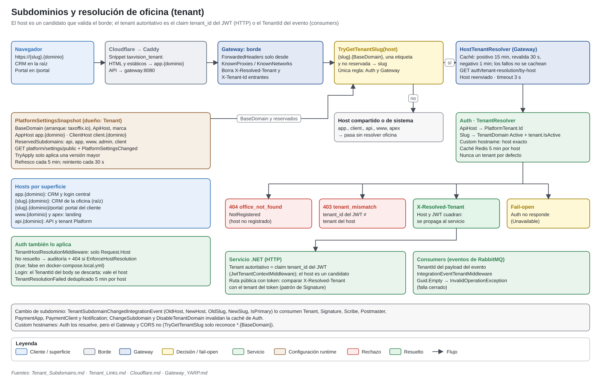

Investigación: [Tenant_Subdomains](Investigaciones/Tenant_Subdomains.md). Checklist: [Checklists/Tenant_Links.md](Checklists/Tenant_Links.md).

#### Qué es
Cómo un host (`{slug}.{dominio}`) se asocia a una oficina, y por qué un servicio de negocio **no** resuelve tenant por host.

#### Por qué existe
Cada oficina tiene su subdominio; el CRM se sirve en la raíz y el portal del cliente bajo `/portal`. El host es un **candidato**; el tenant autoritativo es el claim del JWT (HTTP) o el `TenantId` del evento (consumers).

#### Cómo funciona
| Capa | Componente | Qué hace | Si falla |
|---|---|---|---|
| Regla única de host | `PlatformSettingsSnapshot.TryGetTenantSlug` | `{slug}.{BaseDomain}` con una etiqueta y no reservada → slug | — |
| Dominio de la plataforma | Tenant `PlatformSettings` (`GET platform/settings/public`, `PlatformSettingsChangedIntegrationEvent`) | Marca, `BaseDomain`, `ApiHost`, correos | Cada servicio sigue con su versión vigente |
| Host → tenant | Auth, `TenantDomains` + `ITenantResolver` | Slug → dominio activo → tenant activo | 404 (enforced); nunca "tenant por defecto" |
| Borde | Gateway `TenantHostGuardMiddleware` | Host no registrado → 404; JWT de otra oficina → 403 `tenant_mismatch`; propaga `X-Resolved-Tenant` (borra el entrante) | **Fail-open** si Auth no responde |
| Servicio | `JwtTenantContextMiddleware` / `IntegrationEventTenantMiddleware` | Tenant del JWT o del evento | Sin claim → 0 filas |

Hosts: `app.{dominio}` (CRM y login central), `client.{dominio}` (portal), `www`/apex (landing), `api.{dominio}` (API y tenant Platform), oficina `{slug}.{dominio}`. Reservados: `api`, `app`, `www`, `admin`, `client`. Dominio por defecto de arranque `taxoffix.io` (runtime desde Tenant).

#### Implementación actual en TaxVision
- Auth lee solo `Request.Host` (nunca `X-Forwarded-Host` directo); audita cada host desconocido y publica `TenantResolutionFailedIntegrationEvent` deduplicado; caché 5 min invalidada por `ChangeSubdomain`/`DisableTenantDomain`; en local `EnforceHostResolution=false` (no copiar a otros ambientes).
- Gateway: caché positiva 15 min con revalidación a 30 s, negativa 1 min, timeout 3 s.
- Rename: `TenantSubdomainChangedIntegrationEvent` con 7 consumidores (Tenant, Signature, Scribe, Postmaster, PaymentApp, PaymentClient, Notification). Calendar cachea el host 30 min sin consumer.
- Defensa en profundidad en flujos anónimos: Signature compara `X-Resolved-Tenant` con el tenant del token (403 `tenant_host_mismatch`, tolerante sin header); Client Forms llama a `by-host` y **falla cerrado**.

#### Cómo integrarlo en un servicio nuevo
1. **No resuelvas tenant por host.** HTTP: `JwtTenantContextMiddleware` después de autenticación. Consumers: `IntegrationEventTenantMiddleware` + `LocalCommandTenantMiddleware`.
2. Si necesitas dominio o marca: `AddPlatformSettings(config)` + `options.ListenForPlatformSettings()` (van juntos) y `PlatformSettings__TenantBaseUrl` (ancla `x-platform-settings-env`).
3. "¿Es host de oficina?": `platform.Current.TryGetTenantSlug(host, out var slug)`; host de oficina: `platform.Current.TenantHost(slug)`. Nunca parsear sufijos a mano.
4. Ruta pública con token: copiar `PublicSignatureHostGuardMiddleware` (leer `X-Resolved-Tenant`, verificar token, comparar `TenantId`); el tenant de escritura sale **siempre del token**.
5. Nunca: leer `X-Forwarded-Host`, `X-Tenant-Id` o `X-Resolved-Tenant` sin pasar por el Gateway/ForwardedHeaders; aceptar `TenantId` del body; caer a un tenant por defecto.
6. Si cacheas hosts: consumir `TenantSubdomainChanged` y `PlatformSettingsChanged` para invalidar.

#### Archivos involucrados
`Program.cs` (middlewares, `AddPlatformSettings`), compose (ancla), middleware de guarda pública si aplica.

#### Ejemplo técnico
```csharp
builder.Services.AddPlatformSettings(builder.Configuration);
// dentro de UseWolverine:
options.ListenForPlatformSettings();
options.Policies.ForMessagesOfType<BuildingBlocks.Messaging.IIntegrationEvent>()
    .AddMiddleware(typeof(BuildingBlocks.Web.Tenancy.IntegrationEventTenantMiddleware));
options.Policies.AddMiddleware(typeof(BuildingBlocks.Web.Tenancy.LocalCommandTenantMiddleware));
```

#### Integraciones
Tenant (`PlatformSettings`), Auth (`TenantDomains`, `by-host`, `primary-host`), Gateway, Redis, RabbitMQ, Cloudflare (custom hostnames).

#### Errores históricos
- Memoria del 2026-10-13: `TenantSubdomainChanged` tenía "cero consumers" e `InvalidateAsync` nadie lo llamaba: **hoy corregido** (7 consumers).
- Fail-open del Gateway: si Auth no contesta, un JWT de la oficina A pasa por el host de B (los datos siguen aislados por el JWT).
- Custom hostnames fuera del guard del Gateway y de CORS (Auth sí los resuelve).

#### Pruebas
Existentes: `TenantHostGuardMiddlewareTests`, `HostTenantResolverTests`, `TenantResolverTests` (`Unknown_host_never_resolves_to_a_default_tenant`), `TenantHostResolutionMiddlewareTests` (`Spoofed_X_Forwarded_Host_header_is_ignored`), `PublicSignatureHostGuardMiddlewareTests`, `FormPublicTenantHostValidatorTests`, `PlatformSettingsProviderTests`. Servicio nuevo: JWT de A con datos de B → 0 filas/404; consumer con `TenantId = Guid.Empty` → falla cerrado; ruta pública host A + token B → 403; header de tenant enviado por el cliente → ignorado; token inválido → su error, no 403 enmascarado.

#### Checklist
- [ ] Tenant solo del JWT o del evento.
- [ ] `AddPlatformSettings` + `ListenForPlatformSettings` juntos si se necesita dominio.
- [ ] Rutas públicas con validación Host↔token.
- [ ] Ningún header de tenant leído sin sanear.

---

<a id="cap-22"></a>
## 22. Enlaces por oficina

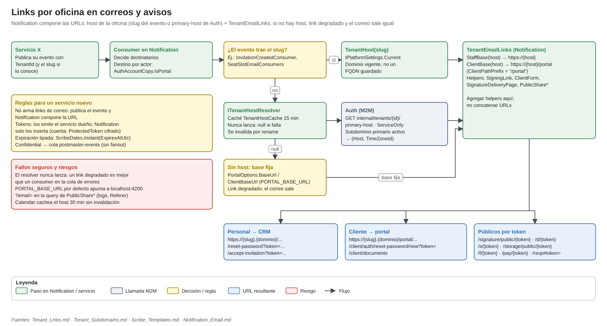

Investigación: [Tenant_Links](Investigaciones/Tenant_Links.md). Checklist: [Checklists/Tenant_Links.md](Checklists/Tenant_Links.md).

#### Qué es
Cómo se construyen las URLs que llegan a empleados y clientes (correos, push, respuestas de API) con el host de **su** oficina.

#### Por qué existe
Un link sin oficina (o con la oficina equivocada) rompe el login, el portal o un enlace público por token. Ningún consumer puede usar el host del request: no lo tiene.

#### Cómo funciona
| Forma | Dónde | Cuándo |
|---|---|---|
| Pull M2M `GET internal/tenants/{tenantId}/primary-host` (Auth) | `ITenantHostResolver` (Notification, Calendar) | Consumers sin slug en el evento |
| Slug en el evento + `IPlatformSettings.Current.TenantHost(slug)` | Notification, Auth, PaymentClient | El productor ya conoce el subdominio |
| Host del request | `PayablePublicUrls.UnavailableCheckoutUrl` | Último recurso documentado (link anulado) |
| Landing | `PlatformSettingsSnapshot.LandingUrl(path)` | Correos de cuenta/suscripción y demo pública |

Formas de URL (`TenantEmailLinks` de Notification): staff/CRM `https://{slug}.{dominio}`; cliente/portal `https://{slug}.{dominio}/portal`; públicas por token bajo el host de la oficina (`/signature/public/{token}`, `/d/{token}`, `/s/{token}`, `/storage/public/{token}`, `/f/{token}`, `/rsvp#token=...`, `/pay/{token}`). Sin host resuelto → base fija de config (`PortalOptions.BaseUrl`/`ClientBaseUrl`), link degradado, el correo sale igual. `primary-host` devuelve el host con el dominio **vigente** (no un FQDN guardado) y **no** devuelve custom hostnames.

#### Implementación actual en TaxVision
Notification cachea hosts 15 min e invalida por `TenantSubdomainChanged`/`PlatformSettingsChanged`; Calendar 30 min sin invalidación. Tokens los emite el servicio dueño (cifrados y ligados a tenant/usuario para cuenta); la expiración viaja tipada (`ScribeDates.Instant`); correos con token van `Confidential = true` (cola directa a Postmaster, no al fanout).

#### Cómo integrarlo en un servicio nuevo
1. **No armes links de correo en tu servicio**: publica el evento con `TenantId` (y slug si lo tienes); el consumer en Notification compone la URL con `ITenantHostResolver` + `TenantEmailLinks`.
2. Si tu API devuelve una URL pública: `platform.Current.TenantHost(slug)`; el host del request solo si no hay entidad de la que sacar el tenant.
3. Destino por actor: `CustomerPortal` → `ClientBase`; staff → `StaffBase`. Helpers nuevos en `TenantEmailLinks`, no concatenaciones.
4. Tokens con expiración emitidos por el dueño, ligados a tenant y destinatario; preferir fragmento (`#token=`) cuando la página lo lee en el cliente; **nunca correo en la query**.
5. Correos con token: `with { Confidential = true }`; expiración con `ScribeDates.Instant(expiresAtUtc)`, nunca texto con "UTC".

#### Archivos involucrados
`Notification.Application/Common/TenantEmailLinks.cs`, `PortalOptions.cs`, consumer en Notification, `PayablePublicUrls.cs` (patrón API).

#### Ejemplo técnico
```csharp
// En el consumer (Notification)
var host = await hosts.ResolveHostAsync(evt.TenantId, ct);           // null si no resolvió
var staffUrl  = $"{TenantEmailLinks.StaffBase(host, portal.Value)}/company/settings#compliance";
var clientUrl = TenantEmailLinks.ClientDocuments(host, portal.Value); // {host}/portal/client/documents

// Destino por actor (PasswordResetRequestedConsumer)
var link = AuthAccountCopy.IsPortal(evt.ActorType)
    ? $"{TenantEmailLinks.ClientBase(tenantHost, portal.Value)}/client/auth/reset-password/new?token={token}"
    : $"{TenantEmailLinks.StaffBase(tenantHost, portal.Value)}/reset-password?token={token}";
```

#### Integraciones
Auth (`primary-host`), Tenant (`PlatformSettings`), M2M, Notification, Scribe, Caddy (rutas públicas abiertas desde el navegador, [cap. 27](#cap-27)).

#### Errores históricos
- Fallback a `PORTAL_BASE_URL`, cuyo default en compose es `http://localhost:4200`: link a localhost en producción si falta la variable y Auth falla.
- `?email=` en links de share (va a logs de proxy y Referer).
- Dos modelos de portal (`client.{dominio}` como fallback vs `{slug}.{dominio}/portal` real): un fallback a `client.` pierde la oficina.
- Lógica de link repartida (Notification, PaymentClient, Auth, Calendar), sin pieza BB.

#### Pruebas
Existentes: `TenantEmailLinksTests`, `AuthAccountEmailsTests`, `PayablePublicUrlsTests`, `OfficeWispReviewDueConsumerTests`, `OAuthReturnRedirectPolicyTests`. Nuevas: oficina A → host A y B → host B en la misma prueba (`FakeTenantHostResolver`); cliente → `/portal/...`, empleado → raíz; sin host → base fija y log, nunca excepción; host del request manipulado no cambia el link; tras `TenantSubdomainChanged`, host nuevo.

#### Checklist
- [ ] Links compuestos en Notification (o con `TenantHost(slug)` en la API).
- [ ] Destino por actor correcto.
- [ ] Tokens del dueño, con expiración, sin PII en la URL.
- [ ] `Confidential = true` si hay token.

---

<a id="cap-23"></a>
## 23. Scribe: plantillas y render

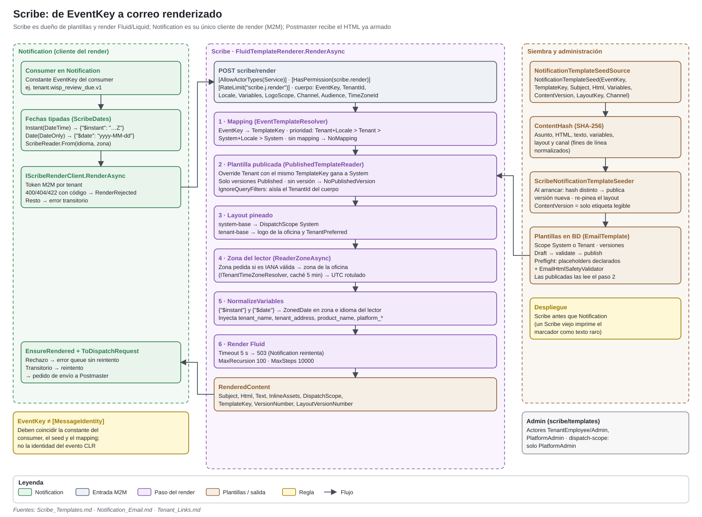

Investigación: [Scribe_Templates](Investigaciones/Scribe_Templates.md). Checklist: [Checklists/Notificaciones.md](Checklists/Notificaciones.md).

#### Qué es
El dueño de las plantillas (email y push) y del render Fluid/Liquid. Notification es su único cliente de render (M2M); Postmaster recibe el HTML ya armado.

#### Por qué existe
Marca, nombre de oficina, idioma, zona horaria y layout se resuelven en un solo lugar; ninguna plantilla sabe de zonas y ningún servicio de dominio escribe HTML de correo.

#### Cómo funciona
- **EventKey** (minúsculas con puntos, p. ej. `tenant.wisp_review_due.v1`, `^[a-z0-9]+(?:[._-][a-z0-9]+)*$`, máx. 200) → `EventTemplateMapping` → **TemplateKey** → `EmailTemplate` (`System` o `Tenant`) → versión `Published` pineada a un **layout** (`system-base` o `tenant-base`).
- **EventKey ≠ MessageIdentity.** Lo que debe coincidir es la constante del consumer, el seed y el mapping (ej.: identidad del evento `BuildingBlocks.Messaging.TenantIntegrationEvents.OfficeWispReviewDueIntegrationEvent`, EventKey `tenant.wisp_review_due.v1`).
- Override por oficina: plantilla/mapping `Tenant` gana sobre `System`. Idioma: Tenant+Locale > Tenant > System+Locale > System.
- **Fechas tipadas:** el emisor manda `{"$instant": "...Z"}` (`ScribeDates.Instant`) o `{"$date": "YYYY-MM-DD"}` (`ScribeDates.Date`); Scribe las imprime en la zona e idioma del lector (zona pedida si es IANA válida → zona de la oficina → UTC rotulado). Formato `Wed, Nov 18, 2026, 9:00 AM · New York time, GMT-5`.
- **Layout** decide logo y carril: `tenant-base` → logo de la oficina y `DispatchScope = TenantPreferred`; `system-base` → `System`.
- El renderer inyecta `tenant_name`, `tenant_address`, `product_name`, `platform_legal_name`, `platform_website`, `platform_support_email` (pisa lo que mande el caller).
- **Plantillas de sistema en código** (`NotificationTemplateSeedSource`); el seeder las **republica por hash de contenido** (`ContentHash` = SHA-256 de asunto, HTML, texto, variables, layout y canal). `ContentVersion` es solo etiqueta legible (sigue siendo convención subirla y las pruebas por plantilla la exigen).
- Endpoint `POST scribe/render` (`[AllowActorTypes(Service)]`, `scribe.render`, `scribe.j.render`); timeout 5 s → 503 (Notification reintenta). Preflight de publicación: todo placeholder declarado + HTML seguro.

#### Implementación actual en TaxVision
Seeders `ScribeNotificationTemplateSeeder`, `ScribeBaseLayoutSeeder`; plantillas en inglés por defecto (algunas bilingües); administración por API (`scribe/templates`, `scribe/event-mappings`, `scribe/layouts`).

#### Cómo integrarlo en un servicio nuevo
1. Entrada `NotificationTemplateSeed` en `NotificationTemplateSeedSource` con `EventKey`, `TemplateKey`, `Subject`, `Html`, variables declaradas con tipo y descripción, `ContentVersion` explícito y mayor que el último usado, `LayoutKey` según quién habla (`system-base` plataforma, `tenant-base` oficina). Agregarla a `All`.
2. Toda fecha con `ScribeDates.Instant`/`ScribeDates.Date`; nunca "UTC" escrito ni formato propio.
3. Audiencia explícita (`ScribeRenderAudience.Client` para clientes/portal/externos) y `ScribeReader.From(idioma, zona)` cuando se conoce al lector.
4. Prueba "declara todas sus variables y lleva su versión" y render de cada rama.
5. **Orden de despliegue:** Scribe antes que Notification cuando se agregan plantillas o variables tipadas (un Scribe viejo imprimiría el marcador como texto).
6. Alternativa sin deploy (plantilla administrada): `POST scribe/templates` → `POST .../versions` → `.../validate` → `.../publish` → `POST scribe/event-mappings`.

#### Archivos involucrados
`src/Services/Scribe/TaxVision.Scribe.Application/Templates/Seed/NotificationTemplateSeedSource*.cs`, consumer en Notification, `deploy/tests/TaxVision.Scribe.Tests/Templates/Seed/*`.

#### Ejemplo técnico
```csharp
private static NotificationTemplateSeed WispReviewDue { get; } =
    new(
        EventKey: "tenant.wisp_review_due.v1",
        TemplateKey: "tenant.wisp_review_due.v1",
        Name: "Tenant — WISP annual review due",
        Subject: "Your security plan review is overdueYour security plan review is due {{ due_date }}",
        Html: """ ... <a href="{{ settings_url }}">Open Compliance settings</a> ... {{ product_name }} ... """,
        Variables:
        [
            ("is_overdue", VariableType.Bool, true, "false", "true when the review date already passed."),
            ("due_date", VariableType.String, true, null, "Review due date, already formatted (en-US)."),
            ("settings_url", VariableType.Url, true, null, "Office settings → Compliance in the office CRM."),
            ("product_name", VariableType.String, false, "TaxOffix", "Lo inyecta el renderer desde PlatformSettings."),
        ],
        ContentVersion: 23
    );
```
```csharp
var render = (await scribe.RenderAsync(EmailEventKey, tenantId,
        new Dictionary<string, object?> { ["due_at"] = ScribeDates.Instant(dueAtUtc), ["link"] = url },
        ScribeRenderAudience.Client, ct))
    .EnsureRendered(EmailEventKey);
```

#### Integraciones
Notification (cliente), CloudStorage (HTML y logos), Tenant (perfil, logo, `PlatformSettings`, zona vía `TenantTimeZones`), Auth (token M2M y `scribe.render`).

#### Errores históricos
- Memoria y guía de notificaciones decían que sin subir `ContentVersion` no se republica: **hoy republica por hash** (prueba `Changed_html_without_bumping_content_version_is_republished`).
- La guía decía que el `event_key` debía ser idéntico a `[MessageIdentity]`: **incorrecto**.
- Override de oficina sin versión publicada → `NoPublishedVersion` (no cae a la de sistema; Decisión pendiente).
- Consumers que mandan fechas ya formateadas en inglés (no respetan idioma).

#### Pruebas
Existentes: `NotificationTemplateSeedSourceTests`, `ScribeNotificationTemplateSeederTests`, `TypedDateTemplatesTests`, `ZonedDateTests`, `EventTemplateResolverTests`, Notification `ScribeRenderFailureTests`. Nuevas: variables declaradas y versión; cada rama renderiza; fecha tipada sin "UTC" en oficina A (Nueva York) y B (Los Ángeles); `Audience = Client`; override de A no afecta a B; sin mapping → cola de errores; 5xx → reintento.

#### Checklist
- [ ] Seed con variables declaradas, `ContentVersion` y layout correcto.
- [ ] Fechas tipadas.
- [ ] EventKey del consumer = seed = mapping.
- [ ] Scribe desplegado antes que Notification.

---

<a id="cap-24"></a>
## 24. Notification: email, SMS, in-app y push

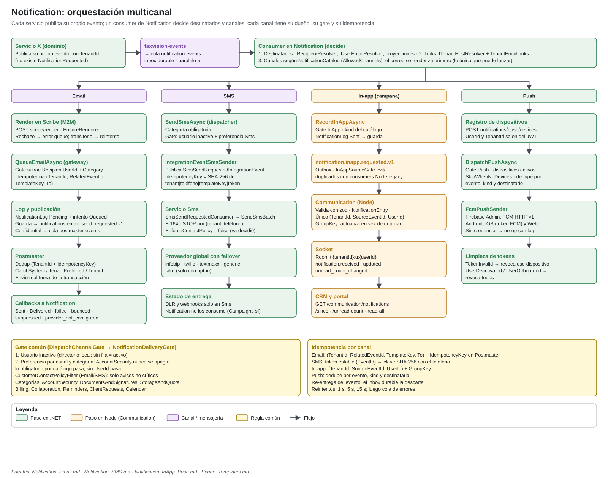

Investigaciones: [Notification_Email](Investigaciones/Notification_Email.md), [Notification_SMS](Investigaciones/Notification_SMS.md), [Notification_InApp_Push](Investigaciones/Notification_InApp_Push.md). Checklist: [Checklists/Notificaciones.md](Checklists/Notificaciones.md).

#### Qué es
El orquestador de avisos: decide destinatarios, canales y textos a partir de eventos de dominio. No existe un evento genérico "NotificationRequested".

#### Por qué existe
Que preferencias, inactividad, idempotencia, plantillas, enlaces por oficina y estado de entrega se apliquen igual para todo aviso, y que ningún servicio llame a Postmaster, Sms o FCM directamente.

#### Cómo funciona
```
Servicio X ──evento──► Notification (consumer)
   1. destinatarios (IRecipientResolver / proyecciones)
   2. links por oficina (ITenantHostResolver + TenantEmailLinks)
   3. render (POST scribe/render, M2M) — primero y una sola vez
   4. por destinatario: correo, campana, push, SMS
```

| Canal | Responsable | Entrada | Preferencias | Idempotencia | Estado real |
|---|---|---|---|---|---|
| Email | Notification + Scribe + Postmaster | `IEmailDispatchGateway.QueueEmailAsync` → `notifications.email_send_requested.v1` | Gate **solo** si `RecipientUserId` + `Category`; contact policy del cliente a mano | `(TenantId, RelatedEventId, TemplateKey, To)` + clave `{eventId:N}:{to}` en Postmaster | Callbacks Sent/Delivered/Failed/Bounced/Suppressed |
| SMS | Notification + servicio Sms | `NotificationDispatcher.SendSmsAsync` → `SmsSendRequestedIntegrationEvent` | Gate por `recipientUserId`; contact policy a mano; STOP en Sms | Token estable (`EventId`) → SHA-256 con teléfono | Solo en Sms (Notification marca "Sent" al publicar) |
| In-app | Notification + Communication | `RecordInAppAsync` + `InAppNotificationRequest` → `notification.inapp.requested.v1` | Gate siempre | `(TenantId, SourceEventId, UserId)` + `GroupKey` | Node; "Sent" = publicado |
| Push | Notification + FCM | `SendPushAsync` con `PushDispatchRequest` | Gate siempre | evento/kind/destinatario | Log por envío; `TokenInvalid` revoca |

- Categorías: `AccountSecurity` (nunca se apaga), `DocumentsAndSignatures`, `StorageAndQuota`, `Billing`, `Collaboration`, `Reminders`, `ClientRequests`, `Calendar`.
- Catálogo único de kinds (`NotificationKinds` + `NotificationCatalog`): categoría, prioridad, canales permitidos, obligatorio, `ResourceType`, `Action`, `TitleKey/BodyKey`.
- Correos con token: `Confidential = true` → cola directa a Postmaster.
- SMS: el proveedor es **global** de la plataforma con failover; el envío transaccional no se cobra al Wallet; `POST sms/messages` es el envío manual del CRM (cobra y exige `sms.send`), **no** se usa desde servicios.
- Push: registro de dispositivos por API (`UserId`/`TenantId` del JWT); revocación al suspender/retirar.

#### Implementación actual en TaxVision
Consumer de referencia: `OfficeWispReviewDueConsumer` (correo + campana + push). `notification-events` con `MaximumParallelMessages(5)`. Retención de logs 12 meses. Push implementado (Firebase Admin, `Notification:UseFcmPush`).

#### Cómo integrarlo en un servicio nuevo
1. Tu servicio **solo publica su evento** (con `TenantId`, `EventId` estable, IDs y fechas UTC; sin PII innecesaria) con `[MessageIdentity]` y `PublishMessage<T>()`.
2. Consumer en `Notification/Application/Consumers/`: render del correo **primero y una vez** (es lo único que puede lanzar; así un reintento no repite campana ni push) con `EnsureRendered` (nunca `if (IsFailure) return`).
3. Email staff: `ToDispatchRequest(...) with { RecipientUserId, Category }` (+ `NotificationKind` si difiere del template). `RelatedEventId = evt.EventId` siempre; no pases `IdempotencyKey` propio salvo que incluya el destinatario.
4. Clientes: `CustomerContactPolicyFilter` solo en avisos no críticos; lo transaccional (OTP, invitación a firmar) sale siempre.
5. SMS: `dispatcher.SendSmsAsync(..., relatedEventId: evt.EventId, recipientUserId: staffId?, idempotencyToken: estable si el texto lleva un secreto)`; validar E.164 antes.
6. In-app: `SourceEventId = evt.EventId`, `GroupKey` si el aviso se repite, `ResourceId/ResourceContext` en vez de URL.
7. Push: `SkipWhenNoDevices = true` para lo no crítico; `Data` con `kind/resourceType/resourceId`; `Link` con `TenantEmailLinks`.
8. Kind en `NotificationKinds` + `NotificationCatalog` (la prueba de arquitectura lo exige) y textos `TitleKey/BodyKey` en el front.
9. Plantilla en Scribe ([cap. 23](#cap-23)).

#### Archivos involucrados
Contrato del evento, `Notification.Application/Consumers/<Feature>Consumer.cs`, `NotificationKinds.cs`, `NotificationCatalog.cs`, seed de Scribe, `notification-i18n` del front.

#### Ejemplo técnico
```csharp
// Correo (forma real de OfficeWispReviewDueConsumer)
var render = (await scribe.RenderAsync(EmailEventKey, evt.TenantId, variables, ct)).EnsureRendered(EmailEventKey);
foreach (var (userId, address) in addresses)
    await gateway.QueueEmailAsync(
        render.ToDispatchRequest(evt.TenantId, address, EmailEventKey, evt.EventId, correlation.CorrelationId)
            with { RecipientUserId = userId, Category = NotificationCategory.Collaboration },
        ct);
```
```csharp
// Campana
await dispatcher.RecordInAppAsync(
    evt.OfficeTenantId, NotificationRecipient.ForUser(userId), notice.Title, Category,
    NotificationKinds.TenantWispReviewDue, evt.EventId, correlation.CorrelationId,
    recipientUserId: userId,
    inApp: new InAppNotificationRequest(
        NotificationKinds.TenantWispReviewDue, userId, evt.EventId, "tenant.office_wisp_review_due.v1",
        evt.OccurredOn, notice.Title, FallbackBody: notice.Body,
        ResourceId: evt.OfficeTenantId.ToString(),
        ResourceContext: new Dictionary<string, string> { ["section"] = "compliance" },
        GroupKey: $"tenant.wisp_review_due:{evt.OfficeTenantId:N}:{evt.DueOn:yyyyMMdd}:{evt.Stage}"),
    ct: ct);
```
```csharp
// SMS
await dispatcher.SendSmsAsync(
    tenantId: evt.TenantId, phoneNumber: phone, text: body,
    category: NotificationCategory.DocumentsAndSignatures, templateKey: "orders.shipped.sms",
    relatedEventId: evt.EventId, correlationId: correlation.CorrelationId,
    recipientUserId: staffUserId, idempotencyToken: null, ct: ct);
```

#### Integraciones
Scribe, Postmaster, Sms, Communication (in-app), Firebase (push), Auth (`primary-host`, directorio, M2M), Customer (política de contacto), offboarding (revocación de push, directorio inactivo).

#### Errores históricos
- Memoria "el gate de preferencias no cubre email": hoy lo aplica, pero **solo** si el consumer pasa `RecipientUserId` + `Category` (opt-in).
- Clave de idempotencia sin destinatario colapsó un fan-out (hoy corregido; un `IdempotencyKey` propio sin destinatario lo reintroduce).
- `RelatedEventId` nulo → clave nueva en cada reintento (sin idempotencia real).
- SMS suprimido por STOP o con E.164 inválido queda "Sent" en Notification.
- Logout no revoca push; el mismo dispositivo puede quedar activo en dos oficinas.
- Flags espejo de la fuente in-app (Node vs Notification) desalineados → duplicado o silencio.
- `deploy.yml` comenta que `NOTIFICATION_USE_FCM_PUSH` es `false` por defecto; el compose dice `true`.

#### Pruebas
Existentes: `EventBasedEmailDispatchGatewayTests`, `NotificationDispatcherSmsTests`, `IntegrationEventSmsSenderTests`, `NotificationDispatcherInAppTests`, `NotificationDispatcherPushTests`, `NotificationDispatcherInactiveRecipientTests`, `UserLifecyclePushDeviceConsumerTests`, `NotificationCatalogArchitectureTests`, `ScribeRenderFailureTests`. Consumer nuevo: fan-out a 2 → 2 correos; reintento → 0 nuevos; preferencia apagada → `Suppressed`, obligatoria → sale; inactivo → nada; oficina A/B → link y logo propios; cliente → portal y `Audience = Client`; Scribe 5xx → reintento, 404 con código → error queue; `TenantId` vacío → falla cerrado; kind en catálogo; `GroupKey` repetido actualiza.

#### Checklist
- [ ] El servicio solo publica su evento.
- [ ] Render primero, `EnsureRendered`.
- [ ] `RelatedEventId = evt.EventId`; `RecipientUserId + Category` para staff.
- [ ] Contact policy solo en lo no crítico.
- [ ] `Confidential` si hay token.
- [ ] Kind en catálogo + textos del front.
- [ ] Plantilla en Scribe.

---

<a id="cap-25"></a>
## 25. Zonas horarias

Investigaciones: [BuildingBlocks](Investigaciones/BuildingBlocks.md) (TimeZones, TenantTimeZones), [Migraciones](Investigaciones/Migraciones.md) (UTC), [Scribe_Templates](Investigaciones/Scribe_Templates.md) (fechas tipadas), [Reconciliation](Investigaciones/Reconciliation.md), [Guardrails](Referencias/Guardrails.md) GC-TZ.

#### Qué es
Las reglas para guardar, calcular y mostrar fechas cuando cada oficina tiene su propia zona IANA.

#### Por qué existe
Vencimientos civiles guardados como medianoche UTC, pipes de fecha que no aplicaban la zona de la oficina y textos con "UTC" fueron hallazgos de la auditoría de zonas. El proceso corre en UTC; **la zona de negocio es la de la oficina**.

#### Cómo funciona
- **Almacenamiento:** todo instante en UTC; `modelBuilder.UseUtcDateTimes()` al final de `OnModelCreating` (todo `DateTime` se lee con `Kind=Utc`); fechas civiles como `DateOnly` (no `DateTime`).
- **Contenedores:** `ENV TZ=Etc/UTC` en la imagen y `TZ: Etc/UTC` en compose (lo exige `ContainerUtcTimeZoneDeployTests`); Prisma con `SYSUTCDATETIME()`.
- **Arranque:** `AddTimeZoneSelfCheck()` comprueba `America/New_York` y `Asia/Tokyo` e informa si la globalización es invariante (nunca detiene el arranque).
- **Cálculo:** tipos del núcleo `IanaTimeZone`, `CivilDate`, `LocalDay`, `WallTime`, `ResolvedTimeZone`, `MonthlyUsagePeriod`, `ZonedTimeFormatter`; nada de aritmética de offsets a mano. Jobs técnicos en UTC; jobs de negocio en la zona del dueño del dato.
- **Zona de la oficina:** kit `TenantTimeZones` (proyección local desde `TenantCreated`/`TenantUpdated`, resolver con caché 5 min, `Forget` al cambiar, reconciliación 12 h con `ReconciliationRetry`). `TenantTimeZoneChangedIntegrationEvent` es aditivo y **no** alimenta la proyección.
- **Presentación en correos:** fechas tipadas (`ScribeDates.Instant`/`Date`); Scribe formatea en la zona e idioma del lector.

#### Implementación actual en TaxVision
Kit en 12 servicios; `UseUtcDateTimes` en 23 de 26 DbContext (Calendar, Signature y Tasks con conversor propio, sin `UtcDateTimesTests`; Decisión pendiente). Guardarraíles: `TimeZoneInfraFitnessTests`, `ContainerUtcTimeZoneDeployTests`, `TenantTimeZoneReconciliationDeployTests`.

#### Cómo integrarlo en un servicio nuevo
1. `UseUtcDateTimes()` y `UtcDateTimesTests`.
2. `DateOnly` para fechas civiles; `TimeProvider` para "ahora".
3. Si calcula vencimientos o formatea en zona de oficina: referencia `BuildingBlocks.TenantTimeZones`, `AddTenantTimeZoneProjection<TDbContext>()`, `AddTenantTimeZoneReconciliation<TTokenProvider>(config)`, `modelBuilder.ApplyTenantTimeZoneProjection()`, `Discovery.IncludeType(typeof(TenantTimeZoneProjectionConsumer))`, migración, URL de Tenant en compose.
4. Cuotas mensuales ancladas al inicio de la suscripción en la zona de la oficina (`MonthlyUsagePeriod`).
5. Correos con fechas tipadas; nunca "UTC" escrito.
6. `TZ=Etc/UTC` en imagen y compose; `AddTimeZoneSelfCheck()` en `Program.cs`.

#### Archivos involucrados
`<Svc>DbContext.cs`, `DependencyInjection.cs`, `Program.cs`, Dockerfile, compose, migración de la proyección, consumers de Notification.

#### Ejemplo técnico
```csharp
// Customer DependencyInjection.cs:174-175 y CustomerDbContext.cs:99,106
services.AddTenantTimeZoneProjection<CustomerDbContext>();
services.AddTenantTimeZoneReconciliation<Reconciliation.CustomerTenantTimeZoneTokenProvider>(config);
modelBuilder.ApplyTenantTimeZoneProjection();
// …
modelBuilder.UseUtcDateTimes();
// Program.cs (UseWolverine)
options.Discovery.IncludeType(typeof(BuildingBlocks.TenantTimeZones.TenantTimeZoneProjectionConsumer));
```
```yaml
TZ: Etc/UTC
TenantTimeZones__Reconciliation__TenantBaseUrl: http://tenant-api:8080
```

#### Integraciones
Tenant (fuente de la zona), Scribe (formato), reconciliación, rate limit/cuotas (período mensual).

#### Errores históricos
- Vencimientos civiles como medianoche UTC y pipe de fecha sin zona (auditoría TZ, CRM y portal).
- Pruebas de zona en Windows: Git Bash no pasa `TZ` (verde falso); usar PowerShell.
- Reconciliación de zona contra `localhost` dentro del contenedor (sin URL en compose).
- Carrera posible (inferida, no reproducida) entre la lectura de la página y un `TenantUpdated` más nuevo en `TenantTimeZoneReconciler`.

#### Pruebas
`UtcDateTimesTests`, `TenantTimeZoneProjectionTests`, `TenantTimeZoneReconcilerTests`, `TimeZoneSelfCheckTests`, `CivilTimeTests`, `TypedDateTemplatesTests`. Nuevas: fecha en oficina de Nueva York y de Los Ángeles; vencimiento civil inclusivo; período mensual en la zona de la oficina.

#### Checklist
- [ ] `UseUtcDateTimes()` + prueba.
- [ ] `DateOnly` para civiles; `TimeProvider` para ahora.
- [ ] Kit `TenantTimeZones` con migración y URL si calcula en zona de oficina.
- [ ] `TZ=Etc/UTC` en imagen y compose; `AddTimeZoneSelfCheck()`.
- [ ] Fechas tipadas en correos.

---

<a id="cap-26"></a>
## 26. Gateway YARP

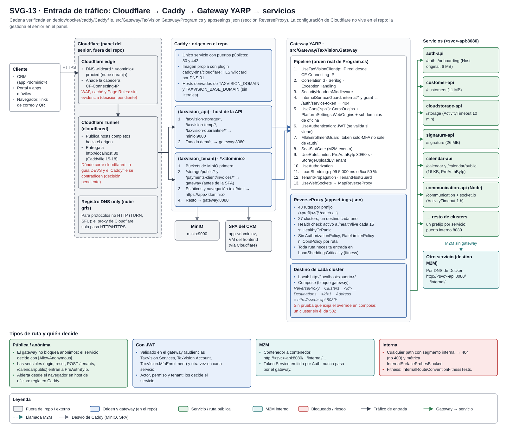

Investigación: [Gateway_YARP](Investigaciones/Gateway_YARP.md). Checklist: [Checklists/YARP_Cloudflare.md](Checklists/YARP_Cloudflare.md).

#### Qué es
La entrada única a los servicios (`src/Gateway/TaxVision.Gateway`, Yarp.ReverseProxy 2.3.0): rutas por prefijo, validación JWT, guardas transversales, rate limit pre-auth, load shedding.

#### Por qué existe
Un solo punto de entrada con CORS, IP real, MFA, asientos, host de oficina y superficie interna cerrada. La autorización fina (actor, permiso, tenant) la hace cada servicio.

#### Cómo funciona
- 43 rutas y 27 clusters (uno por servicio, un destino). Rutas `/<prefijo>/{**catch-all}`. En local los destinos son `http://localhost:<puerto>/`; en producción el compose los pisa con `ReverseProxy__Clusters__<id>__Destinations__<id>1__Address: http://<svc>-api:8080/`.
- Ninguna ruta declara `AuthorizationPolicy`, `RateLimiterPolicy`, `CorsPolicy` ni `Timeout`.
- Pipeline: `UseTaxVisionClientIp` → correlación/logs/excepciones → `SecurityHeadersMiddleware` → **`InternalSurfaceGuardMiddleware` (404 a cualquier path con segmento `internal` y al grant `/auth/service-token`)** → CORS → `UseAuthentication` → `MfaEnrollmentGuardMiddleware` → `SeatSlotGateMiddleware` → `UseRateLimiter` → `UseAuthorization` → `LoadSheddingMiddleware` → `TenantPropagationMiddleware` → `TenantHostGuardMiddleware` → `UseWebSockets()` → `MapReverseProxy()`.
- Health: cada cluster con check activo a `/health/live` cada 15 s (`ConsecutiveFailures`, umbral 3, `HealthyOrPanic`); `/health/ready` del gateway sin checks `ready` (200 si el proceso vive, decisión GW-06); `/health/dependencies` con estado `Degraded`.
- Rate limit del gateway: `PreAuthByIp` (30/60 s por IP+path) para rutas de login/MFA/password/invitaciones, `POST /tenants` y comandos públicos de Calendar; el resto `GetNoLimiter` (su cuota real la aplica el `[RateLimit]` de cada servicio).
- Load shedding: p99 5 000 ms, 5xx 50 %, ventana 60 s, mínimo 200 muestras; `Criticality` por primer segmento de ruta (`Critical`, `Standard`, `Background`); socket.io en pass-through.
- `MaxRequestBodySize` por ruta (p. ej. 64 KB financial, 16 KB calendar-public, 26 MB signature); `HttpRequest.ActivityTimeout` largo solo en cloudstorage, documents (10 min) y communication (1 h).

#### Implementación actual en TaxVision
`appsettings.json` del Gateway (1 079 líneas); bloque `gateway` en compose con overrides de destino y `depends_on`; `docker-compose.local.yml` repite la lista `!override`.

#### Cómo integrarlo en un servicio nuevo
1. Ruta(s) en `ReverseProxy:Routes` con un prefijo que no choque con otro ni con los buckets de MinIO (`/taxvision-storage`, `/taxvision-temp`, `/taxvision-quarantine`).
2. Cluster con el bloque de health check **idéntico** y destino `http://localhost:<puerto>/`.
3. **Entrada obligatoria en `LoadShedding:Criticality`** (lo exige `LoadSheddingCriticalityCoverageTests`).
4. Override en el bloque `gateway` del compose + el servicio en su `depends_on`; repetir en `docker-compose.local.yml` si corre en local.
5. Opcional: `MaxRequestBodySize` por ruta; `ActivityTimeout` si hay streaming o archivos largos.
6. Endpoint público con riesgo de abuso: regla en `GatewayRateLimiting:PreAuthByIp:Rules` y, si el cuerpo es pequeño, una ruta propia con tope.
7. **Nada bajo `internal`** en el Gateway: los M2M se llaman contenedor a contenedor.

#### Archivos involucrados
`src/Gateway/TaxVision.Gateway/appsettings.json`, `deploy/docker/docker-compose.yml` (bloque `gateway`), `deploy/docker/docker-compose.local.yml`.

#### Ejemplo técnico
```json
"ReverseProxy": {
  "Routes": {
    "<svc>": { "ClusterId": "<svc>", "Match": { "Path": "/<prefijo>/{**catch-all}" } }
  },
  "Clusters": {
    "<svc>": {
      "Destinations": { "<svc>1": { "Address": "http://localhost:<puerto>/" } },
      "HealthCheck": {
        "Active": { "Enabled": true, "Interval": "00:00:15", "Timeout": "00:00:05",
                    "Policy": "ConsecutiveFailures", "Path": "/health/live" },
        "Passive": { "Enabled": false }
      },
      "Metadata": { "ConsecutiveFailuresHealthPolicy.Threshold": "3" },
      "AvailableDestinationsPolicy": "HealthyOrPanic"
    }
  }
},
"LoadShedding": { "Criticality": { "<prefijo>": "Standard" } }
```
```yaml
      ReverseProxy__Clusters__<svc>__Destinations__<svc>1__Address: http://<svc>-api:8080/
    depends_on:
      - <svc>-api
```

#### Integraciones
Auth (cluster `auth` usado también por `HostTenantResolver`), Tenant (`PlatformSettings` para CORS), base de Auth (seat gate), compose, Caddy, Cloudflare (`CF-Connecting-IP`).

#### Errores históricos
- **Ruta sin override en compose** apunta a `localhost` dentro del contenedor → 502 descubierto en producción. **No hay prueba** que compare clusters de `appsettings.json` contra overrides del compose (Decisión pendiente).
- Sin `UseWebSockets()` antes de `MapReverseProxy()`, socket.io cae a long-polling y se rompe detrás de Cloudflare.
- Quitar el transform de `CF-Connecting-IP` vuelve a guardar la IP de Docker en auditoría, sesiones, certificados y rate limiter.

#### Pruebas
`GatewayHealthConfigurationTests`, `LoadSheddingCriticalityCoverageTests`, `GatewayPublicBookingRouteTests`, `GatewayWebSocketPipelineTests`, `GatewayCorsPolicyTests`, middlewares (`InternalSurfaceGuard`, `MfaEnrollmentGuard`, `SeatSlotGate`, `TenantHostGuard`…), `InternalRouteConventionFitnessTests`, `DockerComposeNoPublicApiPortsFitnessTests`. Verificación local: `http://localhost:5047/<prefijo>/...` sin token → 401 del servicio (no 404 del gateway).

#### Checklist
- [ ] Ruta + cluster con health check idéntico.
- [ ] Entrada en `LoadShedding:Criticality`.
- [ ] Override en compose (prod y local) + `depends_on`.
- [ ] Nada bajo `internal`.
- [ ] `PreAuthByIp` para públicos sensibles.

---

<a id="cap-27"></a>
## 27. Cloudflare, Tunnel y Caddy

Investigación: [Cloudflare](Investigaciones/Cloudflare.md). Checklist: [Checklists/YARP_Cloudflare.md](Checklists/YARP_Cloudflare.md).

#### Qué es
El borde público: Cloudflare (edge, DNS, Tunnel, Turnstile) → Caddy (origen, imagen propia con plugin DNS de Cloudflare) → Gateway.

#### Por qué existe
TLS wildcard por DNS-01, IP real del cliente (`CF-Connecting-IP`), split SPA+API en hosts de oficina, y que dar de alta una oficina no requiera tocar DNS ni Caddy.

#### Cómo funciona
- **La configuración de Cloudflare no vive en el repo** (no hay `cloudflared`/`config.yml`): la gestiona **a mano el senior** en el panel. Esta guía **no la automatiza**.
- En el repo está el origen: `deploy/docker/caddy/Caddyfile`. Snippet `(taxvision_api)`: buckets de MinIO → `minio:9000`; resto → `gateway:8080`. Snippet `(taxvision_tenant)` para subdominios de oficina: MinIO primero; rutas públicas abiertas desde el navegador (`/storage/public/*`, `/payments-client/invoices/*`) → gateway **antes** de la SPA; estáticos y navegación (`Accept: text/html`) → `https://app.<dominio>`; resto → gateway.
- Hosts derivados de `TAXVISION_BASE_DOMAIN` (apex) y `TAXVISION_DOMAIN` (API); cero hosts literales (probado).
- Token `CLOUDFLARE_DNS_API_TOKEN` de Caddy (Zone:DNS:Edit) **distinto** del que usa Auth para custom hostnames.

#### Cuándo hace falta el senior

| Cambio del servicio nuevo | ¿Cloudflare? | ¿Repo? |
|---|---|---|
| Path nuevo bajo `api.<dominio>` o subdominio de oficina consumido por XHR | **No** (Recomendación inferida del Caddyfile; confirmar que no hay reglas WAF/caché por path) | Ruta YARP + compose |
| Endpoint público que el usuario **abre en el navegador** en host de oficina (link de correo, QR) | No | **Sí**: regla en `(taxvision_tenant)` antes de `@spa_nav` + caso en `CaddyPublicNavigationRouteTests` |
| Prefijo que choca con buckets de MinIO | No | Elegir otro prefijo |
| Hostname nuevo (otra app, subdominio fijo, TURN, webhook dedicado) | **Sí** (public hostname en el túnel o registro DNS) | Posible bloque en Caddy y CORS |
| Puerto no HTTP a internet (UDP, TURN, SFU) | **Sí**: DNS only (nube gris) + reenvío | `ports:` justificado + excepción en `DockerComposeNoPublicApiPortsFitnessTests` |
| Turnstile u otro producto | **Sí** (widget/claves) | Secrets en GitHub |

#### Procedimiento manual del senior (11 pasos, sin automatizar)

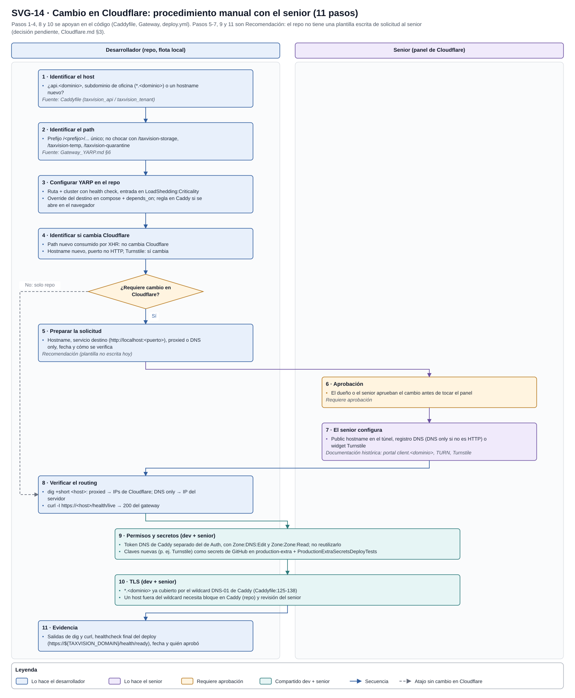

> Procedimiento ordenado a partir de los fragmentos documentados (portal cliente, TURN, Turnstile, wildcard). **Decisión pendiente:** el canal y la plantilla formal de solicitud; confirmar con el senior dónde corre `cloudflared` y si hay reglas WAF/caché.

1. **Decidir si hace falta Cloudflare** con la tabla anterior. Si el cambio es solo un path nuevo por XHR, se para aquí (solo YARP + compose).
2. **Preparar la solicitud** (desarrollador): hostname exacto, servicio destino (`http://localhost:<puerto>` del origen), modo **proxied** (nube naranja, solo HTTP/HTTPS) o **DNS only** (nube gris, protocolos no HTTP), fecha deseada y cómo se verificará.
3. **Enviarla al senior por medio del dueño.** Ningún desarrollador ni agente entra al panel.
4. **Senior — hostname HTTP:** agrega el *public hostname* al túnel de Cloudflare apuntando al origen indicado (patrón documentado: `client.<dominio>` → `http://localhost:8082`).
5. **Senior — protocolo no HTTP:** crea un registro `A` en **DNS only** (el proxy de Cloudflare solo pasa HTTP/HTTPS) y configura el reenvío del puerto; nunca proxied.
6. **Senior — certificados por DNS-01** (si el host nuevo lo necesita): token con `Zone:Zone:Read` **y** `Zone:DNS:Edit`, separado del token de Auth; nunca reutilizar el de Caddy para otros usos.
7. **Senior — productos** (Turnstile): crea el widget con los hostnames correctos y entrega site key y secret al dueño, que los carga como secrets de GitHub en `production-extra`.
8. **Desarrollador — cambios de repo:** bloque o regla en `Caddyfile` (sin hosts literales; reglas públicas después de `@minio` y antes de `@spa_assets`/`@spa_nav`), CORS si aplica, `ports:` justificado con excepción en la prueba, y casos en `CaddyPublicNavigationRouteTests` / `PlatformDomainSingleSourceDeployTests`. Gate local verde.
9. **Despliegue** por el flujo normal (el dueño hace commit y push a `main`).
10. **Verificar DNS:** `dig +short <host>` → proxied devuelve IPs de Cloudflare; DNS only devuelve la IP del servidor.
11. **Verificar servicio:** `curl -I https://<host>/health/live` → 200 del gateway; para la API, el workflow ya consulta `https://${TAXVISION_DOMAIN}/health/ready`; además una petición real por el host nuevo. Registrar evidencia (fecha, host, modo, resultado).

#### Implementación actual en TaxVision
Servicio `caddy` con `ports 80:80, 443:443` (único público); IP real con `AddTaxVisionClientIpForwarding`/`UseTaxVisionClientIp` en todo host (fitness); wildcard `*.<dominio>` proxied para oficinas.

#### Cómo integrarlo en un servicio nuevo
Normalmente **no hay que tocar Cloudflare**: ruta YARP + override en compose. Solo si el usuario abre una URL del servicio en el navegador en un host de oficina, agrega la regla de Caddy. Para cualquier hostname o puerto nuevo, sigue los 11 pasos.

#### Archivos involucrados
`deploy/docker/caddy/Caddyfile`, `deploy/docker/caddy/Dockerfile`, compose (servicio `caddy`), `deploy/tests/TaxVision.BuildingBlocks.Tests/Deploy/CaddyPublicNavigationRouteTests.cs`.

#### Ejemplo técnico
```caddy
	@invoice_link path /payments-client/invoices/*
	handle @invoice_link {
		reverse_proxy gateway:8080
	}
```
(dentro de `(taxvision_tenant)`, después de `@minio` y antes de `@spa_assets` y `@spa_nav`; agregar el prefijo a los dos `[InlineData]` de `CaddyPublicNavigationRouteTests`).

#### Integraciones
Gateway (IP real, WebSockets), Auth (host → tenant, custom hostnames), VM del frontend (`app.*`), GitHub secrets.

#### Errores históricos
- Endpoint público abierto desde el navegador sin regla en Caddy: cae en la SPA y muestra 404 de Angular; el servicio no ve la petición (pasó dos veces).
- Registro proxied para un protocolo no HTTP: el cliente nunca llega, sin error visible.
- Documentación con dominios viejos (`taxprocore.com`, `taxproffice.com`).
- Contradicción sobre dónde corre `cloudflared` (VM del frontend según la guía antigua; `localhost:80` según el Caddyfile): Decisión pendiente.

#### Pruebas
`CaddyPublicNavigationRouteTests`, `PlatformDomainSingleSourceDeployTests`, `ClientIpForwardingFitnessTests`, `GatewayWebSocketPipelineTests`. La configuración de Cloudflare no tiene prueba automatizada (está fuera del repo).

#### Checklist
- [ ] Tabla de decisión aplicada.
- [ ] Solicitud completa al senior (si aplica) vía dueño.
- [ ] Regla de Caddy + prueba si hay navegación pública.
- [ ] Verificación `dig` + `curl` registrada.

---

<a id="cap-28"></a>
## 28. Docker y compose

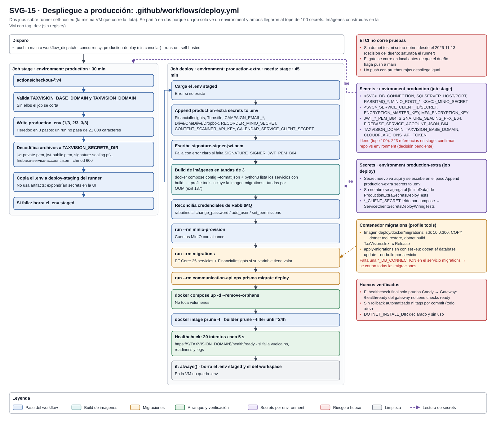

Investigación: [Docker_Deploy](Investigaciones/Docker_Deploy.md). Checklist: [Checklists/Produccion.md](Checklists/Produccion.md).

> Regla de proceso: los agentes **no tocan Docker** (ni compose en ejecución, volúmenes ni contenedores). Editar los archivos del repo sí; ejecutar no.

#### Qué es
La imagen de cada servicio y su bloque en `deploy/docker/docker-compose.yml` (único compose de producción, con overlays locales `docker-compose.local.yml` y `docker-compose.local-infra.yml`).

#### Por qué existe
Que la misma imagen corra en local y en la VM, nada interno quede publicado, las variables obligatorias falten de forma ruidosa y la infraestructura de despliegue sea "código probado" (18 pruebas de wiring leen compose, Dockerfiles, Caddyfile y `deploy.yml`).

#### Cómo funciona
- **Dockerfile .NET**: build `sdk:10.0.300` con contexto acotado (`global.json`, `src/BuildingBlocks/`, `src/Services/<Svc>/`), `publish -c Release /p:UseAppHost=false`; final `aspnet:10.0.9` con `ENV TZ=Etc/UTC`, `ENV MALLOC_ARENA_MAX=2`, `EXPOSE 8080`, `curl` **solo** si el compose le pone healthcheck.
- **Bloque compose**: `image: taxvision/<svc>-api:dev`, `container_name`, `restart: unless-stopped`, `build:` (el workflow construye todo lo que tenga `build:`), `expose: "8080"` **sin `ports:`**, `TZ`, `ASPNETCORE_ENVIRONMENT: Production`, `ConnectionStrings__Default: ${<SVC>_DB_CONNECTION:?…}` (`:?` = el compose no arranca si falta), Redis, RabbitMQ, trío JWT con PEM montado `:ro`, M2M, URLs internas `http://<svc>-api:8080`, OTLP, `depends_on` (`db-ready: service_completed_successfully`, `rabbitmq/redis: service_healthy`, `otel-collector: service_started`), red `taxvision-network`.
- **Puertos publicados**: solo Caddy (`80/443`); infraestructura en `127.0.0.1`/`MGMT_BIND_IP`; SFU de Communication por excepción; gateway `127.0.0.1:5047` (dev). Docker escribe iptables por debajo de UFW: un `ports:` sin `127.0.0.1` queda en internet.
- **Secretos montados** `:ro` desde `TAXVISION_SECRETS_DIR` (`jwt-public.pem` en todos).
- Perfiles: `observability` (apagado por RAM), `tools` (`migrations`, `minio-provision`).

#### Implementación actual en TaxVision
32 Dockerfiles (28 .NET, 3 Node). Solo 12 servicios con healthcheck en compose. **Ninguna imagen .NET de API declara `USER`** (corren como root; solo ContentScanner y Node usan usuario no root; Decisión pendiente). Volumen `taxvision-logs` montado aunque el sink de archivo está apagado en contenedor. `minio/mc:latest` sin versión fija.

#### Cómo integrarlo en un servicio nuevo
1. Dockerfile en `src/Services/<Svc>/TaxVision.<Svc>.Api/Dockerfile` con `TZ` y `MALLOC_ARENA_MAX`.
2. Bloque `<svc>-api` (plantilla de `wallet-api`) con `restart: unless-stopped`, `expose: "8080"`, sin `ports:`, `TZ: Etc/UTC`.
3. Toda URL de otro servicio como `http://<otro>-api:8080`, nunca `localhost`.
4. Healthcheck + `curl` en la imagen **solo** si otro servicio lo esperará con `service_healthy`.
5. Gateway: override del destino y `depends_on` ([cap. 26](#cap-26)).
6. M2M: `ServiceAuth__Clients__<N>__*` en `auth-api` y `*_CLIENT_SECRET` en `deploy.yml`.
7. `*_DB_CONNECTION` también en el servicio `migrations` + `apply_migration`.
8. Correr el gate completo: las pruebas de wiring leen estos archivos.

#### Archivos involucrados
Dockerfile del Api, `deploy/docker/docker-compose.yml` (bloques `<svc>-api`, `auth-api`, `gateway`, `migrations`), `docker-compose.local.yml`, `apply-migrations.sh`.

#### Ejemplo técnico
```dockerfile
FROM mcr.microsoft.com/dotnet/sdk:10.0.300 AS build
WORKDIR /src
COPY global.json ./
COPY src/BuildingBlocks/ src/BuildingBlocks/
COPY src/Services/<Svc>/ src/Services/<Svc>/
RUN dotnet restore "src/Services/<Svc>/TaxVision.<Svc>.Api/TaxVision.<Svc>.Api.csproj"
RUN dotnet publish "src/Services/<Svc>/TaxVision.<Svc>.Api/TaxVision.<Svc>.Api.csproj" \
    -c Release -o /app/publish --no-restore /p:UseAppHost=false

FROM mcr.microsoft.com/dotnet/aspnet:10.0.9 AS final
# Contenedor en UTC; la zona de negocio es la de la oficina.
ENV TZ=Etc/UTC
# glibc: 2 arenas de malloc en vez de 8 por núcleo.
ENV MALLOC_ARENA_MAX=2
WORKDIR /app
EXPOSE 8080
COPY --from=build /app/publish .
ENTRYPOINT ["dotnet", "TaxVision.<Svc>.Api.dll"]
```
```yaml
  <svc>-api:
    image: taxvision/<svc>-api:dev
    container_name: taxvision-<svc>-api
    restart: unless-stopped
    build:
      context: ../..
      dockerfile: src/Services/<Svc>/TaxVision.<Svc>.Api/Dockerfile
    expose:
      - "8080"
    environment:
      TZ: Etc/UTC
      ASPNETCORE_ENVIRONMENT: Production
      ASPNETCORE_URLS: http://+:8080
      ConnectionStrings__Default: ${<SVC>_DB_CONNECTION:?Set <SVC>_DB_CONNECTION in .env}
      ConnectionStrings__Redis: redis:6379
      RabbitMq__Uri: ${RABBITMQ_CONNECTION:?Set RABBITMQ_CONNECTION in .env}
      Jwt__PublicKeyPath: /run/secrets/jwt-public.pem
      Jwt__Issuer: TaxVision.Auth
      Jwt__Audience: TaxVision.Services
      Authorization__PermissionsSource: Projection
      ServiceAuthClient__AuthBaseUrl: http://auth-api:8080
      ServiceAuthClient__ClientId: ${<SVC>_SERVICE_CLIENT_ID:-<svc>-worker}
      ServiceAuthClient__ClientSecret: ${<SVC>_SERVICE_CLIENT_SECRET:-}
      OpenTelemetry__OtlpEndpoint: http://otel-collector:4317
    volumes:
      - taxvision-logs:/app/Logs
      - ${TAXVISION_SECRETS_DIR:-/opt/taxvision/secrets}/jwt-public.pem:/run/secrets/jwt-public.pem:ro
    depends_on:
      db-ready:
        condition: service_completed_successfully
      rabbitmq:
        condition: service_healthy
      redis:
        condition: service_healthy
      otel-collector:
        condition: service_started
    networks:
      - taxvision-network
```

#### Integraciones
`deploy.yml` (escribe el `.env` con los nombres exactos), Caddy, Gateway, `scripts/start-fleet.ps1` (puertos dev).

#### Errores históricos
- Healthcheck con `curl` sobre una imagen sin `curl` (2026-10-03): origen de `ComposeHealthcheckWiringTests`.
- `COPY . .` invalidaba la caché de todas las imágenes: hoy contexto acotado.
- La guía antigua decía "ningún servicio declara `restart`": hoy 42 entradas.
- `deploy/tests/Dockerfile` corre `dotnet test TaxVision.slnx` sin filtro (fallaría sin SQL).

#### Pruebas
`ComposeHealthcheckWiringTests`, `ComposeRestartPolicyWiringTests`, `ContainerUtcTimeZoneDeployTests`, `DotnetImageMallocArenaTests`, `ComposeInternalBaseUrlWiringTests`, `ServiceClientSecretsDeployWiringTests`, `ProductionExtraSecretsDeployTests`, `PlatformDomainSingleSourceDeployTests`, `CaddyPublicNavigationRouteTests`, `DockerComposeNoPublicApiPortsFitnessTests`. Todas en el gate local.

#### Checklist
- [ ] Dockerfile con contexto acotado, `TZ`, `MALLOC_ARENA_MAX`.
- [ ] Bloque compose sin `ports:`, con `restart` y `:?` en obligatorias.
- [ ] URLs internas por DNS de Docker.
- [ ] Overrides en gateway, `auth-api` y `migrations`.
- [ ] Gate completo verde.

---

<a id="cap-29"></a>
## 29. Scripts de la flota local

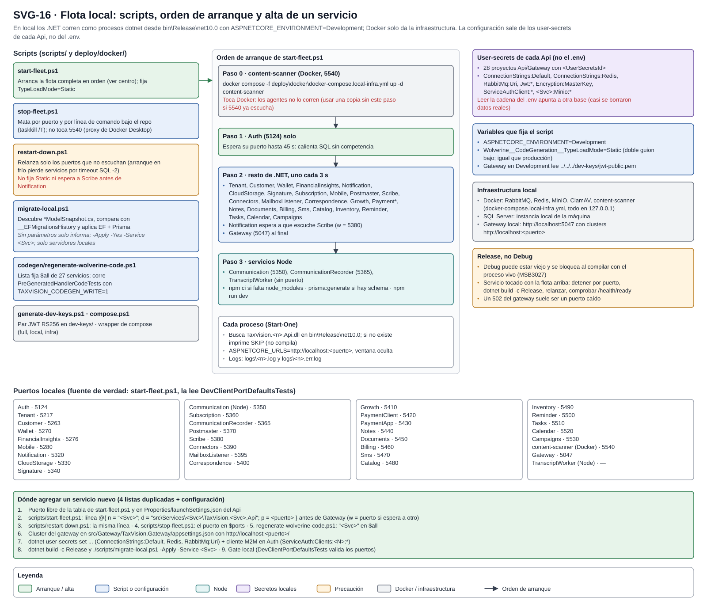

Investigación: [Scripts_Locales](Investigaciones/Scripts_Locales.md).

#### Qué es
Los scripts PowerShell que arrancan, detienen, relanzan, migran y regeneran la flota en la máquina de desarrollo.

#### Por qué existe
En local los servicios .NET **no corren en Docker**: corren como procesos `dotnet <dll>` desde `bin\Release\net10.0` con `ASPNETCORE_ENVIRONMENT=Development`; Docker solo para infraestructura; SQL Server local; configuración por **user-secrets**, no `.env`.

#### Cómo funciona
| Script | Qué hace |
|---|---|
| `scripts/start-fleet.ps1` | Fija `Wolverine__CodeGeneration__TypeLoadMode=Static`; arranca content-scanner (Docker), Auth primero (espera 45 s), el resto cada 3 s (Notification espera a Scribe), Gateway al final, y los 3 Node. Busca el dll en Release; si falta imprime `SKIP` (no compila). Logs en `logs\<n>.log` / `.err.log`. |
| `scripts/stop-fleet.ps1` | Mata por puerto y por línea de comando bajo el repo (excluye 5540) |
| `scripts/restart-down.ps1` | Relanza solo los que no escuchan (arranque en frío pierde servicios por timeout SQL `-2`) |
| `scripts/migrate-local.ps1` | Detecta y aplica migraciones EF y Prisma pendientes en local |
| `scripts/codegen/regenerate-wolverine-code.ps1` | Regenera `Internal/Generated` (fuerza Dynamic) |
| `scripts/generate-dev-keys.ps1` / `.sh` | Par JWT RS256 de desarrollo en `dev-keys/` |
| `deploy/docker/compose.ps1` | Wrapper de compose (full/local/infra) |

Puertos (fuente de verdad: `start-fleet.ps1`, la lee `DevClientPortDefaultsTests`): Auth 5124, Tenant 5217, Customer 5263, Wallet 5270, FinancialInsights 5276, Notification 5320, CloudStorage 5330, Signature 5340, Communication 5350, Subscription 5360, Recorder 5365, Postmaster 5370, Scribe 5380, Connectors 5390, MailboxListener 5395, Correspondence 5400, Growth 5410, PaymentClient 5420, PaymentApp 5430, Notes 5440, Documents 5450, Billing 5460, Sms 5470, Catalog 5480, Inventory 5490, Reminder 5500, Tasks 5510, Calendar 5520, Campaigns 5530, content-scanner 5540, Gateway 5047.

#### Implementación actual en TaxVision
Tres listas de puertos duplicadas (start, stop, restart) más la de codegen; solo `start-fleet.ps1` está protegida por prueba. `restart-down.ps1` **no** fija Static ni espera a Scribe (Decisión pendiente). `start-fleet.ps1` toca Docker (paso 0) y está en cp1252 (escribir solo ASCII).

#### Cómo integrarlo en un servicio nuevo
1. Elegir un puerto libre de la tabla.
2. Fijarlo en `src/Services/<Svc>/TaxVision.<Svc>.Api/Properties/launchSettings.json`.
3. Línea en `scripts/start-fleet.ps1` (antes de Gateway); `w = <puerto>` si depende de otro al arrancar; `e = @{...}` si necesita variables.
4. Misma línea en `scripts/restart-down.ps1` y el puerto en `$ports` de `scripts/stop-fleet.ps1`.
5. `"<Svc>"` en `$all` de `regenerate-wolverine-code.ps1`.
6. Cluster del gateway con `http://localhost:<puerto>/`.
7. User-secrets del Api (`ConnectionStrings:Default`, `ConnectionStrings:Redis`, `RabbitMq:Uri`, `Jwt:*`, `ServiceAuthClient:*`) y el cliente M2M en Auth (`ServiceAuth:Clients:<N>:*`). Nunca imprimir ni commitear valores.
8. `dotnet build -c Release` del Api y `./scripts/migrate-local.ps1 -Apply -Service <Svc>`.
9. Gate (`DevClientPortDefaultsTests` valida los puertos).
10. Con la flota arriba, al tocar un servicio: detenerlo por puerto, `dotnet build -c Release`, relanzarlo y comprobar `/health/ready` (un 502 del gateway suele ser un puerto caído).

#### Archivos involucrados
`scripts/start-fleet.ps1`, `scripts/stop-fleet.ps1`, `scripts/restart-down.ps1`, `scripts/codegen/regenerate-wolverine-code.ps1`, `launchSettings.json`, `src/Gateway/TaxVision.Gateway/appsettings.json`.

#### Ejemplo técnico
```powershell
@{ n = "<Svc>"; d = "src\Services\<Svc>\TaxVision.<Svc>.Api"; p = <puerto> },
```
```powershell
powershell -ExecutionPolicy Bypass -File scripts\start-fleet.ps1
powershell -ExecutionPolicy Bypass -File scripts\restart-down.ps1
powershell -ExecutionPolicy Bypass -File scripts\stop-fleet.ps1
./scripts/migrate-local.ps1
./scripts/migrate-local.ps1 -Apply -Service <Svc>
powershell -ExecutionPolicy Bypass -File scripts\codegen\regenerate-wolverine-code.ps1 -Service <Svc>
Get-Content logs\<Svc>.err.log -Tail 50
dotnet user-secrets set "ConnectionStrings:Default" "<cadena local>" --project src\Services\<Svc>\TaxVision.<Svc>.Api
```

#### Integraciones
Infra Docker local, SQL Server local, user-secrets, `dev-keys/`, Gateway en 5047.

#### Errores históricos
- Probar contra binarios viejos (Debug o Release sin recompilar).
- Migración sin aplicar en local → load shedding (503) en toda la flota.
- Leer la cadena del `.env` en vez de user-secrets apuntó a otra base.
- Encadenar el reinicio de flota en background con tubería nunca avisa (lección de memoria).

#### Pruebas
`DevClientPortDefaultsTests`; la regeneración usa `PreGeneratedHandlerCodeTests`.

#### Checklist
- [ ] Puerto en las 4 listas + `launchSettings.json`.
- [ ] Servicio en `$all` de codegen.
- [ ] Cluster local del gateway.
- [ ] User-secrets cargados (sin imprimir valores).
- [ ] Build Release + migración aplicada.

---

<a id="cap-30"></a>
## 30. CI/CD y secrets

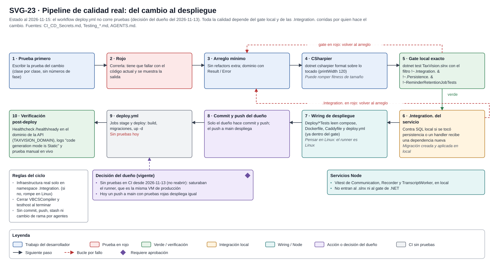

Investigación: [CI_CD_Secrets](Investigaciones/CI_CD_Secrets.md). Checklist: [Checklists/Produccion.md](Checklists/Produccion.md).

#### Qué es
El único workflow `.github/workflows/deploy.yml` ("Deploy to production", push a `main` y `workflow_dispatch`) y la gestión de secrets en GitHub.

#### Por qué existe
Desplegar la flota en la VM con migraciones antes del arranque, secretos escritos en cada corrida y nunca versionados.

#### Cómo funciona
- **Dos jobs** en runner **self-hosted** (la misma VM de producción): `stage` (environment **`production`**) y `deploy` (environment **`production-extra`**, `needs: stage`). Se partió porque un job solo ve un environment y `production` llegó al **tope de 100 secrets**.
- **`stage`:** valida `TAXVISION_BASE_DOMAIN` y `TAXVISION_DOMAIN`; escribe el `.env` en 3 pasos (límite de 21 000 caracteres por `run`); decodifica `jwt-private.pem`, `jwt-public.pem`, `signature-sealing.pfx`, `firebase-service-account.json` a `TAXVISION_SECRETS_DIR`; copia el `.env` al directorio de staging (no artifacts).
- **`deploy`:** carga el `.env` staged; **agrega los secrets de `production-extra`** (paso "Append production-extra secrets to .env"); build en **tandas de 3** con `--profile tools` (incluye la imagen `migrations`; OOM exit 137 con build paralelo); reconcilia credenciales de RabbitMQ; provisiona MinIO; **`run --rm migrations`**; Prisma de Communication; `up -d --remove-orphans`; prune; healthcheck a `https://${TAXVISION_DOMAIN}/health/ready`; `always()` borra el `.env`.
- **El workflow NO corre pruebas** (decisión del dueño desde 2026-11-13: saturaba la VM). No hay registry (tag `:dev`) ni rollback automatizado.
- **Calidad antes de pedir push** (obligatoria): gate local exacto, `.Integration.` del servicio contra la base local si se tocó persistencia o handlers, CSharpier sobre lo tocado, Vitest de los Node si se tocaron, migración aplicada en local, pensar en Linux (la VM es Linux). El dueño hace commit y push; el push a `main` despliega.

#### Implementación actual en TaxVision
223 nombres de secret referenciados en `stage` y 35 en `deploy` (Decisión pendiente: confirmar niveles repo/environment frente al tope de 100). `production-extra` contiene, entre otros, `FINANCIAL_INSIGHTS_*`, `CALENDAR_SERVICE_CLIENT_SECRET`, Turnstile, Campaign email, Google Drive/OneDrive/Dropbox, `CONTENT_SCANNER_API_KEY`, `SIGNATURE_SIGNER_JWT_PEM_B64`. El healthcheck final solo prueba Caddy → Gateway (no detecta servicios caídos).

#### Cómo integrarlo en un servicio nuevo
1. Proyectos en `TaxVision.slnx` (entran a la imagen `migrations`).
2. `build:` en su bloque de compose (el workflow lo descubre solo).
3. **Secrets nuevos → environment `production-extra`** (los carga el dueño; nunca escribir valores en el repo).
4. En `deploy.yml`, paso "Append production-extra secrets to .env": `<SVC>_DB_CONNECTION`, `<SVC>_SERVICE_CLIENT_ID`, `<SVC>_SERVICE_CLIENT_SECRET`, etc.
5. Nombres al `[InlineData]` de `ProductionExtraSecretsDeployTests`.
6. `*_DB_CONNECTION` en el servicio `migrations` del compose y bloque en `apply-migrations.sh`.
7. Cliente M2M en `auth-api` (`ServiceAuth__Clients__<N>__*`).
8. Gate local completo verde; el dueño hace commit y push a `main`.
9. Tras el deploy: logs del servicio en la VM, "code generation mode is Static", una petición real por el gateway.

#### Archivos involucrados
`.github/workflows/deploy.yml`, `deploy/docker/docker-compose.yml`, `deploy/docker/migrations/apply-migrations.sh`, `deploy/tests/TaxVision.BuildingBlocks.Tests/Deploy/{ProductionExtraSecretsDeployTests,ServiceClientSecretsDeployWiringTests}.cs`.

#### Ejemplo técnico
```bash
# deploy.yml, job deploy, paso "Append production-extra secrets to .env"
<SVC>_DB_CONNECTION=${{ secrets.<SVC>_DB_CONNECTION }}
<SVC>_SERVICE_CLIENT_ID=${{ secrets.<SVC>_SERVICE_CLIENT_ID }}
<SVC>_SERVICE_CLIENT_SECRET=${{ secrets.<SVC>_SERVICE_CLIENT_SECRET }}
```
```bash
# Diagnóstico en la VM (no queda .env; los jobs corren dentro del contenedor)
sudo docker ps
sudo docker logs --tail 200 taxvision-<svc>-api
```

#### Integraciones
Compose, migraciones EF y Prisma, Caddy/Cloudflare (healthcheck público), GitHub environments.

#### Errores históricos
- **Google Drive**: secret cargado en el job equivocado → 503 "not configured" (origen de `ProductionExtraSecretsDeployTests`).
- **Calendar E-12**: `*_CLIENT_SECRET` no escrito → M2M apagado en silencio (origen de `ServiceClientSecretsDeployWiringTests`).
- `*_DB_CONNECTION` faltante en `migrations` → `set -eu` corta todas las migraciones.
- Guía antigua: "job único con gate de tests .NET y Node" → hoy dos jobs sin pruebas.
- Pruebas que pasaban en Windows y fallaban en Linux (`Path.GetInvalidFileNameChars()`, fábricas con user-secrets fuera de `.Integration.`).

#### Pruebas
`ProductionExtraSecretsDeployTests`, `ServiceClientSecretsDeployWiringTests`, `PlatformDomainSingleSourceDeployTests` y las `*DeployConfigWiringTests` por servicio. **Solo protegen si el gate se corre en local antes del push.**

#### Checklist
- [ ] Secrets nuevos en `production-extra` (cargados por el dueño).
- [ ] Líneas en el job `deploy` + nombres en la prueba.
- [ ] Migraciones dadas de alta.
- [ ] Gate local, `.Integration.`, CSharpier y Vitest (si aplica) verdes antes de pedir push.

---

<a id="cap-31"></a>
## 31. Postman y OpenAPI

Investigación: [Postman](Investigaciones/Postman.md).

#### Qué es
Las colecciones manuales para probar el servicio por el Gateway y el contrato OpenAPI del servicio en Development.

#### Por qué existe
Probar lo que ve el usuario (CORS, rate limit pre-auth, seat gate, host guard) y dejar documentados actores, permisos y la regla de tenant.

#### Cómo funciona
- Dos carpetas con convenciones distintas: `Postman_Collection/` (23 colecciones, `{{UrlBase}}` + `{{accessToken}}`, environment `TaxVisionBackEnd.postman_environment.json`) y `postman/` (`{{gateway}}` + `{{userToken}}`). **Decisión pendiente:** una sola convención; por volumen, la mayoritaria es `Postman_Collection/`.
- Nadie manda `X-Tenant-Id` (el tenant sale del JWT) ni hace falta `X-Correlation-Id` (si se manda, debe cumplir `^[A-Za-z0-9._-]{1,128}$`).
- OpenAPI: `AddOpenApi()` + `AddSwaggerGen()`; `MapOpenApi()`/`UseSwagger()`/`UseSwaggerUI()` **solo en Development**; el gateway no publica Swagger.

#### Implementación actual en TaxVision
Servicios sin colección: Documents, FinancialInsights, ContentScanner (y otros solo dentro de `NewServices`). Environments con URLs y tokens vacíos y sensibles marcados `secret`. Sin Newman en CI.

#### Cómo integrarlo en un servicio nuevo
1. Copiar `Postman_Collection/TaxVision_Notes.postman_collection.json` como `TaxVision_<Svc>.postman_collection.json`; cambiar `info.name` y `info.description` (environment, actores, permisos, regla de tenant del JWT).
2. Carpetas por superficie: staff, portal (`CustomerPortal`), público/anónimo, webhooks. **Sin carpeta `internal`.**
3. URL `{{UrlBase}}/<prefijo>/...` (mismo prefijo que la ruta YARP).
4. `Authorization: Bearer {{accessToken}}` (o `{{customerPortalAccessToken}}`, `{{serviceAccessToken}}`, `{{platformAdminToken}}`); `Idempotency-Key` donde aplique.
5. En cada `POST` de creación: script que valide el código y guarde el id en `<svc><Entidad>Id`.
6. Variables nuevas en el environment **vacías**; sensibles con `type: secret`.
7. Probar 401 sin token, 403 sin permiso y 404 de otro tenant.
8. Usar `/openapi/v1.json` del servicio en local como fuente del contrato.

#### Archivos involucrados
`Postman_Collection/TaxVision_<Svc>.postman_collection.json`, `Postman_Collection/TaxVisionBackEnd.postman_environment.json`, `Program.cs` (OpenAPI).

#### Ejemplo técnico
```javascript
pm.test("status 201", () => pm.response.code === 201);
if (pm.response.code === 201) {
  const body = pm.response.json();
  pm.environment.set("notesNoteId", body.id);
}
```

#### Integraciones
Gateway (`:5047` local) para todo lo publicado; Auth directo (`{{authService}}` / `AuthDirectBase`, `:5124` local) para el **Service token**, que el Gateway no publica.

#### Errores históricos
- Exportar el environment con tokens llenos y commitearlo filtra credenciales.
- Requests contra el puerto directo saltan el gateway y no prueban lo que ve el usuario.
- README de `postman/` desfasado (`EnforceTierQuotas` "OFF por default", prefijos `/subscription` y `/tenant`).

#### Pruebas
No hay pruebas automáticas sobre las colecciones.

#### Checklist
- [ ] Colección por servicio en `Postman_Collection/`.
- [ ] Variables vacías y `secret` donde corresponde.
- [ ] Casos 401/403/404-otro-tenant.

---

<a id="cap-32"></a>
## 32. Observabilidad

Investigación: [Observabilidad](Investigaciones/Observabilidad.md).

#### Qué es
Logs (Serilog), métricas (OpenTelemetry → collector → Prometheus), trazas (apagadas por defecto), health checks y CorrelationId.

#### Por qué existe
Diagnosticar incidentes en una flota sin backend de logs ni de trazas en producción: la fuente de logs es `docker logs`.

#### Cómo funciona
- **Serilog** (`UseTaxVisionSerilog("<svc>-service")`): plantilla con `Service` y `CorrelationId`; consola siempre; archivo solo fuera de contenedor; OTLP de logs si `OpenTelemetry:ExportLogs=true`. `Microsoft`/EF/HttpClient en Warning; `/health/*` fuera del log.
- **OpenTelemetry** (`AddTaxVisionOpenTelemetry(config, "<svc>-service")`): métricas siempre (ASP.NET Core, HttpClient, Runtime, meter con el **mismo nombre** del servicio, métricas de autorización, asientos y rate limit); trazas solo si `OpenTelemetry:ExportTraces=true`. Collector: OTLP 4317/4318 → Prometheus `:9464`; trazas y logs a `nop`. Prometheus/Grafana en perfil `observability` apagado (12 dashboards y alertas provisionados).
- **Health**: `/health/live` sin checks; `/health/ready` con base (EF) y RabbitMQ (TCP) con tag `ready`.
- **CorrelationId**: header `X-Correlation-Id` validado o generado; en request, response, `Activity`, `ICorrelationContext` y sobre de eventos.
- **TimeZoneSelfCheck** al arrancar (nunca detiene).

#### Implementación actual en TaxVision
Wiring en 27 Program.cs. **Por qué `/health` no prueba producción:** el `/health/ready` público es el del gateway (200 con la flota caída detrás); `/health/live` de los servicios no ejecuta checks; `/health/ready` de un servicio no prueba migraciones aplicadas, consumidores activos, M2M, MinIO ni proveedores; una migración sin aplicar no tumba el health. Sin runbook general.

#### Cómo integrarlo en un servicio nuevo
1. `UseTaxVisionSerilog("<svc>-service")`, `AddTimeZoneSelfCheck()`, `AddTaxVisionOpenTelemetry(config, "<svc>-service")`.
2. Health checks con tag `ready` para su base y RabbitMQ; `/health/live` y `/health/ready`.
3. `CorrelationIdMiddleware` antes de `UseSerilogRequestLogging`.
4. Métrica propia: `Meter` con el mismo nombre que se pasa a `AddTaxVisionOpenTelemetry`.
5. Compose: `OpenTelemetry__OtlpEndpoint: http://otel-collector:4317`.
6. Verificación post-deploy manual: logs sin `Error` al arrancar, línea del TimeZoneSelfCheck, línea de codegen Static y **una petición real por el gateway** (no solo `/health`).

#### Archivos involucrados
`Program.cs`, compose, `deploy/observability/*` (solo lectura para el servicio).

#### Ejemplo técnico
```csharp
builder.Host.UseTaxVisionSerilog("<svc>-service");
builder.Services.AddTimeZoneSelfCheck();
builder.Services.AddTaxVisionOpenTelemetry(builder.Configuration, "<svc>-service");

builder.Services.AddHealthChecks()
    .AddDbContextCheck<<Svc>DbContext>("sql-server", tags: ["ready"])
    .AddCheck("rabbitmq", new TcpEndpointHealthCheck(rabbitUri.Host, rabbitUri.Port), tags: ["ready"]);
// ...
app.UseMiddleware<CorrelationIdMiddleware>();
app.UseSerilogRequestLogging();
app.UseMiddleware<ExceptionHandlingMiddleware>();
// ...
app.MapHealthChecks("/health/live", new HealthCheckOptions { Predicate = _ => false });
app.MapHealthChecks("/health/ready", new HealthCheckOptions { Predicate = check => check.Tags.Contains("ready") });
```

| Síntoma | Dónde mirar |
|---|---|
| 502 en local | Puerto caído: `scripts/restart-down.ps1`, `logs/<Svc>.err.log` |
| 503 "Fleet is overloaded" | `logs/Gateway.log` (`Load shedding activated`), luego `Invalid column name` en `logs/*.log` |
| Evento que no llega | `wolverine_outgoing_envelopes` del emisor, cola `<svc>-events`, `wolverine_dead_letters` del receptor |
| Producción | `sudo docker logs --tail 200 taxvision-<svc>-api` |

#### Integraciones
`otel-collector`, Wolverine (tablas de sobres), RabbitMQ management, Gateway.

#### Errores históricos
- Interpretar un `/health/ready` 200 como "producción sana".
- Bajar EF a Information en producción llena los logs.
- Healthcheck del deploy que no detecta servicios caídos (Decisión pendiente).

#### Pruebas
`TaxVisionLoggingTests`, `OpenTelemetryRegistrationTests`, `CorrelationIdFitnessTests`, `TimeZoneInfraFitnessTests`, `ClientIpForwardingFitnessTests`.

#### Checklist
- [ ] Serilog + OTel con el nombre del servicio.
- [ ] Health `/live` y `/ready` con tags correctos.
- [ ] `CorrelationIdMiddleware` en orden.
- [ ] Verificación post-deploy con petición real.

---

<a id="cap-33"></a>
## 33. Testing

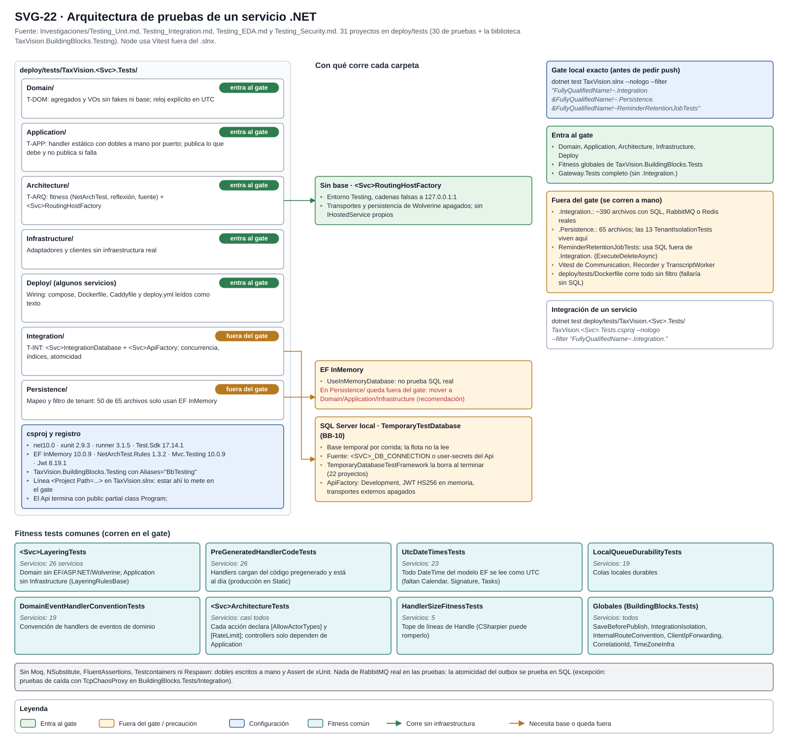

Investigaciones: [Testing_Unit](Investigaciones/Testing_Unit.md), [Testing_Integration](Investigaciones/Testing_Integration.md), [Testing_Security](Investigaciones/Testing_Security.md), [Testing_EDA](Investigaciones/Testing_EDA.md). Checklist: [Checklists/Testing.md](Checklists/Testing.md).

#### Qué es
La estructura de pruebas de la flota: 30 proyectos de prueba + la biblioteca `TaxVision.BuildingBlocks.Testing`, xUnit 2.9.3, dobles a mano (sin Moq, NSubstitute, FluentAssertions ni Testcontainers), Vitest en los servicios Node.

#### Por qué existe
**El CI no corre pruebas desde 2026-11-13** (decisión del dueño). Todo lo que protege la arquitectura, la seguridad, la mensajería, el codegen y el despliegue (incluidas las pruebas de wiring de `BuildingBlocks.Tests/Deploy` que vigilan compose y `deploy.yml`) **solo protege si alguien corre el gate local antes del push**.

#### Cómo funciona

**Gate local exacto (obligatorio antes de entregar):**
```powershell
dotnet test TaxVision.slnx --nologo --filter "FullyQualifiedName!~.Integration.&FullyQualifiedName!~.Persistence.&FullyQualifiedName!~ReminderRetentionJobTests"
```
Más, cuando aplica: `.Integration.` del servicio contra la base local, CSharpier sobre lo tocado (antes del gate: el formato puede romper fitness de tamaño) y Vitest de los Node tocados. Después: cerrar `VBCSCompiler`/`testhost` que queden vivos.

**Tipos de prueba:**

| Código | Tipo | Carpeta | ¿En el gate? |
|---|---|---|---|
| T-DOM | Dominio, sin fakes ni base, reloj explícito | `Domain/<Clase>Tests.cs` | Sí |
| T-APP | Handler/consumer con dobles a mano | `Application/<Handler>Tests.cs` | Sí |
| T-ARQ | Fitness (NetArchTest, reflexión, lectura de fuente/compose) | `Architecture/`, `Deploy/` | Sí |
| T-INT | SQL Server real (base temporal BB-10), namespace `.Integration.` | `Integration/<Tema>IntegrationTests.cs` | **No** (a mano) |
| T-VIVO | Flota local + navegador del dueño | manual | No |

**Reglas:**
- Toda prueba que toca infraestructura real va en un namespace con **`.Integration.`** (una prueba con SQL fuera de él rompió el deploy en Linux el 2026-10-29).
- **`.Persistence.` queda fuera del gate**: 50 de sus 65 archivos usan solo EF InMemory y nunca corren (incluidas las 13 `TenantIsolationTests`). **Recomendación:** pruebas InMemory en `Domain/`, `Application/`, `Infrastructure/` o `Architecture/`, **no** en `Persistence/` (Decisión pendiente para las existentes).
- "Nada de RabbitMQ real en las pruebas; la atomicidad del outbox se prueba en SQL" (excepción: pruebas de caída con `TcpChaosProxy` en BuildingBlocks).
- T-INT con `TemporaryTestDatabase` (base por proceso, borrada al final), fuente `<SVC>_DB_CONNECTION` o user-secrets del Api; host real con transportes externos apagados (si no, roba mensajes de la cola de la flota).
- Fábricas: `<Svc>ApiFactory` (Integration, base temporal, JWT HS256 aleatorio en memoria) y `<Svc>RoutingHostFactory` (Architecture, entorno `Testing`, cadenas falsas a `127.0.0.1:1`, sin transportes ni persistencia ni hosted services: **apta para el gate**).
- Nombres por clase, en inglés, sin números de fase; un escenario por prueba.
- Ciclo: rojo → arreglo mínimo → verde → gate.

#### Implementación actual en TaxVision
Fitness comunes por servicio: `<Svc>LayeringTests` (26), `PreGeneratedHandlerCodeTests` (26), `UtcDateTimesTests` (23), `LocalQueueDurabilityTests` (19), `DomainEventHandlerConventionTests` (19), `<Svc>ArchitectureTests` / `*ActorTypeArchitectureTests`. Globales en `BuildingBlocks.Tests/Architecture/` (`SaveBeforePublishTests`, `CorrelationIdFitnessTests`, `InternalRouteConventionFitnessTests`, `ClientIpForwardingFitnessTests`, `IntegrationIsolationTests`, `NoPlanNameLogicFitnessTests`…), `Messaging/` (`MessageIdentityTests`, `EventRoutingContractTests`, `NodeInteropContractTests`…), `Offboarding/` (3 fitness) y `Deploy/` (18 pruebas de wiring).

#### Cómo integrarlo en un servicio nuevo
1. Proyecto `deploy/tests/TaxVision.<Svc>.Tests` (copiar el csproj de Notes) y alta en `.slnx`.
2. Mínimo de arquitectura: `<Svc>LayeringTests`, `<Svc>ArchitectureTests` (actor + rate limit + capas de controllers), `<Svc>RoutingHostFactory` + `PreGeneratedHandlerCodeTests`, `UtcDateTimesTests`, `LocalQueueDurabilityTests` (con la fábrica de rutas), `DomainEventHandlerConventionTests` (si emite eventos de dominio), prueba de rutas en runtime (copia de `IntegrationEventRoutingTests` de Calendar).
3. T-DOM por agregado/VO; T-APP por handler y consumer.
4. Seguridad: `TenantIsolationTests` **fuera de `Persistence/`** si usa InMemory; ownership si hay recursos con autor; firma de cada webhook; 403 con actor sin permiso.
5. T-INT: `<Svc>IntegrationDatabase` + atributo de ensamblado, `<Svc>ApiFactory`, concurrencia/índices únicos/atomicidad del outbox (patrón Wallet).
6. Offboarding, notificaciones, módulos, reconciliation: las pruebas que pide cada capítulo.
7. Ver cada fitness nueva en **rojo** una vez y luego en verde.

#### Archivos involucrados
`deploy/tests/TaxVision.<Svc>.Tests/**`, `TaxVision.slnx`, `deploy/tests/TaxVision.BuildingBlocks.Testing/**` (solo lectura salvo piezas aditivas aprobadas).

#### Ejemplo técnico
```xml
<!-- deploy/tests/TaxVision.<Svc>.Tests/TaxVision.<Svc>.Tests.csproj (forma real de Notes) -->
<Project Sdk="Microsoft.NET.Sdk">
  <PropertyGroup>
    <TargetFramework>net10.0</TargetFramework>
    <ImplicitUsings>enable</ImplicitUsings>
    <Nullable>enable</Nullable>
    <IsPackable>false</IsPackable>
    <IsTestProject>true</IsTestProject>
  </PropertyGroup>
  <ItemGroup>
    <PackageReference Include="Microsoft.NET.Test.Sdk" Version="17.14.1" />
    <PackageReference Include="xunit" Version="2.9.3" />
    <PackageReference Include="xunit.runner.visualstudio" Version="3.1.5" />
    <PackageReference Include="Microsoft.EntityFrameworkCore.InMemory" Version="10.0.9" />
    <PackageReference Include="NetArchTest.Rules" Version="1.3.2" />
    <PackageReference Include="Microsoft.AspNetCore.Mvc.Testing" Version="10.0.9" />
    <PackageReference Include="System.IdentityModel.Tokens.Jwt" Version="8.19.1" />
  </ItemGroup>
  <ItemGroup><FrameworkReference Include="Microsoft.AspNetCore.App" /></ItemGroup>
  <ItemGroup>
    <ProjectReference Include="..\..\..\src\Services\<Svc>\TaxVision.<Svc>.Api\TaxVision.<Svc>.Api.csproj" />
    <!-- + Domain, Application, Infrastructure, BuildingBlocks.Messaging -->
    <ProjectReference Include="..\TaxVision.BuildingBlocks.Testing\TaxVision.BuildingBlocks.Testing.csproj" Aliases="BbTesting" />
  </ItemGroup>
</Project>
```
```csharp
extern alias BbTesting;
using BbTesting::TaxVision.BuildingBlocks.Testing.Architecture;

public sealed class <Svc>LayeringTests : LayeringRulesBase
{
    protected override Assembly DomainAssembly => typeof(<AgregadoRaiz>).Assembly;
    protected override Assembly ApplicationAssembly => typeof(AssemblyMarker).Assembly;
}
```
```csharp
// Integration/<Svc>IntegrationDatabase.cs (forma real de Notes)
extern alias BbTesting;
using BbTesting::TaxVision.BuildingBlocks.Testing.Integration;

[assembly: TestFramework(TemporaryDatabaseTestFramework.TypeName, TemporaryDatabaseTestFramework.AssemblyName)]

internal static class NotesIntegrationDatabase
{
    private static readonly TemporaryTestDatabase Database = new(
        "not_tint",
        () => Environment.GetEnvironmentVariable("NOTES_DB_CONNECTION")
              ?? new ConfigurationBuilder().AddUserSecrets("<UserSecretsId del Api>").Build().GetConnectionString("Default")
              ?? throw new InvalidOperationException("Set NOTES_DB_CONNECTION or the Api user-secrets to run this test."),
        connection =>
        {
            using var db = new NotesDbContext(new DbContextOptionsBuilder<NotesDbContext>().UseSqlServer(connection).Options, new NoTenant());
            db.Database.Migrate();
        });
    public static string ConnectionString => Database.ConnectionString;
}
```
```powershell
dotnet test deploy/tests/TaxVision.<Svc>.Tests/TaxVision.<Svc>.Tests.csproj --nologo --filter "FullyQualifiedName~.Integration."
```

#### Matriz de pruebas de un servicio nuevo

Estado: **Existe (reutilizable)** = pieza o patrón ya en el repo para copiar/heredar · **Obligatoria** = el servicio nuevo debe crearla · **Condicional** = si aplica la capacidad · **Hueco** = no existe automatización en el repo hoy.

| Área | Tipo de prueba | Escenario | Proyecto | Estado |
|---|---|---|---|---|
| Arquitectura | T-ARQ | Domain sin EF/ASP.NET/Wolverine; Application sin Infrastructure/EF | `<Svc>.Tests/Architecture/<Svc>LayeringTests` (hereda `LayeringRulesBase`) | Obligatoria |
| Arquitectura | T-ARQ | Cada acción declara `[AllowActorTypes]` y `[RateLimit]`/`[RateLimitExempt]`; controllers solo dependen de Application | `<Svc>.Tests/Architecture/<Svc>ArchitectureTests` (copia de Notes) | Obligatoria |
| Arquitectura | T-ARQ | Sin `System.Linq` en Domain | copia de `CalendarArchitectureTests` | Obligatoria (recomendada) |
| Codegen | T-ARQ | Todo handler carga de código pregenerado; código al día | `<Svc>.Tests/Architecture/PreGeneratedHandlerCodeTests` + `<Svc>RoutingHostFactory` | Obligatoria |
| Codegen | T-ARQ | Todo `Program.cs` nuevo llama `UseTaxVisionCodeGeneration` | — | Hueco |
| Persistencia | T-ARQ | Todo `DateTime` se lee como UTC | `<Svc>.Tests/Architecture/UtcDateTimesTests` | Obligatoria |
| Persistencia | T-APP/InMemory | Hija nueva queda `Added` (no `UPDATE`) | `<Svc>.Tests/Infrastructure/` (no `Persistence/`) | Condicional (hijas con Guid de dominio) |
| Persistencia | T-INT | Concurrencia (`RowVersion`) → 409; índice único → 409 | `<Svc>.Tests/Integration/` | Condicional |
| Persistencia | T-INT | Migración con datos previos | `MigrationTestDatabase` | Condicional |
| Dominio | T-DOM | Cada transición y cada VO (límites) | `<Svc>.Tests/Domain/` | Obligatoria |
| Aplicación | T-APP | Handler publica lo que debe y no publica si falla | `<Svc>.Tests/Application/` | Obligatoria |
| Mensajería | T-ARQ | Todo evento publicado tiene ruta a `rabbitmq://` (runtime) | copia de `Calendar.Tests/Architecture/IntegrationEventRoutingTests` | Obligatoria (si publica) |
| Mensajería | T-ARQ | Ruta declarada por texto | `BuildingBlocks.Tests/Messaging/EventRoutingContractTests` | Existe (global) |
| Mensajería | T-ARQ | Colas locales durables | `LocalQueueDurabilityTests` (fábrica de rutas) | Condicional |
| Mensajería | T-ARQ | Todo evento de dominio tiene handler y sobrevive al sobre | `DomainEventHandlerConventionTests` | Condicional (BB-1) |
| Mensajería | T-ARQ | Guardar antes de publicar | `BuildingBlocks.Tests/Architecture/SaveBeforePublishTests` | Existe (global) |
| Mensajería | T-INT | Fila + sobre juntos; fallo tras guardar → ni fila ni sobre | `<Svc>.Tests/Integration/` (patrón Wallet) | Condicional (guarda y publica) |
| Mensajería | T-ARQ | `[MessageIdentity]` en todo contrato | `BuildingBlocks.Tests/Messaging/MessageIdentityTests` | Existe (global) |
| Mensajería | T-ARQ | Interop con Node | `NodeInteropContractTests` | Condicional (lo consume Node) |
| Seguridad | T-APP/InMemory | Filtro global aísla tenant A de B | `TenantIsolationTests` fuera de `Persistence/` | Obligatoria |
| Seguridad | T-INT | Token de A + recurso de B → 404 por HTTP | `<Svc>.Tests/Integration/` | Hueco (sin patrón común) — Recomendada |
| Seguridad | T-INT | Actor sin permiso → 403 `Authz.PermissionDenied` | `<Svc>.Tests/Integration/` | Obligatoria (endpoints sensibles) |
| Seguridad | T-APP | Ownership del autor | patrón `NotesControllerOwnershipTests` | Condicional |
| Seguridad | T-APP | Firma de webhook | patrón `StripeWebhookVerificationTests` | Condicional |
| Seguridad | T-INT | `sid` denylistado → 401 `Auth.SessionRevoked` | `<Svc>.Tests/Integration/` | Recomendada |
| Seguridad | T-ARQ | Superficie `internal/*` fuera del gateway | `InternalRouteConventionFitnessTests` | Existe (global) |
| Permisos | T-APP | `UserRolesChanged`: crea, mayor aplica, menor ignora, igual re-aplica; `RolePermissionsChanged` no altera | `<Svc>.Tests/Permissions/` | Obligatoria (humanos) |
| Permisos | T-APP | Ciclo de vida: desactivado → lector null; evento viejo no reactiva | `UserLifecyclePermissionsProjectionConsumerTests` | Obligatoria (humanos) |
| Permisos | T-APP | Pull-recovery: miss + Auth → persiste; Auth caído → fail-closed | `<Svc>.Tests/Infrastructure/` | Obligatoria (humanos) |
| Proyecciones | T-APP | Orden inverso y duplicado no deshacen; tenant vacío falla | `<Svc>.Tests/Application/` | Condicional (D) |
| Reconciliation | T-APP | Inserta faltantes por páginas; no pisa más nuevo; fuente caída → `completed=false` | `<Svc>.Tests/Infrastructure/` | Condicional (D) |
| Reconciliation | T-ARQ | Job con reintento corto | `BuildingBlocks.Tests/Common/ReconciliationRetryTests` (agregar archivo) | Condicional (D) |
| M2M | T-APP | Acquirer: sin config → null; un POST para N llamadas; cancelación propagada | `<Svc>.Tests/Infrastructure/` | Condicional (M) |
| Offboarding | T-ARQ | Referencias anotadas; registro = consumers reales; pre-flight | `BuildingBlocks.Tests/Offboarding/*` (3) | Existe (global, el servicio debe pasarlas) |
| Offboarding | T-APP | Con sucesor, sin sucesor, sucesor inválido, reentrega, histórico intacto, conteo del pre-flight | `<Svc>.Tests/Application/` | Obligatoria (E) |
| Offboarding | T-INT | Traducción de consultas EF del consumer | `<Svc>.Tests/Integration/` | Condicional (E) |
| Offboarding | T-INT | Retirar → token viejo → 401; socket expulsado | — | Hueco |
| Módulos | T-ARQ | Seeder ↔ mapa; contador del gate | `ModuleCatalogKnownModulesTests`, `ModuleGateWiringFitnessTests` | Condicional (V) |
| Módulos | T-APP | Gate: `null` pasa, `[]` deniega, presente permite | `<Svc>.Tests/Application/` | Condicional (V) |
| Módulos | T-APP | Revisión de catálogo idempotente y solo-mejora | `Subscription.Tests/Application/CatalogRevisionsTests` | Condicional (V) |
| Rate limit | T-ARQ | Cuotas acordadas | patrón `Policies_have_the_agreed_quotas` | Obligatoria |
| Rate limit | T-INT | Exceder → 429 con `Retry-After` (Redis real) | `<Svc>.Tests/Integration/` | Recomendada |
| Notificaciones | T-APP | Fan-out, reintento sin duplicar, preferencias, inactivo, A/B, cliente→portal | `Notification.Tests/` | Condicional (N) |
| Notificaciones | T-APP | Plantilla declara variables y versión; fecha tipada sin "UTC" | `Scribe.Tests/Templates/Seed/` | Condicional (N) |
| Enlaces | T-APP | Oficina A → host A; sin host → base fija | `Notification.Tests/` | Condicional (N con links) |
| Zona horaria | T-APP | Fecha en NY y LA; vencimiento civil inclusivo | `<Svc>.Tests/Domain/` | Condicional (T) |
| Deploy | T-ARQ | Compose/Dockerfile/`deploy.yml` (TZ, malloc, healthcheck, URLs internas, secrets) | `BuildingBlocks.Tests/Deploy/*` | Existe (global, el servicio debe pasarlas) |
| Deploy | T-ARQ | Override de destino por cluster en compose | — | Hueco |
| Gateway | T-ARQ | Criticidad por ruta; health de clusters | `Gateway.Tests/*` | Existe (global) |
| Puertos | T-ARQ | Defaults de clientes = puertos de `start-fleet.ps1` | `DevClientPortDefaultsTests` | Existe (global) |
| Integración | T-ARQ | Pruebas de integración aisladas de la base de la flota | `IntegrationIsolationTests` | Existe (global) |
| En vivo | T-VIVO | Login real + flujo principal por el gateway; Handover status | manual | Obligatoria antes de producción |

#### Integraciones
Todos los capítulos aportan pruebas a esta matriz.

#### Errores históricos
- 6 pruebas de Tasks ClientForms con SQL/Rabbit fuera de `.Integration.` rompieron el deploy (2026-10-29).
- Prueba de arquitectura con la fábrica de integración pasaba en Windows (user-secrets) y fallaba en Linux.
- Pruebas con `FakeMessageBus` pasan aunque falte la ruta.
- Tokens de prueba como PlatformAdmin ocultan errores de permisos.
- Documentación desfasada: `deploy/tests/README.md` (6 proyectos), "Wallet no tiene pruebas", "la suite solo es verde con `-m:1`" (histórico).
- Pruebas con nombres en español en Gateway.Tests y comentarios con fases: no copiar.

#### Pruebas
Esta sección es la matriz.

#### Checklist
- [ ] Proyecto de pruebas en `.slnx`.
- [ ] Mínimo de arquitectura (layering, controllers, codegen, UTC, rutas).
- [ ] T-DOM y T-APP.
- [ ] Seguridad (aislamiento fuera de `Persistence/`, 403 sin permiso).
- [ ] T-INT donde aplica, corridas contra la base local.
- [ ] Gate exacto verde + CSharpier; resultado de `.Integration.` reportado junto al gate.

---

<a id="cap-34"></a>
## 34. Guardrails

Referencia completa: [Referencias/Guardrails.md](Referencias/Guardrails.md).

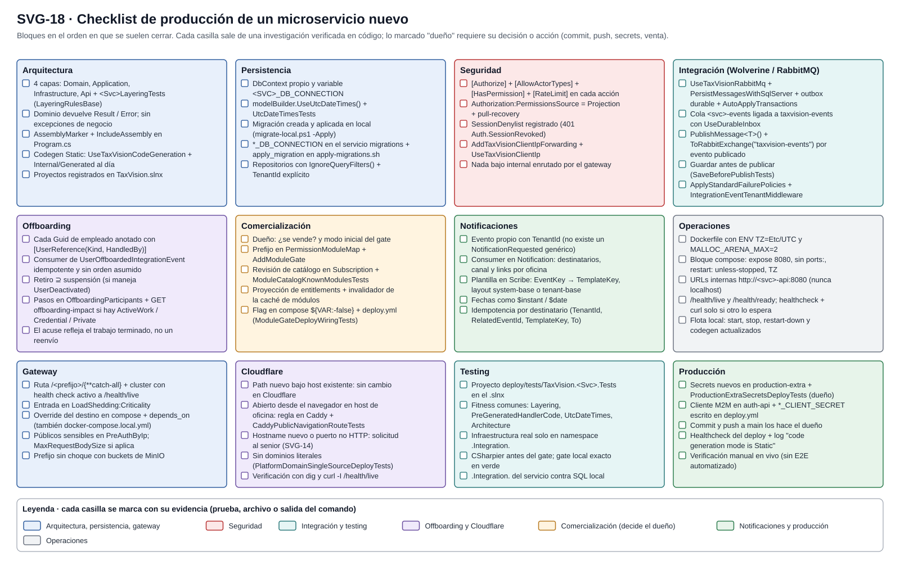

Se usa la **numeración original de 36** (Apéndice A de la auditoría de Signature). Los extra van como **complementarios con prefijo** para no repetir el desfase de la guía antigua (que tenía 38 renumerados). Ninguno de los 36 está contradicho por el código; varios ganaron prueba automática.

| # | Guardrail | Prueba existente |
|---|---|---|
| 1 | Handler > ~30 líneas se divide en métodos privados por fase | `HandlerSizeFitnessTests` (PaymentApp, Auth.Onboarding) |
| 2 | Sin `ChangeStatus(x)` genérico: una transición = un método + su evento | T-DOM |
| 3 | Value Objects, no primitivos sueltos | T-DOM |
| 4 | Cero LINQ en agregados | `CalendarArchitectureTests` |
| 5 | Sin `virtual` ni setters públicos; ctor privado + `Create()` | T-DOM |
| 6 | Un archivo, una clase (contratos de integración agrupados: matiz) | revisión |
| 7 | Repos devuelven `T?` para "no existe"; `Result<T>` cuando hay regla | revisión |
| 8 | `IgnoreQueryFilters()` explícito con tenant validado por parámetro (4 condiciones) | prueba de repositorio |
| 9 | Propiedades calculadas con `builder.Ignore()` | revisar migración |
| 10 | `ValueGeneratedNever()` en PK `Guid` de hijas | `EntityState.Added` (fuera de `Persistence/`) |
| 11 | DbContext vacío igual necesita `InitialCreate` | arranque contra base nueva |
| 12 | Filtro de tenant fail-closed (`Guid.Empty`) | `TenantIsolationTests` |
| 13 | `PublishMessage<T>().ToRabbitExchange(...)` por evento | `IntegrationEventRoutingTests` (Calendar), `EventRoutingContractTests` |
| 14 | Consumer sin cola enlazada nunca corre | revisión |
| 15 | `correlation.Push(...)` primera línea del consumer | `CorrelationIdFitnessTests` (publicador) |
| 16 | `JwtTenantContextMiddleware` antes de `UseAuthorization()` | `JwtTenantContextMiddlewareTests` |
| 17 | `[AllowActorTypes]`, nunca `[Authorize(Roles=)]` | `*ArchitectureTests` |
| 18 | God-role explícito (`IsDangerous`) | catálogo |
| 19 | M2M no usa la staleness de humanos | `PermissionsSourceTests` |
| 20 | Todo lector pasa por `IUserPermissionsSource` | `UserPermissionsSourceRegistrationTests` |
| 21 | Session denylist en todos los servicios | `SessionDenylistMiddlewareTests` |
| 22 | Endpoints M2M+admin con `PlatformOnly`; `internal/*` fuera del gateway | `InternalRouteConventionFitnessTests` |
| 23 | Webhooks: comparación en tiempo constante y rechazo sin secreto | pruebas de firma |
| 24 | Permiso M2M nuevo en user-secrets, compose, catálogo **y** `deploy.yml` | `ServiceClientSecretsDeployWiringTests` |
| 25 | Claves de config M2M calzan exacto con el `SectionName` | revisión |
| 26 | Token M2M cacheado en el consumidor: reiniciar Auth no alcanza | `ExpiringValueCacheTests` |
| 27 | Git Bash mangla paths → `MSYS_NO_PATHCONV=1` (solo quien opera Docker) | — |
| 28 | Runner CI compartiendo host = riesgo OOM (build en tandas; gate local) | — |
| 29 | PFX en Windows con `X509KeyStorageFlags.Exportable` | Signature |
| 30 | `MeterListener` + xUnit en paralelo → `[Collection]` | `AuthorizationMetricsCollection` |
| 31 | Extension method bare requiere `this.` | compilador |
| 32 | PdfSharp 6.x con `IFontResolver` al boot | Signature |
| 33 | RFC 3161 espera SHA-256 | Signature |
| 34 | No documentar un gap como "conocido" sin revisar si es arreglable | proceso |
| 35 | No acoplar a un vendor por un ejemplo | proceso |
| 36 | **Comentarios cortos, en español, con el porqué; sin fechas, fases ni narrativa** | revisión (muy incumplido en código heredado; no se corrige en masa) |

**Complementarios:** GC-01 (`-m:1`, histórico), **GC-02** (todo módulo con datos de empleado entra al retiro), GC-Q1…Q13 (Quartz), **GC-TZ1…TZ10** (zonas horarias), **GC-W1** (guardar antes de publicar, `SaveBeforePublishTests`), **GC-W2** (publicar siempre a `taxvision-events`), **GC-T1** (infra real → `.Integration.`), **GC-M1** (permiso: catálogo + `InsertData`, nunca grant por migración).

**Checklist de PR (copiar):**
```
[ ] G1  Handle ≤ ~30 líneas; métodos privados por fase.
[ ] G2  Ningún ChangeStatus genérico; una transición = un método + su evento.
[ ] G3  Conceptos con reglas como VO (Create() → Result<T>).
[ ] G4  Sin System.Linq en Domain.
[ ] G5  Agregado sealed, ctor privado, private set, colecciones por backing field.
[ ] G8  IgnoreQueryFilters() solo con tenantId explícito o una de las 4 condiciones.
[ ] G9  Propiedades calculadas con builder.Ignore().
[ ] G10 Hijas con Guid generado en dominio → ValueGeneratedNever().
[ ] G11 Migración InitialCreate aunque el DbContext esté vacío.
[ ] G12 Filtro de tenant fail-closed (Guid.Empty sin tenant).
[ ] G13 Un PublishMessage<T>().ToRabbitExchange("taxvision-events") por evento publicado.
[ ] G14 Cola <svc>-events enlazada al exchange con UseDurableInbox().
[ ] G15 using (correlation.Push(...)) primera línea de cada consumer.
[ ] G16 UseAuthentication → JwtTenantContextMiddleware → SessionDenylistMiddleware → UseAuthorization.
[ ] G17 [AllowActorTypes] + [HasPermission]; nunca [Authorize(Roles=...)].
[ ] G36 Comentarios cortos, en español, con el porqué; sin fases ni fechas.
[ ] GC-W1 Guardar antes de publicar.
[ ] GC-02 Referencias a empleados anotadas y retiro evaluado.
[ ] GC-T1 Pruebas con infraestructura real en .Integration.
[ ] GC-M1 Permisos por catálogo + InsertData, sin grants por migración.
```

---

<a id="cap-35"></a>
## 35. Procedimiento de creación de principio a fin

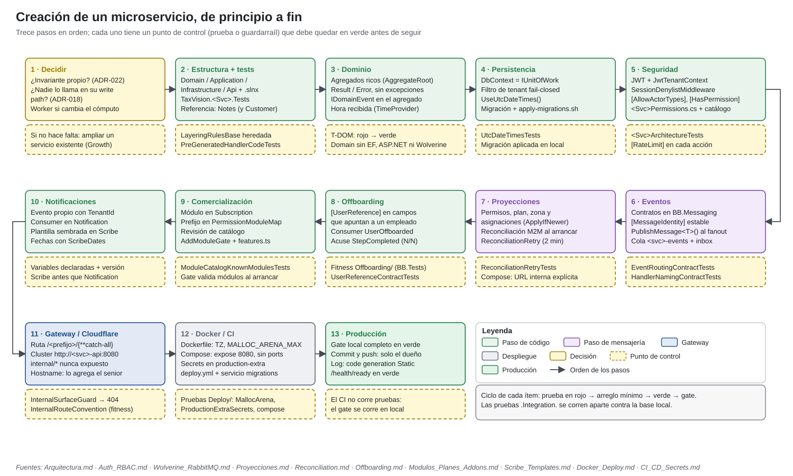

Checklist imprimible: [Checklists/Nuevo_Microservicio.md](Checklists/Nuevo_Microservicio.md). Para agentes IA: cada fase es, como mucho, un ítem por sesión; antes de editar se dicen los archivos y se espera el OK del dueño.

### Fase 0 — Decisión y aprobación
1. Aplicar el [cap. 4](#cap-04) y escribir la justificación (BC nuevo, módulo, worker, consumer o add-on).
2. Marcar los rasgos y resolver la [matriz dinámica](#cap-05); listar las capacidades **RA** y pedirlas al dueño.
3. Elegir nombre (`<Svc>`), prefijo de ruta, cola (`<svc>-events`), puerto local libre, nombre del cliente M2M (`<svc>-worker`), prefijo de permisos y, si vende, código de módulo.

### Fase 1 — Esqueleto
4. 4 proyectos + referencias + alta en `.slnx` ([cap. 7](#cap-07)).
5. `AssemblyMarker`, `Add<Svc>Infrastructure`, `Program.cs` copiado de Notes y adaptado ([cap. 8](#cap-08)); `public partial class Program;`.
6. Proyecto de pruebas + `<Svc>LayeringTests` (rojo → verde) ([cap. 33](#cap-33)).

### Fase 2 — Dominio y casos de uso
7. Agregados, VOs y `<Agg>Errors` (mensajes en inglés); T-DOM primero.
8. Handlers (load → validate → persist → publish) con T-APP primero.
9. Controladores finos con `[AllowActorTypes]`, `[HasPermission]`, `[RateLimit]`; códigos en `ErrorHttpMapping`.

### Fase 3 — Persistencia
10. DbContext fail-closed + `UseUtcDateTimes()` + factory + configuraciones ([cap. 10](#cap-10)).
11. `InitialCreate` creada y **aplicada en local** (`migrate-local.ps1 -Apply -Service <Svc>`); `UtcDateTimesTests`.

### Fase 4 — Seguridad
12. Permisos (constantes, catálogo, bundles, `InsertData`) ([cap. 11](#cap-11)).
13. Proyección de permisos + consumers + pull-recovery ([cap. 14](#cap-14)).
14. Session denylist ([cap. 12](#cap-12)).
15. Cliente M2M en Auth + acquirer con caché; endpoints `internal/*` si los expone ([cap. 13](#cap-13)).
16. `TenantIsolationTests` fuera de `Persistence/`; 403 sin permiso.

### Fase 5 — Datos de otros BC y del personal
17. Proyecciones necesarias con versión e `IncludeType` ([cap. 14](#cap-14)).
18. Reconciliation con `ReconciliationRetry`, URL interna en compose y entrada en `ReconciliationRetryTests` ([cap. 15](#cap-15)).
19. **Offboarding:** inventario de referencias, `[UserReference]`, decisión de participación, consumer, registro, pre-flight, pruebas y los 3 fitness ([cap. 16](#cap-16)). **El servicio no está integrado sin este paso.**
20. Zona horaria si calcula fechas de oficina ([cap. 25](#cap-25)).

### Fase 6 — Mensajería y codegen
21. Contratos con `[MessageIdentity]` `.v1`, `PublishMessage<T>()`, cola enlazada, middlewares; BB-1/BB-2 recomendados ([cap. 19](#cap-19)).
22. Prueba de rutas en runtime; T-INT de atomicidad si guarda y publica.
23. Codegen Static: línea en `UseWolverine`, servicio en `$all`, `PreGeneratedHandlerCodeTests`, regenerar ([cap. 20](#cap-20)).

### Fase 7 — Comercialización (si V)
24. Prefijo en `PermissionModuleMap`, módulo en Subscription (seeder + migración + revisión), cuota como entitlement, gate, contador de fitness, front ([cap. 17](#cap-17)).
25. Políticas de rate limit y, si aplica, `EnforceTierQuotas` ([cap. 18](#cap-18)).

### Fase 8 — Comunicación (si N)
26. Evento propio; consumer en Notification; plantilla Scribe; kind en catálogo; links por oficina ([caps. 22–24](#cap-22)).

### Fase 9 — Exposición
27. Ruta + cluster YARP + criticidad + override en compose (prod y local) ([cap. 26](#cap-26)).
28. Regla de Caddy si hay navegación pública; solicitud al senior (11 pasos) si hay hostname o puerto nuevo ([cap. 27](#cap-27)).

### Fase 10 — Contenedores y despliegue
29. Dockerfile y bloque de compose ([cap. 28](#cap-28)).
30. Migraciones en los 4 lugares; secrets en `production-extra` + `deploy.yml` + prueba; cliente M2M en `auth-api` ([caps. 10](#cap-10), [30](#cap-30)).
31. Alta en los scripts de flota (4 listas) y `launchSettings.json` ([cap. 29](#cap-29)).

### Fase 11 — Operación
32. Observabilidad (Serilog, OTel, health, correlación) ([cap. 32](#cap-32)).
33. Colección Postman ([cap. 31](#cap-31)).

### Fase 12 — Verificación y entrega
34. CSharpier sobre lo tocado → gate exacto verde → `.Integration.` del servicio contra la base local → Vitest si se tocó Node.
35. T-VIVO en la flota local (build Release, migración aplicada, login real por el gateway, flujo principal, Handover status si E).
36. Recorrer los [criterios de aceptación](#cap-37) y el checklist [Produccion.md](Checklists/Produccion.md).
37. Entregar al dueño la lista de archivos tocados, resultado del gate y de `.Integration.`, secrets que debe cargar y pasos manuales pendientes (Cloudflare). **El dueño hace commit y push**; el push a `main` despliega.
38. Post-deploy: logs del servicio, "code generation mode is Static", TimeZoneSelfCheck, una petición real, DLQ vacía.

---

<a id="cap-36"></a>
## 36. Troubleshooting (errores históricos reales)

| Síntoma | Causa real | Arreglo / prevención | Capítulo |
|---|---|---|---|
| 503 "Fleet is overloaded" en toda la flota | Migración generada y no aplicada → `Invalid column name` lento → p99 alto → load shedding | Aplicar la migración (`migrate-local.ps1 -Apply`); en prod, bloque en `apply-migrations.sh` | [10](#cap-10) |
| Deploy verde pero el servicio falla con columnas/tablas inexistentes | Servicio sin bloque en `apply-migrations.sh` o imagen `migrations` vieja | 4 lugares de migración; build con `--profile tools` | [10](#cap-10) |
| Migraciones de **todos** los servicios no se aplican ("unbound variable") | `*_DB_CONNECTION` faltante en el servicio `migrations` (`set -eu`) | Variable con `:?` en `migrations` | [10](#cap-10), [30](#cap-30) |
| "Cannot open database" al primer arranque | DbContext sin `InitialCreate` (Connectors) | Migración inicial aunque esté vacío | [10](#cap-10) |
| `DbUpdateConcurrencyException` al agregar una hija | PK `Guid` sin `ValueGeneratedNever()` (`CustomerAssignment`) | `ValueGeneratedNever()` + prueba `EntityState.Added` | [10](#cap-10) |
| Columnas NULL o "is part of a key" | Owned type compartido entre filas | Copia en la factory del agregado; probar con ≥ 2 filas | [10](#cap-10) |
| El servicio no arranca tras renombrar un enum | `HasConversion<string>()` sin `ValueConverter` con alias legacy | Converter con alias | [10](#cap-10) |
| Consultas que devuelven 0 filas / 404 falsos en handlers o consumers | Scope de Wolverine sin `TenantContext` + filtro global | `IgnoreQueryFilters()` + `TenantId` explícito | [10](#cap-10) |
| RAM de un servicio en GB, primera llamada lenta | Wolverine en Dynamic compilando con Roslyn en producción | `UseTaxVisionCodeGeneration` + código pregenerado + `MALLOC_ARENA_MAX=2` | [20](#cap-20) |
| Excepción en el primer mensaje de un tipo en producción, o handler ignorado | Handler nuevo sin regenerar `Internal/Generated` (Static) | `regenerate-wolverine-code.ps1 -Service <Svc>` | [20](#cap-20) |
| Servicio sigue en Dynamic aunque "se configuró" Static | Variable con un solo guion bajo | `Wolverine__CodeGeneration__TypeLoadMode` | [20](#cap-20) |
| `codegen write` arranca el servicio y procesa mensajes | Los servicios terminan en `app.Run()` | Usar solo el script de regeneración | [20](#cap-20) |
| Evento que nunca llega; "No routes can be determined" en el emisor | Falta `PublishMessage<T>()` (demo pública, Calendar, H-12) | Ruta en el mismo cambio + prueba en runtime | [19](#cap-19) |
| "No known handler" para un handler que sí existe | Nombre plural (`…Consumers`) o fuera de `Discovery` | Clases en singular; `IncludeType` | [19](#cap-19) |
| Mensajes duplicados o "fantasma" tras un fallo | Publicar antes de guardar con `InvokeAsync` (T-8) | Guardar antes de publicar; `TransactionalJobUnit` en jobs | [19](#cap-19) |
| Mensajes perdidos sin error con canal cerrado | Outbox sin confirmaciones del publicador | `UseTaxVisionRabbitMq` | [19](#cap-19) |
| 403 para todos los humanos en un servicio nuevo | Proyección de permisos vacía, sin pull-recovery o sin secreto M2M | Consumers + pull-recovery + cliente M2M | [11](#cap-11), [13](#cap-13) |
| 403 `Authz.ActorTypeNotDeclared` | Acción sin `[AllowActorTypes]` | Declarar actor; fitness de controllers | [11](#cap-11) |
| 403/vacío tras cambiar el orden del pipeline | `JwtTenantContextMiddleware` después de `UseAuthorization` (hotfix en 11 servicios) | Orden exacto del pipeline | [11](#cap-11) |
| Permiso nuevo que nadie tiene / proyecciones sin el permiso | Grant por migración; falta en catálogo o bundle | Catálogo + `InsertData`; sync de Auth concede | [11](#cap-11) |
| Permisos denegados que "vuelven" | Recomponer la unión en `RolePermissionsChanged` | Solo `UserRolesChanged` con códigos efectivos | [14](#cap-14) |
| Menú del módulo invisible para todos | `ExcludeFromAdminBundle: true` (FinancialInsights) | Dejar que el admin lo reciba por filtro | [17](#cap-17) |
| Función que se cobra pero está abierta | Prefijo no mapeado en `PermissionModuleMap` o proyección sin fila (fail-open) | Prefijo + pull de entitlements | [17](#cap-17) |
| 401 en bucle tras cambiar permisos | Front sin refrescar ante `Auth.TokenStale` | Refrescar token | [11](#cap-11) |
| 401 `Auth.SessionRevoked` en todos los servicios para un usuario | Reuso de refresh token detectado (comportamiento correcto) | Volver a iniciar sesión | [12](#cap-12) |
| 401 `Auth.InvalidClient` "tres capas después" | Clave de user-secrets M2M mal escrita | Clave exacta del `SectionName` | [13](#cap-13) |
| M2M de un servicio apagado en producción sin error | `*_CLIENT_SECRET` no escrito en `deploy.yml` (Calendar E-12) | `ServiceClientSecretsDeployWiringTests` | [13](#cap-13), [30](#cap-30) |
| 503 "not configured" con el secret cargado | Secret en el job equivocado (Google Drive) | `production-extra` + job `deploy` + prueba | [30](#cap-30) |
| Proyecciones vacías durante horas tras un deploy | Reconciliación corrió antes que Auth y esperó 12 h | `ReconciliationRetry` | [15](#cap-15) |
| Reconciliación que nunca repara (solo warnings) | URL por defecto a `localhost` dentro del contenedor | URL interna explícita en compose | [15](#cap-15) |
| Empleados sin clientes visibles | Proyección de asignaciones vacía (kit sin reconciliación o URL) | Kit `CustomerVisibility` completo | [14](#cap-14), [15](#cap-15) |
| Trabajo a nombre de un empleado retirado / gate rojo al entrar un servicio | Referencias sin `[UserReference]` o servicio fuera de `OffboardingParticipants` | Procedimiento de 15 pasos | [16](#cap-16) |
| "Handover status" en N-1/N tras 30 min | Consumer caído, en DLQ, o acuse ausente (Node V5) | Revisar DLQ y logs `Offboarding step … rejected` | [16](#cap-16) |
| Run "Completed" pero buzones sin purgar | Acuse al reenviar, no al purgar (Connectors V4) | Registrar como paso el handler que trabaja | [16](#cap-16) |
| 404 de Angular en un link público de correo | Ruta pública sin regla en Caddy antes de `@spa_nav` | Regla + `CaddyPublicNavigationRouteTests` | [27](#cap-27) |
| IP de Docker en auditoría, sesiones y rate limit | Sin transform de `CF-Connecting-IP` o sin client IP forwarding | `UseTaxVisionClientIp` + transform del gateway | [26](#cap-26), [27](#cap-27) |
| socket.io en long-polling roto detrás de Cloudflare | Falta `UseWebSockets()` antes de `MapReverseProxy()` | Orden del gateway | [26](#cap-26) |
| 502 desde el gateway en producción | Cluster sin override en compose (apunta a `localhost`) | Override + `depends_on` | [26](#cap-26) |
| 502 en local | Puerto del servicio caído (timeout SQL `-2` en arranque en frío) | `restart-down.ps1` | [29](#cap-29) |
| Healthcheck de compose falla siempre | `curl` no instalado en la imagen (2026-10-03) | `curl` solo si hay healthcheck | [28](#cap-28) |
| Gate rojo solo en Linux | `Path.GetInvalidFileNameChars()`, fábricas con user-secrets fuera de `.Integration.` | Host de rutas; pensar en Linux | [33](#cap-33) |
| Prueba de zona verde en local que miente | Git Bash no pasa `TZ` | PowerShell | [25](#cap-25) |
| Plantilla editada que no cambia | (Histórico) se creía que hacía falta subir `ContentVersion`; hoy republica por hash: revisar el despliegue de Scribe | Scribe antes que Notification | [23](#cap-23) |
| Render falla con `NoMapping` / `NoPublishedVersion` | EventKey del consumer ≠ seed/mapping; override de oficina sin publicar | Alinear EventKey; publicar el override | [23](#cap-23) |
| Correo que esquiva preferencias/inactividad | Consumer sin `RecipientUserId` + `Category` | Pasarlos siempre para staff | [24](#cap-24) |
| Fan-out de correos colapsado en uno | `IdempotencyKey` propio sin destinatario | No pasar clave propia; `RelatedEventId = evt.EventId` | [24](#cap-24) |
| "No me llegó el SMS" sin rastro en Notification | Notification marca "Sent" al publicar; supresión/E.164 solo en Sms | Mirar el servicio Sms | [24](#cap-24) |
| Link de correo a `localhost:4200` | Falta `PORTAL_BASE_URL` y Auth no resolvió el host | Variable en compose; resolver host | [22](#cap-22) |

---

<a id="cap-37"></a>
## 37. Criterios de aceptación para producción

Checklist imprimible: [Checklists/Produccion.md](Checklists/Produccion.md). Un servicio **no se promueve** si falla cualquiera de los criterios marcados como bloqueantes (B).

### Arquitectura y código
- [ ] (B) 4 capas con referencias correctas; en `.slnx`; `LayeringRulesBase` verde.
- [ ] (B) `Result`/`Error` en dominio y handlers; códigos nuevos en `ErrorHttpMapping`; mensajes en inglés.
- [ ] (B) Guardar antes de publicar en todo handler y job.
- [ ] Comentarios cortos en español, sin fases ni narrativa (guardrail #36).

### Persistencia
- [ ] (B) DbContext fail-closed + `UseUtcDateTimes()` + `UtcDateTimesTests`.
- [ ] (B) Migraciones creadas **y aplicadas en local**; informe de `migrate-local.ps1` vacío.
- [ ] (B) Migraciones dadas de alta en los 4 lugares de producción.

### Seguridad
- [ ] (B) Toda acción con `[AllowActorTypes]`, `[HasPermission]` (o justificación) y `[RateLimit]`/`[RateLimitExempt]`; fitness verde.
- [ ] (B) Permisos en catálogo + `InsertData` + bundles; sin grants por migración.
- [ ] (B) Modo `Projection` + consumers + pull-recovery con cliente M2M funcionando.
- [ ] (B) Session denylist en el orden correcto.
- [ ] (B) Ningún endpoint `internal/*` en el gateway; `ServiceOnly` (+ PlatformTenant si cross-tenant).
- [ ] (B) Aislamiento de tenant probado (y corriendo en el gate).
- [ ] Prueba de 403 con actor sin permiso en endpoints sensibles.

### Datos compartidos y personal
- [ ] (B) Cada proyección con versión del dueño, idempotente y con reparación.
- [ ] (B) Reconciliaciones con `ReconciliationRetry` y URL interna explícita en compose.
- [ ] (B) **Offboarding evaluado y probado**: referencias anotadas, participación decidida, consumer/registro/pre-flight si corresponde, 3 fitness verdes, verificación manual N/N en "Handover status".

### Mensajería y codegen
- [ ] (B) `PublishMessage<T>()` por evento; prueba de rutas en runtime; ninguna línea "No routes can be determined" en el log.
- [ ] (B) Contratos con `[MessageIdentity]`; ninguna identidad existente cambiada.
- [ ] (B) Codegen Static: `UseTaxVisionCodeGeneration`, servicio en `$all`, `PreGeneratedHandlerCodeTests` verde, `Internal/Generated` al día.

### Comercialización (si V)
- [ ] (B) Prefijo en `PermissionModuleMap`; seeder ↔ mapa; contador del gate actualizado.
- [ ] (B) Módulo en Subscription (seeder + migración + revisión al final de `All`); modo inicial del gate aprobado por el dueño.
- [ ] (B) Front (CRM, portal, landing) con el mismo nombre visible.

### Notificaciones y enlaces (si N)
- [ ] (B) El servicio solo publica su evento; consumer en Notification con `EnsureRendered`, `RelatedEventId`, `RecipientUserId + Category` para staff.
- [ ] (B) Plantilla en Scribe con variables declaradas y fechas tipadas; kind en catálogo.
- [ ] Links por oficina (A/B probados); `Confidential` si hay token; sin PII en la URL.

### Exposición y despliegue
- [ ] (B) Ruta + cluster + criticidad + override en compose (prod y local).
- [ ] (B) Dockerfile con `TZ` y `MALLOC_ARENA_MAX`; bloque compose sin `ports:`; URLs internas por DNS.
- [ ] (B) Secrets en `production-extra`, escritos en el job `deploy` y en `ProductionExtraSecretsDeployTests`; cargados por el dueño.
- [ ] (B) Pasos manuales de Cloudflare ejecutados y verificados (si aplica).
- [ ] Alta en los scripts de flota y `launchSettings.json`.

### Calidad y verificación
- [ ] (B) CSharpier sobre lo tocado; **gate exacto verde**; `.Integration.` del servicio verde contra la base local (si aplica); Vitest (si aplica).
- [ ] (B) Pruebas de wiring de despliegue (`BuildingBlocks.Tests/Deploy`) verdes.
- [ ] (B) T-VIVO: login real por el gateway y flujo principal funcionando en la flota local en Static.
- [ ] Colección Postman con 401/403/404-otro-tenant.
- [ ] Post-deploy: logs sin `Error` al arrancar, "code generation mode is Static", TimeZoneSelfCheck, petición real por el gateway, DLQ sin mensajes nuevos.

### Decisiones abiertas que afectan al servicio
- [ ] Revisadas las [decisiones pendientes](Referencias/Decisiones_Arquitectonicas.md#decisiones-pendientes) que tocan las capacidades del servicio, con la respuesta del dueño registrada.

---

<a id="anexo-a"></a>
## Anexo A. Mapa de documentos relacionados

**Referencias**
- [Referencias/Guardrails.md](Referencias/Guardrails.md) — los 36 guardrails explicados y verificados.
- [Referencias/Decisiones_Arquitectonicas.md](Referencias/Decisiones_Arquitectonicas.md) — contradicciones resueltas y decisiones pendientes.
- [Referencias/Fuentes_Verificadas.md](Referencias/Fuentes_Verificadas.md) — fuentes consultadas y su estado.
- [03_INVENTARIO_ARQUITECTURA.md](03_INVENTARIO_ARQUITECTURA.md) · [02_COMPARATIVA_GUIAS.md](02_COMPARATIVA_GUIAS.md) · [01_ESTADO_INVESTIGACION.md](01_ESTADO_INVESTIGACION.md)

**Checklists**
- [Nuevo_Microservicio](Checklists/Nuevo_Microservicio.md) · [Seguridad](Checklists/Seguridad.md) · [Proyecciones_Reconciliation](Checklists/Proyecciones_Reconciliation.md) · [Offboarding](Checklists/Offboarding.md) · [Testing](Checklists/Testing.md) · [Modulos_Planes](Checklists/Modulos_Planes.md) · [Notificaciones](Checklists/Notificaciones.md) · [Tenant_Links](Checklists/Tenant_Links.md) · [YARP_Cloudflare](Checklists/YARP_Cloudflare.md) · [Produccion](Checklists/Produccion.md)

**Investigaciones**
- Fundamentos: [Arquitectura](Investigaciones/Arquitectura.md) · [BuildingBlocks](Investigaciones/BuildingBlocks.md) · [Migraciones](Investigaciones/Migraciones.md)
- Seguridad: [Auth_RBAC](Investigaciones/Auth_RBAC.md) · [Session_Denylist](Investigaciones/Session_Denylist.md) · [M2M_ServiceAuth](Investigaciones/M2M_ServiceAuth.md)
- Datos compartidos: [Proyecciones](Investigaciones/Proyecciones.md) · [Reconciliation](Investigaciones/Reconciliation.md) · [RateLimit_Cuotas_Gates](Investigaciones/RateLimit_Cuotas_Gates.md)
- Personal: [Offboarding](Investigaciones/Offboarding.md) · [Offboarding_Integraciones](Investigaciones/Offboarding_Integraciones.md)
- Comercialización y mensajería: [Modulos_Planes_Addons](Investigaciones/Modulos_Planes_Addons.md) · [Wolverine_RabbitMQ](Investigaciones/Wolverine_RabbitMQ.md) · [Roslyn_Produccion](Investigaciones/Roslyn_Produccion.md)
- Oficina y comunicación: [Tenant_Subdomains](Investigaciones/Tenant_Subdomains.md) · [Tenant_Links](Investigaciones/Tenant_Links.md) · [Scribe_Templates](Investigaciones/Scribe_Templates.md) · [Notification_Email](Investigaciones/Notification_Email.md) · [Notification_SMS](Investigaciones/Notification_SMS.md) · [Notification_InApp_Push](Investigaciones/Notification_InApp_Push.md)
- Operación: [Docker_Deploy](Investigaciones/Docker_Deploy.md) · [Scripts_Locales](Investigaciones/Scripts_Locales.md) · [Gateway_YARP](Investigaciones/Gateway_YARP.md) · [Cloudflare](Investigaciones/Cloudflare.md) · [CI_CD_Secrets](Investigaciones/CI_CD_Secrets.md) · [Postman](Investigaciones/Postman.md) · [Observabilidad](Investigaciones/Observabilidad.md)
- Testing: [Testing_Unit](Investigaciones/Testing_Unit.md) · [Testing_Integration](Investigaciones/Testing_Integration.md) · [Testing_Security](Investigaciones/Testing_Security.md) · [Testing_EDA](Investigaciones/Testing_EDA.md)

**Diagramas** (carpeta `Diagramas/`): SVG-01_Ecosistema, SVG-02_Clean_Architecture, SVG-03_Creacion, SVG-04_Reconciliation, SVG-05_Seguridad, SVG-06_Comercializacion, SVG-07_Mensajeria, SVG-08_M2M, SVG-09_Subdominios, SVG-10_Links_Tenant, SVG-11_Notification, SVG-12_Scribe, SVG-13_YARP_Cloudflare, SVG-14_Cloudflare_Manual, SVG-15_Deployment, SVG-16_Flota_Local, SVG-17_Matriz_Dinamica, SVG-18_Checklist, SVG-19_Offboarding, SVG-20_Offboarding_Servicios, SVG-21_Offboarding_Seguridad, SVG-22_Testing_Architecture, SVG-23_Testing_CI_CD.

[Volver al índice](#indice)
